# Code graph

Generated by `node tools/codegraph.mjs` — re-run after big changes. 59 files, 2081 top-level names.
All src/*.js files are concatenated in this order into ONE scope (tools/build.mjs), so any top-level name is visible everywhere after it loads.
Find a name: search this file for `### name` or `\bname\b`. Each entry: where it's defined → which files use it (hit counts).

## Files (build order)

| File | KB | Lines | Names | Uses most from | Purpose |
|---|---|---|---|---|---|
| 00_engine.js | 42.7 | 607 | 97 | 20_core, 30_systems, 90_render | Math helpers |
| 10_world.js | 40.6 | 534 | 134 | 00_engine, 47b_body, 20_core | City generation |
| 15_meshes.js | 6.4 | 77 | 17 | 00_engine, 50_npcs | Entity meshes (vehicles, drones, bosses) |
| 20_core.js | 37.5 | 296 | 76 | 40_powers, 30_systems, 00_engine | Config: every balance number lives here |
| 30_systems.js | 26.1 | 343 | 65 | 00_engine, 20_core, 10_world | Player, damage, energy, progression, reputation |
| 40_powers.js | 26.1 | 346 | 66 | 20_core, 30_systems, 00_engine | Powers |
| 42_combat.js | 17.7 | 217 | 35 | 30_systems, 00_engine, 40_powers | Melee combat: lock-on, 4-hit chains, finishers, dash, wall slams |
| 43_ragdoll.js | 5.1 | 68 | 11 | 00_engine, 90_render, 10_world | Ragdolls: verlet bodies for anyone launched by a finisher or charged punch |
| 44_movement.js | 15.8 | 198 | 28 | 20_core, 00_engine, 30_systems | Traversal: physics-based web swinging, web zip, wall running, parkour leaps |
| 45_aliens.js | 15.2 | 153 | 20 | 30_systems, 40_powers, 00_engine | Morph Band: transform into alien forms (original designs) |
| 45b_voidborn.js | 10.1 | 125 | 19 | 00_engine, 30_systems, 40_powers | Voidborn: two giant masks decide whether you get to move |
| 46_buildings.js | 7.5 | 91 | 12 | 30_systems, 00_engine, 49_ring | Destructible buildings |
| 47_abilities.js | 13.2 | 125 | 16 | 00_engine, 40_powers, 30_systems | Hero-inspired abilities (original names and designs) |
| 47b_body.js | 10.4 | 107 | 19 | 00_engine, 30_systems, 20_core | Body mods: Metal Forms weapons, Stretch Strike, Giant Form, and thrown telekinesis slabs |
| 47c_pool.js | 8.8 | 68 | 4 | 40_powers, 30_systems, 20_core | More powers for the shared ability pool (anyone can put these on keys 4 and 5, or pick them for a custom build |
| 48_spider.js | 9.1 | 108 | 14 | 00_engine, 30_systems, 40_powers | Web Runner kit: web wings, updrafts, swing boost, slingshot, dives, air tricks, |
| 49_ring.js | 40.8 | 407 | 91 | 00_engine, 30_systems, 20_core | Ring Bearer: ring charge, hard-light constructs, ring moves, the black hole and the oath |
| 49b_speed.js | 9.1 | 102 | 25 | 30_systems, 00_engine, 40_powers | Speedster: speed dial, fast mode, phasing, lightning, slow time and time stop |
| 49c_suit.js | 7.9 | 79 | 11 | 00_engine, 20_core, 30_systems | Suit up: U swaps between your civilian clothes and your suit |
| 49d_wanted.js | 3.6 | 49 | 11 | 20_core, 30_systems, 70_ui | Wanted level (1-5 stars) and bounty |
| 49e_meters.js | 7.9 | 99 | 25 | 20_core, 40_powers, 30_systems | Hero meters: the Armored Inventor's suit battery, the Tempest's lightning and the Speedster's calories |
| 49f_constructs.js | 11.7 | 119 | 13 | 49_ring, 00_engine, 30_systems | More Ring Bearer constructs: a bike and a race car you drive on the ground, |
| 49g_armorforms.js | 5.7 | 63 | 10 | 00_engine, 40_powers, 49_ring | Armored Inventor suit forms: the armor folds itself into a jet, a bike, a sports car or a tank |
| 49h_space.js | 5.3 | 65 | 15 | 00_engine, 10_world, 30_systems | Space: fly high enough and you leave the atmosphere; the Moon, the planets and the Sun are out there |
| 49i_moreconstructs.js | 20.9 | 165 | 7 | 00_engine, 49_ring, 30_systems | Even more Ring Bearer constructs: bikes and boards, heavy rides and aircraft, blades and guns |
| 49j_voice.js | 7.5 | 82 | 28 | 49_ring, 20_core, 70_ui | Saying the oath out loud: the browser's speech recognition listens while the beacon is up |
| 49k_sungod.js | 17.5 | 174 | 37 | 30_systems, 00_engine, 40_powers | Sun God: the Sun Titan's god mode. V (60 s, then a 90 s wait) or fly into the Sun (120 s, no wait). |
| 50_npcs.js | 54.3 | 669 | 101 | 30_systems, 00_engine, 20_core | NPCs: people, drones, vehicles, rival supers, shops |
| 50b_hunters.js | 9.0 | 98 | 15 | 00_engine, 30_systems, 10_world | Hunter squads: armadas of AI robot supers |
| 52_heli.js | 6.7 | 77 | 8 | 00_engine, 30_systems, 10_world | Police helicopters |
| 53_water.js | 5.3 | 68 | 16 | 00_engine, 10_world, 30_systems | Water: swimming, diving and splashes |
| 54_ambient.js | 12.5 | 143 | 30 | 00_engine, 30_systems, 10_world | City life: planes, a blimp, birds, pigeons, boats, fountains and ponds |
| 60_multiplayer.js | 22.5 | 270 | 13 | 00_engine, 30_systems, 20_core | Multiplayer: other players via the claude.ai room capability |
| 62_worldsync.js | 21.1 | 219 | 12 | 50_npcs, 30_systems, 00_engine | Shared city for room-code games |
| 63_host.js | 3.3 | 44 | 10 | 30_systems, 50_npcs, 70_ui | Room host controls (room-code multiplayer) |
| 64_portal.js | 9.8 | 118 | 6 | 20_core, 30_systems, 60_multiplayer | Game portals (CrazyGames): ads, gameplay events, invite links, happy time, cloud save and a quick start |
| 65_rewards.js | 13.2 | 126 | 32 | 20_core, 70_ui, 00_engine | CrazyGames rewards: power keys by level, 10-minute trials, refills and cosmetics |
| 65b_goals.js | 2.2 | 32 | 6 | 20_core, 65_rewards, 30_systems | Starter goals: one goal at a time in a small pill (#goal), each pays XP. save.goal is the index of the current |
| 65c_daily.js | 4.1 | 51 | 17 | 70_ui, 49b_speed, 99_main | Daily reward: one claim per local date, a streak of up to 7 days. save.daily={last:'YYYY-MM-DD',streak:0..7} |
| 66_icons.js | 10.8 | 103 | 6 | 10_world, 00_engine, 40_powers | Icons: small line drawings for the HUD icon bar and the power cards |
| 66b_story.js | 10.7 | 132 | 25 | 30_systems, 80_player, 00_engine | Story core: active play time, cutscenes, the objective pill, the yes/no popup |
| 66c_zones.js | 13.3 | 167 | 28 | 10_world, 90_render, 30_systems | Zones: separate playable areas far from the city (the UFO interior now; the Kathana arena, the cyber world and |
| 66d_ufo.js | 37.2 | 401 | 49 | 00_engine, 30_systems, 66c_zones | The UFO event: a saucer over Nova Bay, a way in, an interior full of aliens, and one item per hero |
| 66e_boost.js | 12.1 | 148 | 28 | 00_engine, 20_core, 30_systems | UFO boosts: what taking the UFO item gives every hero (save.story.ufo>=2, see ufoBoost / boostMul in 20_core.j |
| 66f_kathana.js | 35.3 | 446 | 83 | 00_engine, 30_systems, 20_core | The Prism form, Destroy, and Kathana's first stage |
| 66g_kperfect.js | 53.4 | 634 | 103 | 00_engine, 30_systems, 66f_kathana | Kathana, stage 2: the scream, the split, the Perfect Form, the break-free QTE and the duel; then the super-pow |
| 66h_invasion.js | 50.5 | 565 | 85 | 00_engine, 30_systems, 20_core | The invasion: 100 warships over Earth, three waves of superpowered invaders in space, then light-speed travel |
| 66i_cyber.js | 29.7 | 306 | 45 | 00_engine, 10_world, 50_npcs | The cyber world: a hyper-advanced civilisation, 3 x 3 km of white and blue towers, flying cars and a shield yo |
| 66j_spire.js | 79.0 | 795 | 91 | 00_engine, 30_systems, 40_powers | The Apex Spire: three floors of cyber-enhanced fighters, the Sovereign, and the ending that gives the sky back |
| 66k_prismform.js | 23.0 | 296 | 50 | 00_engine, 30_systems, 20_core | Prism Ascension: the rainbow form every hero can enter, anywhere |
| 67_hudbar.js | 9.7 | 111 | 22 | 70_ui, 66_icons, 20_core | HUD icon bar and the move list |
| 68_markers.js | 5.6 | 61 | 10 | 40_powers, 10_world, 20_core | Markers in the world: crimes, and where to recharge |
| 68b_hints.js | 3.7 | 50 | 12 | 30_systems, 20_core, 70_ui | Key hints: "L Mouse" under the clock, and the Lock on pill by the crosshair |
| 70_ui.js | 49.2 | 467 | 94 | 20_core, 10_world, 50_npcs | HUD |
| 71_opener.js | 32.5 | 393 | 42 | 00_engine, 30_systems, 20_core | The opener: a first-time player's first two or three minutes ("the Twins") |
| 80_player.js | 35.7 | 354 | 36 | 30_systems, 00_engine, 70_ui | Input: keyboard, mouse, pointer lock, touch |
| 81_touch.js | 17.0 | 192 | 26 | 80_player, 20_core, 49_ring | Touch controls (phones and tablets, played sideways) |
| 90_render.js | 47.9 | 519 | 61 | 00_engine, 40_powers, 30_systems | Day / night |
| 99_main.js | 18.7 | 136 | 13 | 70_ui, 20_core, 30_systems | HUD update |

## Who depends on whom (strongest 70 links)

```mermaid
graph LR
  f90_render_js["90_render"] -->|724| f00_engine_js["00_engine"]
  f66j_spire_js["66j_spire"] -->|539| f00_engine_js["00_engine"]
  f66h_invasion_js["66h_invasion"] -->|299| f00_engine_js["00_engine"]
  f66g_kperfect_js["66g_kperfect"] -->|277| f00_engine_js["00_engine"]
  f70_ui_js["70_ui"] -->|253| f20_core_js["20_core"]
  f50_npcs_js["50_npcs"] -->|215| f30_systems_js["30_systems"]
  f66d_ufo_js["66d_ufo"] -->|206| f00_engine_js["00_engine"]
  f66f_kathana_js["66f_kathana"] -->|165| f00_engine_js["00_engine"]
  f49i_moreconstructs_js["49i_moreconstructs"] -->|164| f00_engine_js["00_engine"]
  f71_opener_js["71_opener"] -->|162| f00_engine_js["00_engine"]
  f66h_invasion_js["66h_invasion"] -->|153| f30_systems_js["30_systems"]
  f49_ring_js["49_ring"] -->|143| f00_engine_js["00_engine"]
  f54_ambient_js["54_ambient"] -->|139| f00_engine_js["00_engine"]
  f66j_spire_js["66j_spire"] -->|125| f30_systems_js["30_systems"]
  f50_npcs_js["50_npcs"] -->|123| f00_engine_js["00_engine"]
  f80_player_js["80_player"] -->|121| f30_systems_js["30_systems"]
  f40_powers_js["40_powers"] -->|120| f20_core_js["20_core"]
  f90_render_js["90_render"] -->|117| f40_powers_js["40_powers"]
  f66g_kperfect_js["66g_kperfect"] -->|115| f30_systems_js["30_systems"]
  f49i_moreconstructs_js["49i_moreconstructs"] -->|114| f49_ring_js["49_ring"]
  f49_ring_js["49_ring"] -->|111| f30_systems_js["30_systems"]
  f66i_cyber_js["66i_cyber"] -->|111| f00_engine_js["00_engine"]
  f10_world_js["10_world"] -->|105| f00_engine_js["00_engine"]
  f47b_body_js["47b_body"] -->|104| f00_engine_js["00_engine"]
  f50_npcs_js["50_npcs"] -->|99| f20_core_js["20_core"]
  f80_player_js["80_player"] -->|99| f00_engine_js["00_engine"]
  f99_main_js["99_main"] -->|98| f70_ui_js["70_ui"]
  f49_ring_js["49_ring"] -->|90| f20_core_js["20_core"]
  f50_npcs_js["50_npcs"] -->|89| f10_world_js["10_world"]
  f49_ring_js["49_ring"] -->|88| f40_powers_js["40_powers"]
  f47_abilities_js["47_abilities"] -->|87| f00_engine_js["00_engine"]
  f45_aliens_js["45_aliens"] -->|86| f30_systems_js["30_systems"]
  f65_rewards_js["65_rewards"] -->|86| f20_core_js["20_core"]
  f30_systems_js["30_systems"] -->|85| f00_engine_js["00_engine"]
  f30_systems_js["30_systems"] -->|83| f20_core_js["20_core"]
  f49f_constructs_js["49f_constructs"] -->|82| f49_ring_js["49_ring"]
  f66k_prismform_js["66k_prismform"] -->|79| f00_engine_js["00_engine"]
  f49f_constructs_js["49f_constructs"] -->|76| f00_engine_js["00_engine"]
  f99_main_js["99_main"] -->|75| f20_core_js["20_core"]
  f40_powers_js["40_powers"] -->|74| f30_systems_js["30_systems"]
  f49k_sungod_js["49k_sungod"] -->|74| f30_systems_js["30_systems"]
  f99_main_js["99_main"] -->|74| f30_systems_js["30_systems"]
  f66c_zones_js["66c_zones"] -->|73| f10_world_js["10_world"]
  f66f_kathana_js["66f_kathana"] -->|73| f30_systems_js["30_systems"]
  f90_render_js["90_render"] -->|71| f30_systems_js["30_systems"]
  f40_powers_js["40_powers"] -->|70| f00_engine_js["00_engine"]
  f42_combat_js["42_combat"] -->|70| f30_systems_js["30_systems"]
  f45_aliens_js["45_aliens"] -->|70| f40_powers_js["40_powers"]
  f47_abilities_js["47_abilities"] -->|70| f40_powers_js["40_powers"]
  f71_opener_js["71_opener"] -->|68| f30_systems_js["30_systems"]
  f80_player_js["80_player"] -->|67| f70_ui_js["70_ui"]
  f47c_pool_js["47c_pool"] -->|66| f40_powers_js["40_powers"]
  f49k_sungod_js["49k_sungod"] -->|66| f00_engine_js["00_engine"]
  f66k_prismform_js["66k_prismform"] -->|65| f30_systems_js["30_systems"]
  f62_worldsync_js["62_worldsync"] -->|63| f50_npcs_js["50_npcs"]
  f62_worldsync_js["62_worldsync"] -->|61| f30_systems_js["30_systems"]
  f49e_meters_js["49e_meters"] -->|60| f20_core_js["20_core"]
  f60_multiplayer_js["60_multiplayer"] -->|60| f00_engine_js["00_engine"]
  f62_worldsync_js["62_worldsync"] -->|60| f00_engine_js["00_engine"]
  f80_player_js["80_player"] -->|60| f20_core_js["20_core"]
  f47_abilities_js["47_abilities"] -->|59| f30_systems_js["30_systems"]
  f49i_moreconstructs_js["49i_moreconstructs"] -->|59| f30_systems_js["30_systems"]
  f47c_pool_js["47c_pool"] -->|57| f30_systems_js["30_systems"]
  f48_spider_js["48_spider"] -->|57| f00_engine_js["00_engine"]
  f66h_invasion_js["66h_invasion"] -->|57| f20_core_js["20_core"]
  f71_opener_js["71_opener"] -->|57| f20_core_js["20_core"]
  f52_heli_js["52_heli"] -->|56| f00_engine_js["00_engine"]
  f66h_invasion_js["66h_invasion"] -->|56| f40_powers_js["40_powers"]
  f90_render_js["90_render"] -->|53| f10_world_js["10_world"]
  f66d_ufo_js["66d_ufo"] -->|52| f30_systems_js["30_systems"]
```

## Names by file

### 00_engine.js

- `TAU` (const) [00_engine.js:4](../src/00_engine.js#L4) ← 66j_spire×16, 54_ambient×14, 48_spider×11, 70_ui×9, 49i_moreconstructs×8, 66h_invasion×8, 66d_ufo×7, 66f_kathana×7 +26 more
- `clamp` (fn) [00_engine.js:5](../src/00_engine.js#L5) ← 62_worldsync×34, 60_multiplayer×22, 80_player×20, 66g_kperfect×19, 42_combat×11, 50_npcs×11, 66j_spire×11, 10_world×10 +36 more
- `lerp` (fn) [00_engine.js:6](../src/00_engine.js#L6) ← 66j_spire×27, 66g_kperfect×20, 71_opener×16, 90_render×15, 50_npcs×14, 80_player×14, 66h_invasion×9, 40_powers×8 +23 more
- `smooth` (fn) [00_engine.js:7](../src/00_engine.js#L7) ← 66h_invasion×12, 66j_spire×4, 90_render×2, 49h_space×1, 66d_ufo×1, 66g_kperfect×1
- `damp` (fn) [00_engine.js:8](../src/00_engine.js#L8) ← 50_npcs×23, 80_player×11, 66f_kathana×6, 66j_spire×6, 40_powers×5, 50b_hunters×5, 66d_ufo×5, 52_heli×4 +14 more
- `angLerp` (fn) [00_engine.js:9](../src/00_engine.js#L9) ← 50_npcs×10, 66j_spire×4, 62_worldsync×3, 80_player×3, 66d_ufo×2, 66f_kathana×2, 66g_kperfect×2, 71_opener×2 +5 more
- `rr` (fn) [00_engine.js:10](../src/00_engine.js#L10) (short name, uses not tracked)
- `mulberry32` (fn) [00_engine.js:11](../src/00_engine.js#L11) (this file only)
- `srand` (const) [00_engine.js:12](../src/00_engine.js#L12) ← 10_world×42
- `sr` (fn) [00_engine.js:13](../src/00_engine.js#L13) (short name, uses not tracked)
- `hex` (fn) [00_engine.js:14](../src/00_engine.js#L14) ← 66d_ufo×19, 50_npcs×2, 50b_hunters×2, 66i_cyber×2, 80_player×2, 10_world×1, 30_systems×1, 60_multiplayer×1
- `M4` (const) [00_engine.js:27](../src/00_engine.js#L27) (short name, uses not tracked)
- `canvas` (const) [00_engine.js:68](../src/00_engine.js#L68) ← 66e_boost×5, 80_player×4, 49b_speed×3, 70_ui×1
- `gl` (const) [00_engine.js:69](../src/00_engine.js#L69) (short name, uses not tracked)
- `ERRS` (const) [00_engine.js:75](../src/00_engine.js#L75) (this file only)
- `logErr` (fn) [00_engine.js:76](../src/00_engine.js#L76) ← 60_multiplayer×18, 66c_zones×5, 66b_story×4, 49j_voice×3, 64_portal×1, 65b_goals×1, 65c_daily×1, 66e_boost×1 +3 more
- `glLost` (const) [00_engine.js:83](../src/00_engine.js#L83) ← 99_main×1
- `IS_TOUCH_DEVICE` (fn) [00_engine.js:88](../src/00_engine.js#L88) ← 20_core×1, 54_ambient×1, 70_ui×1, 81_touch×1, 99_main×1
- `GFX_TIERS` (const) [00_engine.js:92](../src/00_engine.js#L92) ← 20_core×1
- `GFX_NAMES` (const) [00_engine.js:95](../src/00_engine.js#L95) ← 70_ui×2
- `gfxFromSettings` (fn) [00_engine.js:98](../src/00_engine.js#L98) ← 20_core×1
- `GFX_SAVE` (const) [00_engine.js:99](../src/00_engine.js#L99) ← 20_core×1
- `GFX_BOOT` (fn) [00_engine.js:100](../src/00_engine.js#L100) (this file only)
- `gfxTier` (fn) [00_engine.js:101](../src/00_engine.js#L101) ← 70_ui×1
- `gfx` (fn) [00_engine.js:103](../src/00_engine.js#L103) ← 90_render×4, 70_ui×3, 20_core×2, 50_npcs×1, 66c_zones×1
- `GFXB` (const) [00_engine.js:104](../src/00_engine.js#L104) ← 20_core×1
- `setGfx` (fn) [00_engine.js:105](../src/00_engine.js#L105) ← 70_ui×1
- `GW` (const) [00_engine.js:108](../src/00_engine.js#L108) (short name, uses not tracked)
- `gfxWatch` (fn) [00_engine.js:109](../src/00_engine.js#L109) ← 99_main×1
- `W` (const) [00_engine.js:117](../src/00_engine.js#L117) (short name, uses not tracked)
- `H` (const) [00_engine.js:117](../src/00_engine.js#L117) (short name, uses not tracked)
- `DPR` (const) [00_engine.js:117](../src/00_engine.js#L117) (this file only)
- `resize` (fn) [00_engine.js:118](../src/00_engine.js#L118) ← 49_ring×1, 67_hudbar×1, 81_touch×1
- `KPSC` (const) [00_engine.js:121](../src/00_engine.js#L121) (this file only)
- `program` (fn) [00_engine.js:122](../src/00_engine.js#L122) (this file only)
- `progFinish` (fn) [00_engine.js:129](../src/00_engine.js#L129) (this file only)
- `GLSL_COMMON` (const) [00_engine.js:138](../src/00_engine.js#L138) (this file only)
- `MAIN_VS` (const) [00_engine.js:146](../src/00_engine.js#L146) (this file only)
- `MAIN_FS` (const) [00_engine.js:152](../src/00_engine.js#L152) (this file only)
- `DEPTH_VS` (const) [00_engine.js:264](../src/00_engine.js#L264) (this file only)
- `DEPTH_FS` (const) [00_engine.js:267](../src/00_engine.js#L267) (this file only)
- `SKY_VS` (const) [00_engine.js:270](../src/00_engine.js#L270) (this file only)
- `SKY_FS` (const) [00_engine.js:272](../src/00_engine.js#L272) (this file only)
- `vec3` (const) [00_engine.js:283](../src/00_engine.js#L283) (this file only)
- `PART_VS` (const) [00_engine.js:357](../src/00_engine.js#L357) (this file only)
- `PART_FS` (const) [00_engine.js:361](../src/00_engine.js#L361) (this file only)
- `MAIN` (const) [00_engine.js:365](../src/00_engine.js#L365) ← 90_render×7
- `SKY` (const) [00_engine.js:365](../src/00_engine.js#L365) ← 90_render×3
- `storyVariant` (fn) [00_engine.js:366](../src/00_engine.js#L366) (this file only)
- `storyProgs` (fn) [00_engine.js:367](../src/00_engine.js#L367) ← 90_render×1
- `storyReady` (fn) [00_engine.js:369](../src/00_engine.js#L369) ← 90_render×1
- `storyPoll` (fn) [00_engine.js:370](../src/00_engine.js#L370) ← 90_render×1
- `DEPTH` (const) [00_engine.js:373](../src/00_engine.js#L373) ← 90_render×4
- `PART` (const) [00_engine.js:374](../src/00_engine.js#L374) ← 90_render×4
- `skyVao` (const) [00_engine.js:375](../src/00_engine.js#L375) ← 90_render×1
- `SHADOW` (const) [00_engine.js:378](../src/00_engine.js#L378) ← 90_render×4
- `shTex` (const) [00_engine.js:379](../src/00_engine.js#L379) ← 90_render×1
- `shFbo` (const) [00_engine.js:388](../src/00_engine.js#L388) ← 90_render×1
- `primBox` (fn) [00_engine.js:397](../src/00_engine.js#L397) (this file only)
- `primSphere` (fn) [00_engine.js:409](../src/00_engine.js#L409) ← 66g_kperfect×2, 49h_space×1, 66d_ufo×1, 66f_kathana×1
- `primCyl` (fn) [00_engine.js:417](../src/00_engine.js#L417) ← 66d_ufo×2, 66g_kperfect×1
- `primTorus` (fn) [00_engine.js:431](../src/00_engine.js#L431) ← 66f_kathana×2, 66g_kperfect×2, 66d_ufo×1
- `primRing` (fn) [00_engine.js:439](../src/00_engine.js#L439) ← 66h_invasion×1
- `primQuad` (fn) [00_engine.js:445](../src/00_engine.js#L445) (this file only)
- `primPrism` (fn) [00_engine.js:446](../src/00_engine.js#L446) (this file only)
- `PRIM` (const) [00_engine.js:458](../src/00_engine.js#L458) ← 10_world×30, 15_meshes×29, 66h_invasion×14, 53_water×1, 66g_kperfect×1
- `TM` (const) [00_engine.js:460](../src/00_engine.js#L460) (short name, uses not tracked)
- `makeMesh` (fn) [00_engine.js:479](../src/00_engine.js#L479) (this file only)
- `freeMesh` (fn) [00_engine.js:488](../src/00_engine.js#L488) ← 10_world×1, 66c_zones×1, 66d_ufo×1, 66j_spire×1
- `primMesh` (fn) [00_engine.js:490](../src/00_engine.js#L490) ← 66g_kperfect×6, 66f_kathana×3, 49h_space×1, 66d_ufo×1, 66h_invasion×1
- `MESH` (const) [00_engine.js:492](../src/00_engine.js#L492) ← 90_render×183, 66j_spire×100, 66f_kathana×50, 66h_invasion×43, 66d_ufo×39, 54_ambient×36, 66g_kperfect×35, 71_opener×30 +25 more
- `F_SH` (const) [00_engine.js:502](../src/00_engine.js#L502) ← 90_render×51, 47b_body×12, 71_opener×7, 47_abilities×3, 66h_invasion×3, 66d_ufo×2, 66e_boost×2, 43_ragdoll×1 +6 more
- `F_UN` (const) [00_engine.js:502](../src/00_engine.js#L502) ← 45b_voidborn×2, 90_render×2, 47_abilities×1, 49_ring×1, 49h_space×1
- `F_ADD` (const) [00_engine.js:502](../src/00_engine.js#L502) ← 66j_spire×72, 90_render×49, 66h_invasion×27, 66d_ufo×23, 66i_cyber×17, 49i_moreconstructs×16, 66k_prismform×12, 49_ring×11 +16 more
- `F_BL` (const) [00_engine.js:502](../src/00_engine.js#L502) ← 66g_kperfect×28, 66f_kathana×18, 90_render×14, 66j_spire×12, 48_spider×4, 49i_moreconstructs×4, 49_ring×3, 49f_constructs×3 +7 more
- `F_NF` (const) [00_engine.js:502](../src/00_engine.js#L502) ← 66j_spire×6, 66h_invasion×2, 66d_ufo×1, 90_render×1
- `drawList` (const) [00_engine.js:503](../src/00_engine.js#L503) ← 90_render×4, 49_ring×1, 66g_kperfect×1
- `matPool` (const) [00_engine.js:504](../src/00_engine.js#L504) (this file only)
- `tmpM` (fn) [00_engine.js:505](../src/00_engine.js#L505) ← 90_render×21, 66g_kperfect×18, 66j_spire×12, 66h_invasion×8, 49k_sungod×7, 66k_prismform×7, 49i_moreconstructs×6, 49_ring×5 +12 more
- `queue` (fn) [00_engine.js:506](../src/00_engine.js#L506) ← 90_render×136, 66j_spire×110, 66h_invasion×52, 66g_kperfect×47, 66d_ufo×43, 66f_kathana×39, 54_ambient×36, 71_opener×30 +21 more
- `child` (fn) [00_engine.js:507](../src/00_engine.js#L507) ← 90_render×190, 49i_moreconstructs×64, 66j_spire×58, 54_ambient×35, 49_ring×33, 49g_armorforms×33, 66h_invasion×31, 71_opener×27 +10 more
- `at` (fn) [00_engine.js:508](../src/00_engine.js#L508) (short name, uses not tracked)
- `FX` (const) [00_engine.js:548](../src/00_engine.js#L548) (short name, uses not tracked)
- `SMOKE` (const) [00_engine.js:548](../src/00_engine.js#L548) ← 99_main×2, 54_ambient×1, 90_render×1
- `emit` (fn) [00_engine.js:549](../src/00_engine.js#L549) ← 30_systems×16, 40_powers×8, 80_player×7, 66g_kperfect×6, 66j_spire×6, 47_abilities×5, 49k_sungod×5, 54_ambient×5 +26 more
- `smoke` (fn) [00_engine.js:550](../src/00_engine.js#L550) ← 30_systems×6, 46_buildings×5, 66f_kathana×5, 50_npcs×2, 66g_kperfect×2, 80_player×2, 20_core×1, 40_powers×1 +7 more
- `burst` (fn) [00_engine.js:553](../src/00_engine.js#L553) ← 66j_spire×27, 66h_invasion×21, 30_systems×15, 45_aliens×10, 66g_kperfect×10, 50_npcs×9, 80_player×8, 66_icons×7 +27 more
- `GLASSC` (const) [00_engine.js:557](../src/00_engine.js#L557) ← 30_systems×1, 46_buildings×1
- `WATER` (const) [00_engine.js:557](../src/00_engine.js#L557) ← 54_ambient×3, 53_water×2, 30_systems×1, 80_player×1
- `LEAF` (const) [00_engine.js:557](../src/00_engine.js#L557) ← 30_systems×1
- `FIRE` (const) [00_engine.js:558](../src/00_engine.js#L558) ← 30_systems×8, 45_aliens×2, 52_heli×2, 80_player×2, 90_render×2, 40_powers×1, 49f_constructs×1, 50_npcs×1 +1 more
- `SPARK` (const) [00_engine.js:558](../src/00_engine.js#L558) ← 50_npcs×4, 42_combat×3, 80_player×3, 30_systems×2, 47_abilities×2, 40_powers×1, 45_aliens×1, 48_spider×1 +1 more
- `CYAN` (const) [00_engine.js:558](../src/00_engine.js#L558) ← 30_systems×4, 40_powers×2, 47c_pool×1
- `GOLD` (const) [00_engine.js:558](../src/00_engine.js#L558) ← 10_world×3, 30_systems×1
- `DUST` (const) [00_engine.js:558](../src/00_engine.js#L558) ← 80_player×5, 50_npcs×4, 40_powers×3, 44_movement×3, 48_spider×2, 30_systems×1, 42_combat×1, 45_aliens×1 +2 more
- `RED` (const) [00_engine.js:558](../src/00_engine.js#L558) ← 10_world×8, 30_systems×1
- `SFX` (const) [00_engine.js:562](../src/00_engine.js#L562) ← 66j_spire×67, 66h_invasion×56, 66g_kperfect×50, 49_ring×31, 50_npcs×30, 66k_prismform×22, 40_powers×21, 45_aliens×21 +40 more

### 10_world.js

- `CELL` (const) [10_world.js:9](../src/10_world.js#L9) ← 50_npcs×11, 70_ui×1
- `GX` (const) [10_world.js:9](../src/10_world.js#L9) (short name, uses not tracked)
- `GZ` (const) [10_world.js:9](../src/10_world.js#L9) (short name, uses not tracked)
- `X0` (const) [10_world.js:9](../src/10_world.js#L9) (short name, uses not tracked)
- `Z0` (const) [10_world.js:9](../src/10_world.js#L9) (short name, uses not tracked)
- `X1` (const) [10_world.js:9](../src/10_world.js#L9) (short name, uses not tracked)
- `Z1` (const) [10_world.js:9](../src/10_world.js#L9) (short name, uses not tracked)
- `HALF` (const) [10_world.js:10](../src/10_world.js#L10) ← 71_opener×2
- `EDGE` (const) [10_world.js:10](../src/10_world.js#L10) ← 50_npcs×4, 70_ui×1
- `LIMIT` (const) [10_world.js:10](../src/10_world.js#L10) ← 50_npcs×8, 50b_hunters×8, 52_heli×6, 62_worldsync×1
- `CEIL` (const) [10_world.js:10](../src/10_world.js#L10) ← 49h_space×5, 49k_sungod×3, 66k_prismform×3, 80_player×3, 50b_hunters×2, 90_render×2, 50_npcs×1, 66f_kathana×1 +1 more
- `LAND` (const) [10_world.js:12](../src/10_world.js#L12) ← 81_touch×1
- `BRIDGES` (const) [10_world.js:21](../src/10_world.js#L21) (this file only)
- `RIVER` (const) [10_world.js:22](../src/10_world.js#L22) (this file only)
- `cellAt` (fn) [10_world.js:23](../src/10_world.js#L23) ← 70_ui×1, 99_main×1
- `isBlock` (fn) [10_world.js:24](../src/10_world.js#L24) ← 70_ui×1
- `cellX` (fn) [10_world.js:25](../src/10_world.js#L25) ← 70_ui×2, 90_render×1
- `cellZ` (fn) [10_world.js:25](../src/10_world.js#L25) ← 70_ui×2, 90_render×1
- `cellI` (fn) [10_world.js:26](../src/10_world.js#L26) ← 90_render×1
- `cellJ` (fn) [10_world.js:26](../src/10_world.js#L26) ← 90_render×1
- `zEdge` (fn) [10_world.js:28](../src/10_world.js#L28) ← 50_npcs×3, 99_main×1
- `xEdge` (fn) [10_world.js:29](../src/10_world.js#L29) ← 50_npcs×2, 99_main×1
- `colliders` (const) [10_world.js:30](../src/10_world.js#L30) ← 66i_cyber×2, 30_systems×1, 62_worldsync×1, 66c_zones×1
- `blockCols` (const) [10_world.js:30](../src/10_world.js#L30) (this file only)
- `extraCols` (const) [10_world.js:30](../src/10_world.js#L30) (this file only)
- `roofTops` (const) [10_world.js:30](../src/10_world.js#L30) ← 48_spider×1, 49e_meters×1, 54_ambient×1, 68_markers×1, 99_main×1
- `mapRects` (const) [10_world.js:30](../src/10_world.js#L30) ← 70_ui×1
- `parks` (const) [10_world.js:30](../src/10_world.js#L30) ← 54_ambient×6, 99_main×3, 66i_cyber×2, 70_ui×2, 48_spider×1
- `shops` (const) [10_world.js:30](../src/10_world.js#L30) ← 50_npcs×4, 49e_meters×1, 68_markers×1, 99_main×1
- `atms` (const) [10_world.js:30](../src/10_world.js#L30) ← 50_npcs×2
- `alleys` (const) [10_world.js:30](../src/10_world.js#L30) ← 50_npcs×1
- `curbSpots` (const) [10_world.js:30](../src/10_world.js#L30) ← 50_npcs×2
- `orbSpots` (const) [10_world.js:30](../src/10_world.js#L30) ← 30_systems×1
- `lakes` (const) [10_world.js:30](../src/10_world.js#L30) ← 54_ambient×1, 70_ui×1, 90_render×1, 99_main×1
- `fountainSpots` (const) [10_world.js:30](../src/10_world.js#L30) ← 54_ambient×2, 99_main×1
- `blockProps` (const) [10_world.js:31](../src/10_world.js#L31) ← 30_systems×2, 90_render×2, 99_main×2, 62_worldsync×1
- `tlights` (const) [10_world.js:31](../src/10_world.js#L31) ← 99_main×1
- `bank` (const) [10_world.js:32](../src/10_world.js#L32) ← 50_npcs×15, 90_render×11, 70_ui×10, 80_player×6, 49_ring×4, 49i_moreconstructs×4, 60_multiplayer×4, 62_worldsync×3 +7 more
- `hospital` (const) [10_world.js:32](../src/10_world.js#L32) ← 70_ui×3, 46_buildings×1, 64_portal×1, 66c_zones×1
- `policeHQ` (const) [10_world.js:32](../src/10_world.js#L32) ← 70_ui×3
- `invTower` (const) [10_world.js:32](../src/10_world.js#L32) ← 68_markers×4, 70_ui×3, 49e_meters×2, 99_main×2
- `city` (const) [10_world.js:33](../src/10_world.js#L33) ← 71_opener×11, 66c_zones×6, 66i_cyber×5, 30_systems×4, 62_worldsync×4, 46_buildings×3, 66d_ufo×3, 66f_kathana×3 +21 more
- `C` (fn) [10_world.js:34](../src/10_world.js#L34) (short name, uses not tracked)
- `STYLE` (const) [10_world.js:35](../src/10_world.js#L35) (this file only)
- `FAC` (const) [10_world.js:36](../src/10_world.js#L36) (this file only)
- `NEON` (const) [10_world.js:41](../src/10_world.js#L41) (this file only)
- `SHOP_COLS` (const) [10_world.js:42](../src/10_world.js#L42) (this file only)
- `SHOP_NAMES` (const) [10_world.js:43](../src/10_world.js#L43) (this file only)
- `ROOF` (const) [10_world.js:44](../src/10_world.js#L44) (this file only)
- `WALK` (const) [10_world.js:44](../src/10_world.js#L44) ← 30_systems×1
- `POLE` (const) [10_world.js:44](../src/10_world.js#L44) (this file only)
- `LAMP` (const) [10_world.js:44](../src/10_world.js#L44) (this file only)
- `DOOR` (const) [10_world.js:44](../src/10_world.js#L44) (this file only)
- `STONE` (const) [10_world.js:44](../src/10_world.js#L44) (this file only)
- `TRIM` (const) [10_world.js:44](../src/10_world.js#L44) (this file only)
- `GRASS` (const) [10_world.js:45](../src/10_world.js#L45) (this file only)
- `TRUNK` (const) [10_world.js:45](../src/10_world.js#L45) (this file only)
- `PATHC` (const) [10_world.js:45](../src/10_world.js#L45) (this file only)
- `ROOFTILE` (const) [10_world.js:45](../src/10_world.js#L45) (this file only)
- `TREES` (const) [10_world.js:46](../src/10_world.js#L46) (this file only)
- `CONT` (const) [10_world.js:47](../src/10_world.js#L47) (this file only)
- `addCollider` (fn) [10_world.js:49](../src/10_world.js#L49) (this file only)
- `bldgs` (const) [10_world.js:51](../src/10_world.js#L51) ← 71_opener×7, 46_buildings×2, 49_ring×2, 62_worldsync×1, 63_host×1, 99_main×1
- `bStart` (fn) [10_world.js:52](../src/10_world.js#L52) (this file only)
- `bEnd` (fn) [10_world.js:53](../src/10_world.js#L53) (this file only)
- `rect` (fn) [10_world.js:56](../src/10_world.js#L56) ← 66_icons×8
- `districtOf` (fn) [10_world.js:57](../src/10_world.js#L57) (this file only)
- `faceInfo` (fn) [10_world.js:72](../src/10_world.js#L72) (this file only)
- `slabOn` (fn) [10_world.js:73](../src/10_world.js#L73) (this file only)
- `storefront` (fn) [10_world.js:77](../src/10_world.js#L77) (this file only)
- `atmOn` (fn) [10_world.js:88](../src/10_world.js#L88) (this file only)
- `parapet` (fn) [10_world.js:94](../src/10_world.js#L94) (this file only)
- `waterTower` (fn) [10_world.js:96](../src/10_world.js#L96) (this file only)
- `roofStuff` (fn) [10_world.js:98](../src/10_world.js#L98) (this file only)
- `ledges` (fn) [10_world.js:105](../src/10_world.js#L105) (this file only)
- `fireEscape` (fn) [10_world.js:106](../src/10_world.js#L106) (this file only)
- `tower` (fn) [10_world.js:108](../src/10_world.js#L108) ← 66i_cyber×20, 66j_spire×11, 49e_meters×4, 20_core×3, 46_buildings×2, 66b_story×2, 66h_invasion×2, 00_engine×1 +3 more
- `house` (fn) [10_world.js:130](../src/10_world.js#L130) ← 46_buildings×1, 49_ring×1
- `warehouse` (fn) [10_world.js:143](../src/10_world.js#L143) ← 46_buildings×1
- `containers` (fn) [10_world.js:156](../src/10_world.js#L156) (this file only)
- `PROP_DEF` (const) [10_world.js:163](../src/10_world.js#L163) ← 30_systems×1
- `addProp` (fn) [10_world.js:176](../src/10_world.js#L176) (this file only)
- `propPartM` (fn) [10_world.js:181](../src/10_world.js#L181) ← 30_systems×1
- `PART_PRIM` (const) [10_world.js:183](../src/10_world.js#L183) (this file only)
- `buildBlockProps` (fn) [10_world.js:184](../src/10_world.js#L184) ← 30_systems×1
- `propMeshes` (const) [10_world.js:189](../src/10_world.js#L189) ← 90_render×1, 99_main×1
- `curbProps` (fn) [10_world.js:190](../src/10_world.js#L190) (this file only)
- `special` (fn) [10_world.js:208](../src/10_world.js#L208) ← 20_core×2, 66_icons×1, 71_opener×1
- `parkBlock` (fn) [10_world.js:254](../src/10_world.js#L254) (this file only)
- `centralPark` (fn) [10_world.js:270](../src/10_world.js#L270) (this file only)
- `lakeR` (fn) [10_world.js:288](../src/10_world.js#L288) ← 54_ambient×2, 70_ui×1
- `inLake` (fn) [10_world.js:289](../src/10_world.js#L289) ← 53_water×1, 99_main×1
- `lakeSlab` (fn) [10_world.js:291](../src/10_world.js#L291) (this file only)
- `IDM` (const) [10_world.js:300](../src/10_world.js#L300) (this file only)
- `lakeRim` (fn) [10_world.js:302](../src/10_world.js#L302) (this file only)
- `parkFountain` (fn) [10_world.js:306](../src/10_world.js#L306) (this file only)
- `PIER_X1` (const) [10_world.js:364](../src/10_world.js#L364) (this file only)
- `PIER_X0` (const) [10_world.js:364](../src/10_world.js#L364) (this file only)
- `SHORE` (const) [10_world.js:379](../src/10_world.js#L379) ← 70_ui×1
- `SEAWALL` (const) [10_world.js:379](../src/10_world.js#L379) (this file only)
- `groundGeo` (const) [10_world.js:379](../src/10_world.js#L379) (this file only)
- `BRIDGE_RECTS` (const) [10_world.js:385](../src/10_world.js#L385) ← 70_ui×1
- `cityMesh` (const) [10_world.js:396](../src/10_world.js#L396) ← 90_render×4, 46_buildings×1, 71_opener×1, 99_main×1
- `groundMesh` (const) [10_world.js:397](../src/10_world.js#L397) ← 90_render×1
- `waterMesh` (const) [10_world.js:398](../src/10_world.js#L398) ← 90_render×1
- `lakeMesh` (fn) [10_world.js:399](../src/10_world.js#L399) ← 90_render×1
- `SPAWNS` (const) [10_world.js:409](../src/10_world.js#L409) ← 66c_zones×6, 66j_spire×6, 66i_cyber×3, 30_systems×2, 66h_invasion×1, 71_opener×1, 99_main×1
- `lightFor` (fn) [10_world.js:411](../src/10_world.js#L411) ← 50_npcs×2, 90_render×1, 99_main×1
- `pathPos` (fn) [10_world.js:418](../src/10_world.js#L418) ← 50_npcs×3
- `blockCenter` (fn) [10_world.js:428](../src/10_world.js#L428) ← 50_npcs×3
- `pathFor` (fn) [10_world.js:431](../src/10_world.js#L431) ← 50_npcs×4
- `sidewalkPointNear` (fn) [10_world.js:437](../src/10_world.js#L437) ← 50_npcs×4
- `NEAR` (const) [10_world.js:446](../src/10_world.js#L446) ← 66c_zones×3
- `zone` (const) [10_world.js:448](../src/10_world.js#L448) ← 66c_zones×43, 90_render×21, 66d_ufo×11, 66j_spire×8, 66i_cyber×7, 49h_space×6, 66f_kathana×6, 30_systems×5 +13 more
- `nearCols` (fn) [10_world.js:449](../src/10_world.js#L449) ← 66c_zones×2, 66d_ufo×1
- `GR` (const) [10_world.js:457](../src/10_world.js#L457) (short name, uses not tracked)
- `GRX0` (const) [10_world.js:457](../src/10_world.js#L457) (this file only)
- `GRZ0` (const) [10_world.js:457](../src/10_world.js#L457) (this file only)
- `GRW` (const) [10_world.js:457](../src/10_world.js#L457) (this file only)
- `GRH` (const) [10_world.js:457](../src/10_world.js#L457) (this file only)
- `GROUND` (const) [10_world.js:457](../src/10_world.js#L457) (this file only)
- `onIsland` (fn) [10_world.js:463](../src/10_world.js#L463) ← 54_ambient×9, 53_water×4, 49h_space×1, 50_npcs×1, 66c_zones×1, 80_player×1, 99_main×1
- `baseY` (fn) [10_world.js:464](../src/10_world.js#L464) ← 53_water×1, 66c_zones×1, 80_player×1
- `inBuilding` (fn) [10_world.js:465](../src/10_world.js#L465) ← 30_systems×5, 50_npcs×4, 66j_spire×4, 45_aliens×3, 66i_cyber×3, 47b_body×2, 49_ring×2, 50b_hunters×2 +8 more
- `groundY` (fn) [10_world.js:469](../src/10_world.js#L469) ← 45_aliens×5, 47c_pool×5, 50_npcs×4, 44_movement×3, 50b_hunters×3, 52_heli×3, 30_systems×2, 40_powers×2 +15 more
- `RAYHIT` (const) [10_world.js:471](../src/10_world.js#L471) ← 47_abilities×9, 40_powers×7, 49_ring×7, 42_combat×5, 44_movement×5, 49k_sungod×4, 47c_pool×2
- `_best` (const) [10_world.js:472](../src/10_world.js#L472) ← 66c_zones×1
- `rayBox` (fn) [10_world.js:473](../src/10_world.js#L473) ← 66c_zones×2
- `rayCity` (fn) [10_world.js:484](../src/10_world.js#L484) ← 47_abilities×3, 40_powers×2, 47c_pool×2, 50_npcs×2, 66c_zones×2, 90_render×2, 42_combat×1, 44_movement×1 +3 more
- `raySphere` (fn) [10_world.js:500](../src/10_world.js#L500) ← 40_powers×1
- `COL` (const) [10_world.js:507](../src/10_world.js#L507) ← 66h_invasion×4
- `collideBody` (fn) [10_world.js:508](../src/10_world.js#L508) ← 50_npcs×3, 80_player×2, 66c_zones×1, 66d_ufo×1, 66j_spire×1
- `PNEAR` (const) [10_world.js:527](../src/10_world.js#L527) (this file only)
- `propsNear` (fn) [10_world.js:528](../src/10_world.js#L528) ← 30_systems×1, 80_player×1, 99_main×1

### 15_meshes.js

- `GLASS_C` (const) [15_meshes.js:4](../src/15_meshes.js#L4) (this file only)
- `BLACK_C` (const) [15_meshes.js:4](../src/15_meshes.js#L4) ← 50_npcs×1
- `TRIM_C` (const) [15_meshes.js:4](../src/15_meshes.js#L4) (this file only)
- `CHROME` (const) [15_meshes.js:4](../src/15_meshes.js#L4) ← 90_render×1
- `HEAD_C` (const) [15_meshes.js:4](../src/15_meshes.js#L4) (this file only)
- `TAIL_C` (const) [15_meshes.js:4](../src/15_meshes.js#L4) (this file only)
- `carGeo` (fn) [15_meshes.js:6](../src/15_meshes.js#L6) (this file only)
- `VEH_S` (const) [15_meshes.js:28](../src/15_meshes.js#L28) ← 90_render×5, 50_npcs×4, 62_worldsync×2
- `CARS` (const) [15_meshes.js:29](../src/15_meshes.js#L29) ← 62_worldsync×2, 50_npcs×1, 60_multiplayer×1, 90_render×1
- `CAR_KINDS` (const) [15_meshes.js:38](../src/15_meshes.js#L38) ← 50_npcs×1
- `vanMesh` (const) [15_meshes.js:39](../src/15_meshes.js#L39) ← 50_npcs×1, 62_worldsync×1
- `truckMesh` (fn) [15_meshes.js:40](../src/15_meshes.js#L40) ← 50_npcs×1, 62_worldsync×1
- `droneMesh` (fn) [15_meshes.js:46](../src/15_meshes.js#L46) ← 90_render×2
- `ROTORS` (const) [15_meshes.js:53](../src/15_meshes.js#L53) ← 90_render×2
- `bagMesh` (fn) [15_meshes.js:54](../src/15_meshes.js#L54) ← 90_render×1
- `bossMesh` (fn) [15_meshes.js:57](../src/15_meshes.js#L57) ← 90_render×1
- `heliMesh` (fn) [15_meshes.js:67](../src/15_meshes.js#L67) ← 52_heli×1

### 20_core.js

- `CONFIG` (const) [20_core.js:4](../src/20_core.js#L4) ← 70_ui×19, 30_systems×15, 80_player×9, 50_npcs×5, 40_powers×4, 44_movement×3, 42_combat×2, 53_water×2 +7 more
- `POWERS` (const) [20_core.js:20](../src/20_core.js#L20) ← 40_powers×26, 70_ui×17, 65_rewards×13, 44_movement×7, 49b_speed×3, 49c_suit×3, 30_systems×2, 66e_boost×2 +9 more
- `PRESETS` (const) [20_core.js:94](../src/20_core.js#L94) ← 70_ui×9, 49c_suit×2, 65_rewards×2, 66e_boost×2, 99_main×1
- `presetOf` (fn) [20_core.js:108](../src/20_core.js#L108) ← 70_ui×1
- `PASSIVES` (const) [20_core.js:109](../src/20_core.js#L109) ← 70_ui×3
- `NPCS` (const) [20_core.js:115](../src/20_core.js#L115) ← 50_npcs×20, 62_worldsync×9, 30_systems×8, 60_multiplayer×2
- `REP` (const) [20_core.js:125](../src/20_core.js#L125) ← 30_systems×3
- `CRIMES` (const) [20_core.js:128](../src/20_core.js#L128) ← 50_npcs×23, 64_portal×6, 62_worldsync×4
- `Bus` (const) [20_core.js:134](../src/20_core.js#L134) ← 30_systems×9, 62_worldsync×3, 66k_prismform×3, 49k_sungod×2, 50b_hunters×2, 64_portal×2, 70_ui×2, 65_rewards×1 +2 more
- `SAVE_KEY` (const) [20_core.js:135](../src/20_core.js#L135) ← 64_portal×4
- `SAVE_VERSION` (const) [20_core.js:135](../src/20_core.js#L135) (this file only)
- `RING_MAX` (const) [20_core.js:136](../src/20_core.js#L136) ← 49_ring×3, 49e_meters×1, 49j_voice×1, 99_main×1
- `TRAV_STYLES` (const) [20_core.js:138](../src/20_core.js#L138) ← 70_ui×4, 49c_suit×2
- `DEFAULT_SETTINGS` (const) [20_core.js:143](../src/20_core.js#L143) (this file only)
- `SUIT_OPTS` (const) [20_core.js:145](../src/20_core.js#L145) ← 80_player×4, 60_multiplayer×3, 70_ui×2
- `CAPE_OPTS` (const) [20_core.js:146](../src/20_core.js#L146) ← 60_multiplayer×2, 70_ui×2, 80_player×2
- `ACC_OPTS` (const) [20_core.js:147](../src/20_core.js#L147) ← 60_multiplayer×2, 80_player×2, 70_ui×1
- `cleanName` (fn) [20_core.js:148](../src/20_core.js#L148) ← 60_multiplayer×1, 70_ui×1
- `BAD_PART` (const) [20_core.js:150](../src/20_core.js#L150) (this file only)
- `BAD_WORD` (const) [20_core.js:150](../src/20_core.js#L150) (this file only)
- `safeName` (fn) [20_core.js:151](../src/20_core.js#L151) ← 60_multiplayer×2, 49d_wanted×1
- `freshPassives` (fn) [20_core.js:153](../src/20_core.js#L153) ← 70_ui×2
- `storyFresh` (fn) [20_core.js:155](../src/20_core.js#L155) (this file only)
- `freshSave` (fn) [20_core.js:156](../src/20_core.js#L156) ← 66b_story×1
- `IMPLIED` (const) [20_core.js:159](../src/20_core.js#L159) (this file only)
- `LEVEL_OF` (fn) [20_core.js:161](../src/20_core.js#L161) ← 65_rewards×3, 70_ui×1
- `ownedIds` (fn) [20_core.js:163](../src/20_core.js#L163) ← 70_ui×2
- `refundDropped` (fn) [20_core.js:165](../src/20_core.js#L165) ← 70_ui×1
- `presetAbilities` (fn) [20_core.js:168](../src/20_core.js#L168) (this file only)
- `isHero` (fn) [20_core.js:169](../src/20_core.js#L169) ← 70_ui×1
- `validCharacter` (fn) [20_core.js:170](../src/20_core.js#L170) ← 70_ui×2, 99_main×1
- `BODY_HERO` (const) [20_core.js:177](../src/20_core.js#L177) (this file only)
- `migrateCharacter` (fn) [20_core.js:178](../src/20_core.js#L178) (this file only)
- `loadSave` (fn) [20_core.js:186](../src/20_core.js#L186) ← 64_portal×1, 71_opener×1, 99_main×1
- `save` (const) [20_core.js:226](../src/20_core.js#L226) ← 70_ui×93, 49e_meters×49, 49_ring×44, 65_rewards×42, 99_main×35, 40_powers×28, 66h_invasion×24, 64_portal×22 +32 more
- `persistHook` (const) [20_core.js:227](../src/20_core.js#L227) ← 64_portal×2
- `persist` (fn) [20_core.js:228](../src/20_core.js#L228) ← 70_ui×15, 65_rewards×6, 66j_spire×5, 00_engine×4, 71_opener×4, 49e_meters×3, 49k_sungod×3, 66d_ufo×3 +16 more
- `touchOn` (fn) [20_core.js:229](../src/20_core.js#L229) ← 70_ui×15, 49_ring×10, 66k_prismform×10, 49k_sungod×8, 68_markers×8, 71_opener×7, 80_player×7, 66f_kathana×4 +12 more
- `pv` (fn) [20_core.js:231](../src/20_core.js#L231) (short name, uses not tracked)
- `ufoBoost` (fn) [20_core.js:235](../src/20_core.js#L235) ← 66e_boost×7, 49e_meters×2, 45_aliens×1, 49c_suit×1, 49k_sungod×1, 66d_ufo×1, 99_main×1
- `BOOST_ALL` (const) [20_core.js:236](../src/20_core.js#L236) ← 66e_boost×1
- `BOOST_ARC` (const) [20_core.js:236](../src/20_core.js#L236) (this file only)
- `boostMul` (fn) [20_core.js:237](../src/20_core.js#L237) ← 40_powers×4, 66e_boost×4, 30_systems×2, 44_movement×1, 49e_meters×1, 99_main×1
- `arenaHp` (const) [20_core.js:242](../src/20_core.js#L242) ← 66f_kathana×3
- `maxHp` (fn) [20_core.js:243](../src/20_core.js#L243) ← 71_opener×20, 62_worldsync×19, 66j_spire×16, 50_npcs×11, 70_ui×9, 46_buildings×6, 66f_kathana×6, 30_systems×5 +16 more
- `maxEn` (fn) [20_core.js:244](../src/20_core.js#L244) ← 66h_invasion×4, 30_systems×3, 40_powers×2, 49e_meters×2, 49k_sungod×2, 66i_cyber×2, 66k_prismform×2, 99_main×2 +4 more
- `enRegen` (fn) [20_core.js:245](../src/20_core.js#L245) ← 40_powers×1
- `hpRegen` (fn) [20_core.js:246](../src/20_core.js#L246) ← 40_powers×1
- `strengthMul` (fn) [20_core.js:247](../src/20_core.js#L247) ← 47c_pool×8, 47_abilities×7, 42_combat×5, 49i_moreconstructs×5, 49f_constructs×4, 48_spider×3, 49_ring×3, 47b_body×1 +3 more
- `throwMul` (fn) [20_core.js:248](../src/20_core.js#L248) ← 40_powers×2
- `hasPower` (fn) [20_core.js:249](../src/20_core.js#L249) ← 47b_body×13, 80_player×11, 49c_suit×8, 70_ui×8, 40_powers×3, 44_movement×3, 45_aliens×2, 68b_hints×2 +10 more
- `hasTrav` (fn) [20_core.js:250](../src/20_core.js#L250) ← 40_powers×5, 49_ring×3, 49k_sungod×3, 66d_ufo×3, 66e_boost×3, 70_ui×2, 44_movement×1, 45_aliens×1 +6 more
- `travStyle` (fn) [20_core.js:252](../src/20_core.js#L252) ← 70_ui×5, 40_powers×2, 49c_suit×2, 44_movement×1, 48_spider×1, 99_main×1
- `powerLevel` (fn) [20_core.js:253](../src/20_core.js#L253) ← 70_ui×3, 40_powers×1, 45_aliens×1, 49_ring×1, 65_rewards×1, 99_main×1
- `PBAL` (const) [20_core.js:257](../src/20_core.js#L257) ← 65_rewards×9, 40_powers×6, 49_ring×3, 67_hudbar×3, 99_main×3, 44_movement×2, 49c_suit×2, 70_ui×2 +4 more
- `BASIC_LAUNCH` (const) [20_core.js:260](../src/20_core.js#L260) ← 64_portal×3, 67_hudbar×1
- `MASTERY_MAX` (const) [20_core.js:266](../src/20_core.js#L266) ← 66h_invasion×3, 70_ui×3
- `MASTERY_FULL` (const) [20_core.js:266](../src/20_core.js#L266) ← 66h_invasion×4, 65_rewards×1, 70_ui×1
- `MASTERY_K` (const) [20_core.js:266](../src/20_core.js#L266) ← 66h_invasion×1
- `MASTERY_P10` (const) [20_core.js:266](../src/20_core.js#L266) ← 66h_invasion×2
- `MASTERY_P100` (const) [20_core.js:266](../src/20_core.js#L266) ← 66h_invasion×1
- `trialOn` (fn) [20_core.js:267](../src/20_core.js#L267) ← 65_rewards×4, 70_ui×2, 45_aliens×1, 49_ring×1
- `masteryAt` (fn) [20_core.js:268](../src/20_core.js#L268) ← 66h_invasion×1
- `masteryLevel` (fn) [20_core.js:269](../src/20_core.js#L269) ← 66h_invasion×5, 49_ring×2, 65_rewards×2, 70_ui×2, 99_main×2, 48_spider×1
- `mk` (fn) [20_core.js:271](../src/20_core.js#L271) (short name, uses not tracked)
- `masteryOver` (fn) [20_core.js:272](../src/20_core.js#L272) ← 40_powers×1, 44_movement×1, 49_ring×1
- `addMastery` (fn) [20_core.js:273](../src/20_core.js#L273) ← 49_ring×6, 48_spider×4, 80_player×3, 40_powers×1, 44_movement×1, 46_buildings×1, 49b_speed×1, 49f_constructs×1 +3 more
- `MASTERY_NOTES` (const) [20_core.js:275](../src/20_core.js#L275) ← 70_ui×1
- `statLevel` (fn) [20_core.js:280](../src/20_core.js#L280) ← 40_powers×1
- `lvlK` (fn) [20_core.js:281](../src/20_core.js#L281) ← 40_powers×3, 90_render×1
- `pstat` (fn) [20_core.js:282](../src/20_core.js#L282) ← 40_powers×28, 47c_pool×20, 47_abilities×19, 49_ring×10, 48_spider×7, 47b_body×6, 49b_speed×6, 99_main×5 +9 more
- `faction` (fn) [20_core.js:287](../src/20_core.js#L287) ← 50_npcs×24, 30_systems×11, 62_worldsync×10, 70_ui×5, 60_multiplayer×4, 50b_hunters×3, 66f_kathana×3, 66j_spire×3 +8 more
- `playerFaction` (fn) [20_core.js:288](../src/20_core.js#L288) ← 50_npcs×7, 70_ui×4, 60_multiplayer×3, 50b_hunters×2, 66c_zones×2, 47_abilities×1, 47c_pool×1, 49d_wanted×1 +1 more
- `repTier` (fn) [20_core.js:289](../src/20_core.js#L289) ← 99_main×3, 30_systems×2, 70_ui×2, 60_multiplayer×1
- `hasBounty` (fn) [20_core.js:294](../src/20_core.js#L294) ← 50_npcs×3, 60_multiplayer×1
- `FACTION_COL` (const) [20_core.js:295](../src/20_core.js#L295) ← 70_ui×6, 66c_zones×2, 99_main×1

### 30_systems.js

- `state` (const) [30_systems.js:4](../src/30_systems.js#L4) ← 50_npcs×73, 66h_invasion×51, 80_player×29, 60_multiplayer×20, 99_main×19, 46_buildings×17, 90_render×15, 71_opener×14 +41 more
- `paused` (const) [30_systems.js:4](../src/30_systems.js#L4) ← 80_player×13, 66b_story×7, 99_main×5, 65_rewards×4, 64_portal×3, 65c_daily×2, 66h_invasion×2, 66k_prismform×2 +10 more
- `time` (const) [30_systems.js:4](../src/30_systems.js#L4) ← 80_player×40, 90_render×36, 49_ring×27, 49i_moreconstructs×27, 66h_invasion×25, 50_npcs×21, 54_ambient×21, 66j_spire×21 +44 more
- `tod` (const) [30_systems.js:4](../src/30_systems.js#L4) ← 62_worldsync×6, 99_main×4, 90_render×3, 63_host×1, 66i_cyber×1, 66j_spire×1
- `timeFast` (const) [30_systems.js:4](../src/30_systems.js#L4) ← 90_render×1, 99_main×1
- `shake` (const) [30_systems.js:4](../src/30_systems.js#L4) ← 20_core×3, 90_render×3, 66g_kperfect×1
- `hurtFlash` (const) [30_systems.js:4](../src/30_systems.js#L4) ← 99_main×1
- `flashWhite` (const) [30_systems.js:4](../src/30_systems.js#L4) ← 66j_spire×25, 66g_kperfect×13, 66h_invasion×13, 66k_prismform×13, 71_opener×13, 49k_sungod×9, 66d_ufo×8, 49_ring×4 +14 more
- `lastHurtSfx` (const) [30_systems.js:4](../src/30_systems.js#L4) (this file only)
- `slowT` (const) [30_systems.js:4](../src/30_systems.js#L4) ← 50_npcs×17, 62_worldsync×5, 66j_spire×5, 42_combat×4, 66d_ufo×4, 66g_kperfect×4, 66h_invasion×4, 71_opener×4 +7 more
- `REDUCED` (const) [30_systems.js:5](../src/30_systems.js#L5) (this file only)
- `actors` (const) [30_systems.js:6](../src/30_systems.js#L6) ← 50_npcs×31, 45_aliens×10, 62_worldsync×8, 42_combat×5, 47_abilities×5, 47c_pool×4, 48_spider×4, 49_ring×4 +21 more
- `P` (const) [30_systems.js:7](../src/30_systems.js#L7) (short name, uses not tracked)
- `_c` (const) [30_systems.js:13](../src/30_systems.js#L13) (short name, uses not tracked)
- `center` (fn) [30_systems.js:14](../src/30_systems.js#L14) ← 66g_kperfect×22, 49_ring×14, 42_combat×12, 49k_sungod×11, 66k_prismform×11, 50_npcs×10, 47c_pool×9, 45_aliens×8 +23 more
- `spend` (fn) [30_systems.js:15](../src/30_systems.js#L15) ← 40_powers×8, 44_movement×5, 71_opener×3, 47_abilities×1, 66d_ufo×1, 66e_boost×1, 70_ui×1
- `addShake` (fn) [30_systems.js:16](../src/30_systems.js#L16) ← 66j_spire×12, 66g_kperfect×11, 49_ring×9, 42_combat×8, 66f_kathana×8, 66h_invasion×8, 40_powers×6, 45_aliens×6 +20 more
- `knock` (fn) [30_systems.js:18](../src/30_systems.js#L18) ← 50_npcs×8, 45_aliens×7, 47b_body×7, 49_ring×7, 66j_spire×7, 47_abilities×6, 49i_moreconstructs×6, 40_powers×5 +16 more
- `hitMotion` (fn) [30_systems.js:26](../src/30_systems.js#L26) (this file only)
- `Damage` (const) [30_systems.js:35](../src/30_systems.js#L35) ← 50_npcs×18, 80_player×10, 42_combat×9, 47c_pool×9, 49_ring×8, 47_abilities×7, 45_aliens×6, 48_spider×5 +22 more
- `hitMarkT` (const) [30_systems.js:79](../src/30_systems.js#L79) ← 60_multiplayer×1
- `breakShield` (fn) [30_systems.js:80](../src/30_systems.js#L80) (this file only)
- `playerDown` (fn) [30_systems.js:81](../src/30_systems.js#L81) ← 99_main×1
- `respawn` (fn) [30_systems.js:87](../src/30_systems.js#L87) ← 10_world×1, 20_core×1, 80_player×1, 99_main×1
- `xpNeed` (fn) [30_systems.js:99](../src/30_systems.js#L99) ← 65b_goals×1, 99_main×1
- `addXP` (fn) [30_systems.js:100](../src/30_systems.js#L100) ← 50_npcs×2, 47c_pool×1, 49d_wanted×1, 49h_space×1, 60_multiplayer×1, 62_worldsync×1, 65b_goals×1, 65c_daily×1 +3 more
- `addRep` (fn) [30_systems.js:111](../src/30_systems.js#L111) ← 50_npcs×2, 80_player×2, 47c_pool×1, 49d_wanted×1, 60_multiplayer×1, 62_worldsync×1, 99_main×1
- `orbs` (const) [30_systems.js:144](../src/30_systems.js#L144) ← 66f_kathana×29, 66g_kperfect×18, 66h_invasion×11, 99_main×2, 20_core×1, 66k_prismform×1, 70_ui×1, 90_render×1
- `rollOrb` (fn) [30_systems.js:145](../src/30_systems.js#L145) (this file only)
- `ORB_COL` (const) [30_systems.js:147](../src/30_systems.js#L147) ← 90_render×1
- `updateOrbs` (fn) [30_systems.js:148](../src/30_systems.js#L148) ← 99_main×2
- `rings` (const) [30_systems.js:164](../src/30_systems.js#L164) ← 66f_kathana×4, 66h_invasion×2, 66k_prismform×2, 81_touch×2, 00_engine×1, 45b_voidborn×1, 49k_sungod×1, 66d_ufo×1 +4 more
- `timers` (const) [30_systems.js:164](../src/30_systems.js#L164) (this file only)
- `debris` (const) [30_systems.js:164](../src/30_systems.js#L164) ← 66c_zones×3, 47c_pool×1, 49_ring×1, 66h_invasion×1, 90_render×1, 99_main×1
- `scorches` (const) [30_systems.js:164](../src/30_systems.js#L164) ← 46_buildings×4, 20_core×1, 71_opener×1, 90_render×1, 99_main×1
- `fires` (const) [30_systems.js:164](../src/30_systems.js#L164) ← 66f_kathana×2, 49f_constructs×1, 52_heli×1, 66c_zones×1, 66g_kperfect×1
- `tracers` (const) [30_systems.js:164](../src/30_systems.js#L164) ← 66c_zones×2, 66h_invasion×1, 90_render×1
- `wrecks` (const) [30_systems.js:164](../src/30_systems.js#L164) ← 50_npcs×1, 90_render×1
- `windows` (const) [30_systems.js:164](../src/30_systems.js#L164) ← 46_buildings×3, 20_core×2, 90_render×2, 00_engine×1, 62_worldsync×1, 71_opener×1, 99_main×1
- `fountains` (const) [30_systems.js:164](../src/30_systems.js#L164) ← 54_ambient×3, 66i_cyber×2
- `dmgNums` (const) [30_systems.js:164](../src/30_systems.js#L164) ← 70_ui×1
- `METAL` (const) [30_systems.js:165](../src/30_systems.js#L165) ← 80_player×2, 50_npcs×1
- `ringFx` (fn) [30_systems.js:166](../src/30_systems.js#L166) ← 66j_spire×19, 66h_invasion×15, 66g_kperfect×13, 49_ring×12, 49k_sungod×10, 45_aliens×8, 40_powers×7, 42_combat×6 +18 more
- `later` (fn) [30_systems.js:167](../src/30_systems.js#L167) ← 47c_pool×4, 50_npcs×4, 46_buildings×3, 49k_sungod×3, 66j_spire×3, 20_core×2, 49b_speed×2, 65c_daily×2 +15 more
- `tracer` (fn) [30_systems.js:168](../src/30_systems.js#L168) ← 66j_spire×10, 49b_speed×6, 48_spider×4, 40_powers×3, 44_movement×3, 45_aliens×2, 47_abilities×2, 47b_body×2 +12 more
- `spawnPiece` (fn) [30_systems.js:169](../src/30_systems.js#L169) ← 66f_kathana×3, 66g_kperfect×3, 47c_pool×2, 50_npcs×2, 42_combat×1, 46_buildings×1, 47b_body×1, 49_ring×1 +4 more
- `spawnDebris` (fn) [30_systems.js:173](../src/30_systems.js#L173) ← 50_npcs×1
- `dmgNum` (fn) [30_systems.js:177](../src/30_systems.js#L177) ← 60_multiplayer×1
- `shatter` (fn) [30_systems.js:182](../src/30_systems.js#L182) ← 66g_kperfect×1, 66j_spire×1
- `breakWindowAt` (fn) [30_systems.js:187](../src/30_systems.js#L187) ← 42_combat×2, 40_powers×1, 45_aliens×1, 47c_pool×1, 49k_sungod×1, 50_npcs×1, 62_worldsync×1, 80_player×1 +1 more
- `breakProp` (fn) [30_systems.js:199](../src/30_systems.js#L199) ← 62_worldsync×1, 80_player×1, 99_main×1
- `propDirty` (const) [30_systems.js:212](../src/30_systems.js#L212) (this file only)
- `hitProps` (fn) [30_systems.js:213](../src/30_systems.js#L213) ← 45_aliens×6, 49_ring×5, 42_combat×4, 47_abilities×4, 47c_pool×4, 49k_sungod×3, 40_powers×2, 45b_voidborn×2 +9 more
- `updateStreetProps` (fn) [30_systems.js:216](../src/30_systems.js#L216) ← 50_npcs×2
- `addScorch` (fn) [30_systems.js:220](../src/30_systems.js#L220) ← 40_powers×2, 47_abilities×2, 42_combat×1, 45_aliens×1, 45b_voidborn×1, 49_ring×1, 49k_sungod×1
- `addFire` (fn) [30_systems.js:221](../src/30_systems.js#L221) ← 49k_sungod×2, 45_aliens×1, 50_npcs×1, 52_heli×1
- `explode` (fn) [30_systems.js:222](../src/30_systems.js#L222) ← 50_npcs×4, 62_worldsync×2, 47_abilities×1, 47b_body×1, 49_ring×1, 49g_armorforms×1, 49i_moreconstructs×1, 49k_sungod×1 +3 more
- `areaDamage` (fn) [30_systems.js:234](../src/30_systems.js#L234) ← 45_aliens×4, 49_ring×4, 49i_moreconstructs×4, 47_abilities×3, 40_powers×2, 47b_body×2, 45b_voidborn×1, 50_npcs×1 +4 more
- `faceNormal` (fn) [30_systems.js:244](../src/30_systems.js#L244) ← 45_aliens×1, 50_npcs×1, 52_heli×1
- `updateFx` (fn) [30_systems.js:248](../src/30_systems.js#L248) ← 99_main×2
- `projs` (const) [30_systems.js:276](../src/30_systems.js#L276) ← 71_opener×4, 66c_zones×2, 66h_invasion×2, 66i_cyber×1, 66j_spire×1, 90_render×1, 99_main×1
- `fireProj` (fn) [30_systems.js:277](../src/30_systems.js#L277) ← 50_npcs×6, 49_ring×3, 49f_constructs×3, 71_opener×3, 40_powers×2, 50b_hunters×2, 66j_spire×2, 45_aliens×1 +9 more
- `updateProjs` (fn) [30_systems.js:280](../src/30_systems.js#L280) ← 99_main×2
- `projImpact` (fn) [30_systems.js:310](../src/30_systems.js#L310) (this file only)
- `explodeSmall` (fn) [30_systems.js:342](../src/30_systems.js#L342) ← 50_npcs×1

### 40_powers.js

- `PS` (const) [40_powers.js:4](../src/40_powers.js#L4) (short name, uses not tracked)
- `aim` (const) [40_powers.js:5](../src/40_powers.js#L5) ← 49_ring×43, 47_abilities×27, 47c_pool×19, 45_aliens×18, 44_movement×14, 66h_invasion×14, 48_spider×12, 49f_constructs×12 +15 more
- `beam` (const) [40_powers.js:6](../src/40_powers.js#L6) ← 90_render×42, 66f_kathana×16, 60_multiplayer×13, 66h_invasion×10, 66j_spire×10, 49k_sungod×9, 66k_prismform×9, 47_abilities×8 +13 more
- `ice` (const) [40_powers.js:6](../src/40_powers.js#L6) ← 60_multiplayer×5, 66j_spire×5, 20_core×2, 45_aliens×2
- `lastScorch` (const) [40_powers.js:6](../src/40_powers.js#L6) (this file only)
- `castT` (const) [40_powers.js:6](../src/40_powers.js#L6) ← 50b_hunters×6, 66h_invasion×6, 66j_spire×5, 62_worldsync×4, 66d_ufo×4, 71_opener×4, 80_player×2, 45_aliens×1 +5 more
- `SKILL_GROW` (const) [40_powers.js:10](../src/40_powers.js#L10) (this file only)
- `skillGrowMax` (fn) [40_powers.js:12](../src/40_powers.js#L12) ← 99_main×1
- `skillGrowMin` (fn) [40_powers.js:13](../src/40_powers.js#L13) (this file only)
- `castK` (const) [40_powers.js:14](../src/40_powers.js#L14) ← 20_core×4, 30_systems×4
- `heldSlot` (const) [40_powers.js:14](../src/40_powers.js#L14) ← 80_player×8, 81_touch×4, 66b_story×2, 99_main×2, 49_ring×1
- `skillSize` (fn) [40_powers.js:15](../src/40_powers.js#L15) ← 99_main×2
- `withCast` (fn) [40_powers.js:16](../src/40_powers.js#L16) (this file only)
- `drawPrimed` (fn) [40_powers.js:18](../src/40_powers.js#L18) ← 49_ring×1
- `skillGrowStep` (fn) [40_powers.js:24](../src/40_powers.js#L24) ← 80_player×1, 99_main×1
- `camPos` (const) [40_powers.js:35](../src/40_powers.js#L35) ← 90_render×41, 66h_invasion×9, 71_opener×7, 66c_zones×6, 66j_spire×6, 66b_story×5, 49h_space×4, 54_ambient×4 +8 more
- `camF` (const) [40_powers.js:35](../src/40_powers.js#L35) ← 45_aliens×38, 47c_pool×38, 90_render×22, 47_abilities×11, 49i_moreconstructs×11, 45b_voidborn×10, 49_ring×9, 66h_invasion×9 +14 more
- `camR` (const) [40_powers.js:35](../src/40_powers.js#L35) ← 90_render×4, 68_markers×3, 80_player×2
- `camU` (const) [40_powers.js:35](../src/40_powers.js#L35) ← 90_render×4, 68_markers×3
- `computeAim` (fn) [40_powers.js:36](../src/40_powers.js#L36) ← 99_main×2
- `canAct` (fn) [40_powers.js:53](../src/40_powers.js#L53) ← 49_ring×11, 42_combat×8, 66k_prismform×5, 49k_sungod×4, 47_abilities×3, 80_player×3, 44_movement×2, 45_aliens×2 +5 more
- `noEnergy` (fn) [40_powers.js:54](../src/40_powers.js#L54) ← 44_movement×4, 47_abilities×1, 47b_body×1, 49b_speed×1, 66d_ufo×1
- `faceAim` (fn) [40_powers.js:55](../src/40_powers.js#L55) ← 47c_pool×6, 47_abilities×5, 48_spider×2, 49k_sungod×2, 66k_prismform×2, 45_aliens×1, 47b_body×1, 49_ring×1 +1 more
- `handPoint` (fn) [40_powers.js:56](../src/40_powers.js#L56) ← 47_abilities×7, 45_aliens×4, 48_spider×4, 44_movement×3, 49_ring×2, 66k_prismform×2, 42_combat×1, 47b_body×1 +3 more
- `dirTo` (fn) [40_powers.js:57](../src/40_powers.js#L57) ← 47_abilities×5, 50_npcs×5, 66j_spire×5, 49_ring×4, 49f_constructs×4, 49i_moreconstructs×3, 66h_invasion×2, 71_opener×2 +7 more
- `abilityDown` (fn) [40_powers.js:58](../src/40_powers.js#L58) ← 80_player×1, 81_touch×1, 99_main×1
- `castPrimed` (fn) [40_powers.js:76](../src/40_powers.js#L76) (this file only)
- `abilityUp` (fn) [40_powers.js:82](../src/40_powers.js#L82) ← 80_player×3, 66b_story×2, 81_touch×1, 99_main×1
- `togglePower` (fn) [40_powers.js:94](../src/40_powers.js#L94) (this file only)
- `flySpeed` (fn) [40_powers.js:105](../src/40_powers.js#L105) ← 45_aliens×2, 66h_invasion×2, 80_player×2, 66e_boost×1, 99_main×1
- `travK` (fn) [40_powers.js:109](../src/40_powers.js#L109) ← 49h_space×1
- `travOver` (fn) [40_powers.js:110](../src/40_powers.js#L110) ← 49h_space×1
- `flyBoost` (fn) [40_powers.js:111](../src/40_powers.js#L111) ← 66h_invasion×1, 80_player×1, 99_main×1
- `flyChargeStart` (fn) [40_powers.js:113](../src/40_powers.js#L113) ← 66h_invasion×1, 80_player×1, 81_touch×1
- `flyChargeRelease` (fn) [40_powers.js:118](../src/40_powers.js#L118) ← 80_player×1, 81_touch×1
- `stormLeap` (fn) [40_powers.js:128](../src/40_powers.js#L128) (this file only)
- `stormRide` (fn) [40_powers.js:129](../src/40_powers.js#L129) ← 80_player×2, 66h_invasion×1, 66j_spire×1
- `hammerLeap` (fn) [40_powers.js:130](../src/40_powers.js#L130) (this file only)
- `launchFx` (fn) [40_powers.js:134](../src/40_powers.js#L134) (this file only)
- `flyChargeTick` (fn) [40_powers.js:140](../src/40_powers.js#L140) (this file only)
- `toggleFlight` (fn) [40_powers.js:146](../src/40_powers.js#L146) ← 80_player×3, 66h_invasion×1, 71_opener×1, 81_touch×1, 99_main×1
- `bolt` (fn) [40_powers.js:155](../src/40_powers.js#L155) ← 49e_meters×21, 20_core×6, 66_icons×4, 68_markers×3, 47_abilities×2, 30_systems×1, 49b_speed×1, 49c_suit×1 +7 more
- `TOGGLE_FN` (const) [40_powers.js:165](../src/40_powers.js#L165) ← 47c_pool×1, 49_ring×1, 49b_speed×1
- `CHANNEL_FN` (const) [40_powers.js:165](../src/40_powers.js#L165) ← 49b_speed×1
- `ringSpend` (fn) [40_powers.js:167](../src/40_powers.js#L167) ← 49i_moreconstructs×11, 49_ring×8, 49f_constructs×8, 49g_armorforms×3
- `POWER_FN` (const) [40_powers.js:168](../src/40_powers.js#L168) ← 47b_body×2, 49b_speed×2, 47_abilities×1, 47c_pool×1, 48_spider×1, 49_ring×1, 99_main×1
- `shockAt` (fn) [40_powers.js:185](../src/40_powers.js#L185) ← 50b_hunters×1, 80_player×1
- `laserTick` (fn) [40_powers.js:191](../src/40_powers.js#L191) (this file only)
- `iceTick` (fn) [40_powers.js:205](../src/40_powers.js#L205) (this file only)
- `iceVisuals` (fn) [40_powers.js:216](../src/40_powers.js#L216) (this file only)
- `tkLevel` (fn) [40_powers.js:224](../src/40_powers.js#L224) ← 90_render×2
- `tkMax` (fn) [40_powers.js:225](../src/40_powers.js#L225) (this file only)
- `tkCanLift` (fn) [40_powers.js:226](../src/40_powers.js#L226) (this file only)
- `tkAttach` (fn) [40_powers.js:233](../src/40_powers.js#L233) ← 47b_body×1
- `tkGrab` (fn) [40_powers.js:240](../src/40_powers.js#L240) (this file only)
- `tkGrabMore` (fn) [40_powers.js:249](../src/40_powers.js#L249) ← 80_player×1, 81_touch×1, 99_main×1
- `tkRip` (fn) [40_powers.js:257](../src/40_powers.js#L257) (this file only)
- `tkPoints` (fn) [40_powers.js:269](../src/40_powers.js#L269) (this file only)
- `tkMove` (fn) [40_powers.js:274](../src/40_powers.js#L274) (this file only)
- `tkTick` (fn) [40_powers.js:281](../src/40_powers.js#L281) (this file only)
- `tkFling` (fn) [40_powers.js:292](../src/40_powers.js#L292) (this file only)
- `tkThrow` (fn) [40_powers.js:300](../src/40_powers.js#L300) ← 47b_body×2
- `tkSlam` (fn) [40_powers.js:309](../src/40_powers.js#L309) ← 80_player×1, 81_touch×1, 99_main×1
- `tkDrop` (fn) [40_powers.js:314](../src/40_powers.js#L314) ← 49_ring×1, 62_worldsync×1
- `stopAllPowers` (fn) [40_powers.js:315](../src/40_powers.js#L315) ← 66c_zones×2, 30_systems×1, 45_aliens×1, 49k_sungod×1, 66e_boost×1, 66k_prismform×1, 70_ui×1, 80_player×1
- `updatePowers` (fn) [40_powers.js:321](../src/40_powers.js#L321) ← 99_main×2

### 42_combat.js

- `COMBAT` (const) [42_combat.js:7](../src/42_combat.js#L7) ← 50_npcs×4, 66d_ufo×2, 80_player×1, 99_main×1
- `lockT` (const) [42_combat.js:10](../src/42_combat.js#L10) ← 71_opener×17, 66h_invasion×11, 49_ring×9, 66g_kperfect×7, 66k_prismform×7, 47_abilities×6, 47c_pool×6, 66f_kathana×6 +13 more
- `comboN` (const) [42_combat.js:10](../src/42_combat.js#L10) ← 99_main×4, 66c_zones×2, 66h_invasion×1
- `comboT` (const) [42_combat.js:10](../src/42_combat.js#L10) (this file only)
- `dashCd` (const) [42_combat.js:10](../src/42_combat.js#L10) (this file only)
- `airDash` (const) [42_combat.js:10](../src/42_combat.js#L10) ← 44_movement×1
- `lockMark` (fn) [42_combat.js:11](../src/42_combat.js#L11) (this file only)
- `comboEl` (fn) [42_combat.js:12](../src/42_combat.js#L12) (this file only)
- `lockable` (fn) [42_combat.js:13](../src/42_combat.js#L13) ← 66k_prismform×2, 66h_invasion×1, 66j_spire×1, 68b_hints×1
- `lockValid` (fn) [42_combat.js:19](../src/42_combat.js#L19) (this file only)
- `hostileTo` (fn) [42_combat.js:20](../src/42_combat.js#L20) ← 66k_prismform×2, 68b_hints×1
- `nextLock` (fn) [42_combat.js:22](../src/42_combat.js#L22) ← 66k_prismform×1
- `pickLock` (fn) [42_combat.js:27](../src/42_combat.js#L27) ← 68b_hints×1
- `lockToggle` (fn) [42_combat.js:36](../src/42_combat.js#L36) ← 80_player×1, 81_touch×1, 99_main×1
- `updateLock` (fn) [42_combat.js:42](../src/42_combat.js#L42) (this file only)
- `drawLockMark` (fn) [42_combat.js:51](../src/42_combat.js#L51) ← 99_main×1
- `meleeTargets` (fn) [42_combat.js:58](../src/42_combat.js#L58) (this file only)
- `punch` (fn) [42_combat.js:67](../src/42_combat.js#L67) ← 66j_spire×19, 66h_invasion×8, 81_touch×7, 45_aliens×5, 47b_body×5, 49_ring×5, 70_ui×5, 71_opener×5 +16 more
- `touchJump` (fn) [42_combat.js:106](../src/42_combat.js#L106) (this file only)
- `hitVehicle` (fn) [42_combat.js:108](../src/42_combat.js#L108) (this file only)
- `dashPress` (fn) [42_combat.js:115](../src/42_combat.js#L115) ← 99_main×1
- `ldSkip` (const) [42_combat.js:126](../src/42_combat.js#L126) (this file only)
- `LD` (const) [42_combat.js:127](../src/42_combat.js#L127) (short name, uses not tracked)
- `lockDashStart` (fn) [42_combat.js:128](../src/42_combat.js#L128) (this file only)
- `lockDashEnd` (fn) [42_combat.js:140](../src/42_combat.js#L140) (this file only)
- `updateLockDash` (fn) [42_combat.js:145](../src/42_combat.js#L145) (this file only)
- `updateCombat` (fn) [42_combat.js:156](../src/42_combat.js#L156) ← 80_player×1
- `crater` (fn) [42_combat.js:162](../src/42_combat.js#L162) ← 80_player×6, 40_powers×2, 45_aliens×2, 47b_body×2, 49_ring×2, 49i_moreconstructs×2, 52_heli×2, 30_systems×1 +4 more
- `slamWall` (fn) [42_combat.js:170](../src/42_combat.js#L170) ← 50_npcs×2, 66d_ufo×1
- `slamGround` (fn) [42_combat.js:179](../src/42_combat.js#L179) ← 50_npcs×2, 66d_ufo×1
- `flungSweep` (fn) [42_combat.js:184](../src/42_combat.js#L184) ← 50_npcs×2, 66d_ufo×1
- `canChargePunch` (fn) [42_combat.js:195](../src/42_combat.js#L195) (this file only)
- `chargeStart` (fn) [42_combat.js:196](../src/42_combat.js#L196) ← 80_player×1, 81_touch×1, 99_main×1
- `chargeRelease` (fn) [42_combat.js:197](../src/42_combat.js#L197) ← 80_player×1, 81_touch×1, 99_main×1
- `updateCharge` (fn) [42_combat.js:198](../src/42_combat.js#L198) (this file only)

### 43_ragdoll.js

- `RAG_PTS` (const) [43_ragdoll.js:7](../src/43_ragdoll.js#L7) (unused?)
- `RAG_LINKS` (const) [43_ragdoll.js:8](../src/43_ragdoll.js#L8) (this file only)
- `ragdolls` (const) [43_ragdoll.js:9](../src/43_ragdoll.js#L9) ← 66e_boost×2, 99_main×1
- `ragPose` (fn) [43_ragdoll.js:10](../src/43_ragdoll.js#L10) (this file only)
- `startRagdoll` (fn) [43_ragdoll.js:16](../src/43_ragdoll.js#L16) ← 30_systems×2, 50_npcs×1, 60_multiplayer×1, 62_worldsync×1, 99_main×1
- `ragAir` (fn) [43_ragdoll.js:25](../src/43_ragdoll.js#L25) (this file only)
- `updateRagdolls` (fn) [43_ragdoll.js:29](../src/43_ragdoll.js#L29) ← 99_main×2
- `limb` (fn) [43_ragdoll.js:56](../src/43_ragdoll.js#L56) (this file only)
- `drawRagdoll` (fn) [43_ragdoll.js:57](../src/43_ragdoll.js#L57) ← 90_render×4, 66d_ufo×1
- `ragColorsHuman` (fn) [43_ragdoll.js:66](../src/43_ragdoll.js#L66) ← 90_render×1
- `ragColorsSuper` (fn) [43_ragdoll.js:67](../src/43_ragdoll.js#L67) ← 90_render×3

### 44_movement.js

- `MOVE` (const) [44_movement.js:8](../src/44_movement.js#L8) ← 80_player×2
- `webHeld` (const) [44_movement.js:13](../src/44_movement.js#L13) ← 66e_boost×1
- `webSide` (const) [44_movement.js:13](../src/44_movement.js#L13) (this file only)
- `chainWait` (const) [44_movement.js:13](../src/44_movement.js#L13) (this file only)
- `noAnchorT` (const) [44_movement.js:13](../src/44_movement.js#L13) (this file only)
- `hasWeb` (fn) [44_movement.js:14](../src/44_movement.js#L14) ← 80_player×5, 48_spider×4
- `webRange` (fn) [44_movement.js:15](../src/44_movement.js#L15) (this file only)
- `intentDir` (fn) [44_movement.js:17](../src/44_movement.js#L17) ← 66e_boost×1, 99_main×1
- `findAnchor` (fn) [44_movement.js:25](../src/44_movement.js#L25) ← 99_main×2
- `ropeD` (fn) [44_movement.js:37](../src/44_movement.js#L37) (this file only)
- `ropeLen` (fn) [44_movement.js:39](../src/44_movement.js#L39) (this file only)
- `ropeVel` (fn) [44_movement.js:43](../src/44_movement.js#L43) (this file only)
- `ropePos` (fn) [44_movement.js:47](../src/44_movement.js#L47) ← 80_player×1
- `attachWeb` (fn) [44_movement.js:49](../src/44_movement.js#L49) (this file only)
- `webPress` (fn) [44_movement.js:57](../src/44_movement.js#L57) ← 66d_ufo×1, 80_player×1, 81_touch×1, 99_main×1
- `webHop` (fn) [44_movement.js:82](../src/44_movement.js#L82) (this file only)
- `webAssist` (fn) [44_movement.js:89](../src/44_movement.js#L89) ← 80_player×1
- `tetherShielded` (fn) [44_movement.js:94](../src/44_movement.js#L94) ← 99_main×1
- `tetherTo` (fn) [44_movement.js:98](../src/44_movement.js#L98) (this file only)
- `tetherTick` (fn) [44_movement.js:100](../src/44_movement.js#L100) (this file only)
- `webRelease` (fn) [44_movement.js:108](../src/44_movement.js#L108) ← 80_player×3, 66b_story×2, 53_water×1, 66e_boost×1, 81_touch×1, 99_main×1
- `swingJump` (fn) [44_movement.js:116](../src/44_movement.js#L116) ← 80_player×1, 99_main×1
- `swingStep` (fn) [44_movement.js:117](../src/44_movement.js#L117) ← 80_player×1
- `webZip` (fn) [44_movement.js:143](../src/44_movement.js#L143) ← 80_player×2, 48_spider×1, 99_main×1
- `zipStep` (fn) [44_movement.js:152](../src/44_movement.js#L152) ← 80_player×1
- `tryWallRun` (fn) [44_movement.js:160](../src/44_movement.js#L160) ← 80_player×1, 99_main×1
- `wallRunStep` (fn) [44_movement.js:173](../src/44_movement.js#L173) ← 80_player×1
- `wallRunLeap` (fn) [44_movement.js:191](../src/44_movement.js#L191) ← 80_player×1

### 45_aliens.js

- `ALIENS` (const) [45_aliens.js:6](../src/45_aliens.js#L6) ← 70_ui×8, 42_combat×4, 65_rewards×4, 99_main×3, 90_render×2, 20_core×1, 60_multiplayer×1, 81_touch×1
- `ALIEN_IDS` (const) [45_aliens.js:23](../src/45_aliens.js#L23) ← 70_ui×3, 65_rewards×1
- `BAND_COL` (const) [45_aliens.js:24](../src/45_aliens.js#L24) ← 90_render×3, 60_multiplayer×2
- `band` (const) [45_aliens.js:25](../src/45_aliens.js#L25) ← 66_icons×3, 70_ui×3, 99_main×3, 00_engine×2, 45b_voidborn×1, 49k_sungod×1, 65_rewards×1, 66d_ufo×1
- `tornados` (const) [45_aliens.js:26](../src/45_aliens.js#L26) ← 90_render×1
- `spikes` (const) [45_aliens.js:26](../src/45_aliens.js#L26) ← 66f_kathana×2, 49_ring×1, 90_render×1
- `shiftMaster` (fn) [45_aliens.js:28](../src/45_aliens.js#L28) ← 70_ui×5, 66e_boost×1, 99_main×1
- `aliensUnlocked` (fn) [45_aliens.js:29](../src/45_aliens.js#L29) ← 65_rewards×1, 70_ui×1, 99_main×1
- `alienDef` (fn) [45_aliens.js:30](../src/45_aliens.js#L30) ← 80_player×5, 53_water×2, 66h_invasion×1, 81_touch×1
- `alienMul` (fn) [45_aliens.js:31](../src/45_aliens.js#L31) ← 45b_voidborn×2, 80_player×1
- `bandPress` (fn) [45_aliens.js:32](../src/45_aliens.js#L32) ← 40_powers×1, 70_ui×1, 80_player×1, 99_main×1
- `transformInto` (fn) [45_aliens.js:38](../src/45_aliens.js#L38) ← 99_main×2, 70_ui×1
- `revertAlien` (fn) [45_aliens.js:51](../src/45_aliens.js#L51) ← 49k_sungod×2, 30_systems×1, 45b_voidborn×1, 65_rewards×1, 66h_invasion×1, 66k_prismform×1, 70_ui×1, 99_main×1
- `unphase` (fn) [45_aliens.js:60](../src/45_aliens.js#L60) (this file only)
- `coneHit` (fn) [45_aliens.js:62](../src/45_aliens.js#L62) ← 45b_voidborn×1
- `alienAbilityDown` (fn) [45_aliens.js:68](../src/45_aliens.js#L68) ← 40_powers×1
- `alienAbilityUp` (fn) [45_aliens.js:74](../src/45_aliens.js#L74) ← 40_powers×1
- `ALIEN_FN` (const) [45_aliens.js:75](../src/45_aliens.js#L75) ← 45b_voidborn×1
- `zig` (fn) [45_aliens.js:126](../src/45_aliens.js#L126) ← 49c_suit×1
- `updateAliens` (fn) [45_aliens.js:128](../src/45_aliens.js#L128) ← 50_npcs×3

### 45b_voidborn.js

- `VOIDBORN` (const) [45b_voidborn.js:9](../src/45b_voidborn.js#L9) ← 90_render×1
- `voidbornDuration` (fn) [45b_voidborn.js:10](../src/45b_voidborn.js#L10) ← 45_aliens×1, 70_ui×1
- `XQS` (const) [45b_voidborn.js:12](../src/45b_voidborn.js#L12) ← 60_multiplayer×2, 99_main×1
- `XQ` (const) [45b_voidborn.js:45](../src/45b_voidborn.js#L45) (short name, uses not tracked)
- `xServerUsed` (fn) [45b_voidborn.js:46](../src/45b_voidborn.js#L46) (this file only)
- `pickXQuestion` (fn) [45b_voidborn.js:47](../src/45b_voidborn.js#L47) (this file only)
- `onXClaim` (fn) [45b_voidborn.js:56](../src/45b_voidborn.js#L56) ← 60_multiplayer×1
- `voidbornStage` (fn) [45b_voidborn.js:57](../src/45b_voidborn.js#L57) ← 99_main×1
- `voidbornLocked` (fn) [45b_voidborn.js:58](../src/45b_voidborn.js#L58) ← 80_player×2, 40_powers×1, 66k_prismform×1, 90_render×1
- `voidbornAway` (fn) [45b_voidborn.js:59](../src/45b_voidborn.js#L59) ← 90_render×2, 30_systems×1, 68_markers×1, 80_player×1
- `XQ_CODES` (const) [45b_voidborn.js:60](../src/45b_voidborn.js#L60) ← 80_player×2
- `voidbornBegin` (fn) [45b_voidborn.js:61](../src/45b_voidborn.js#L61) ← 45_aliens×1
- `voidbornAnswer` (fn) [45b_voidborn.js:67](../src/45b_voidborn.js#L67) ← 80_player×1, 99_main×1
- `voidbornTick` (fn) [45b_voidborn.js:76](../src/45b_voidborn.js#L76) ← 45_aliens×1
- `voidbornEnd` (fn) [45b_voidborn.js:82](../src/45b_voidborn.js#L82) ← 45_aliens×1
- `xTime` (fn) [45b_voidborn.js:83](../src/45b_voidborn.js#L83) ← 70_ui×1
- `xqEl` (fn) [45b_voidborn.js:85](../src/45b_voidborn.js#L85) (this file only)
- `renderXQuiz` (fn) [45b_voidborn.js:86](../src/45b_voidborn.js#L86) (this file only)
- `drawXRealm` (fn) [45b_voidborn.js:99](../src/45b_voidborn.js#L99) ← 90_render×1

### 46_buildings.js

- `BLD` (const) [46_buildings.js:9](../src/46_buildings.js#L9) (this file only)
- `cityPos0` (const) [46_buildings.js:10](../src/46_buildings.js#L10) ← 71_opener×2
- `bldActive` (const) [46_buildings.js:11](../src/46_buildings.js#L11) ← 71_opener×6, 40_powers×1, 49_ring×1
- `bldOf` (fn) [46_buildings.js:13](../src/46_buildings.js#L13) (unused?)
- `damageBuilding` (fn) [46_buildings.js:14](../src/46_buildings.js#L14) ← 49_ring×3, 30_systems×2, 42_combat×2, 80_player×2, 40_powers×1, 47_abilities×1, 47b_body×1, 49k_sungod×1 +1 more
- `collapseBuilding` (fn) [46_buildings.js:20](../src/46_buildings.js#L20) ← 49_ring×1, 62_worldsync×1, 99_main×1
- `writeBldVerts` (fn) [46_buildings.js:33](../src/46_buildings.js#L33) (this file only)
- `playersNear` (fn) [46_buildings.js:40](../src/46_buildings.js#L40) (this file only)
- `updateBuildings` (fn) [46_buildings.js:41](../src/46_buildings.js#L41) ← 99_main×2
- `RING_BUILD` (const) [46_buildings.js:71](../src/46_buildings.js#L71) (this file only)
- `ringRebuild` (fn) [46_buildings.js:72](../src/46_buildings.js#L72) ← 80_player×1, 81_touch×1, 99_main×1
- `drawRubble` (fn) [46_buildings.js:81](../src/46_buildings.js#L81) ← 90_render×1

### 47_abilities.js

- `thrown` (const) [47_abilities.js:4](../src/47_abilities.js#L4) ← 50_npcs×29, 49_ring×5, 62_worldsync×5, 40_powers×4, 49i_moreconstructs×4, 45_aliens×3, 80_player×3, 42_combat×2 +14 more
- `wells` (const) [47_abilities.js:5](../src/47_abilities.js#L5) ← 60_multiplayer×1, 99_main×1
- `bigBeam` (const) [47_abilities.js:6](../src/47_abilities.js#L6) ← 49f_constructs×2, 99_main×2, 90_render×1
- `timeDil` (const) [47_abilities.js:7](../src/47_abilities.js#L7) ← 49b_speed×2, 99_main×2
- `hasteT` (const) [47_abilities.js:7](../src/47_abilities.js#L7) ← 49b_speed×2, 80_player×1
- `HAMMER_C` (const) [47_abilities.js:8](../src/47_abilities.js#L8) ← 47b_body×2
- `HANDLE_C` (const) [47_abilities.js:8](../src/47_abilities.js#L8) ← 47b_body×2
- `DISC_C` (const) [47_abilities.js:8](../src/47_abilities.js#L8) (this file only)
- `DISC_B` (const) [47_abilities.js:8](../src/47_abilities.js#L8) (this file only)
- `nearestFoe` (fn) [47_abilities.js:9](../src/47_abilities.js#L9) ← 47c_pool×3, 49_ring×2, 47b_body×1, 49b_speed×1
- `repT` (const) [47_abilities.js:48](../src/47_abilities.js#L48) ← 30_systems×2
- `repHand` (const) [47_abilities.js:48](../src/47_abilities.js#L48) (this file only)
- `repulsorTick` (fn) [47_abilities.js:49](../src/47_abilities.js#L49) ← 40_powers×1
- `chargeFire` (fn) [47_abilities.js:54](../src/47_abilities.js#L54) ← 40_powers×1
- `updateHeroAbilities` (fn) [47_abilities.js:60](../src/47_abilities.js#L60) ← 40_powers×1
- `drawHeroAbilities` (fn) [47_abilities.js:110](../src/47_abilities.js#L110) ← 90_render×1

### 47b_body.js

- `METAL_W` (const) [47b_body.js:6](../src/47b_body.js#L6) (this file only)
- `metalWeapon` (fn) [47b_body.js:14](../src/47b_body.js#L14) ← 42_combat×1, 49_ring×1
- `metalDown` (fn) [47b_body.js:15](../src/47b_body.js#L15) ← 40_powers×1
- `metalUp` (fn) [47b_body.js:16](../src/47b_body.js#L16) ← 40_powers×1
- `heroKnockMul` (fn) [47b_body.js:25](../src/47b_body.js#L25) ← 42_combat×1
- `bodyPunchMul` (fn) [47b_body.js:26](../src/47b_body.js#L26) ← 42_combat×1
- `bodyReach` (fn) [47b_body.js:27](../src/47b_body.js#L27) ← 42_combat×2
- `bodyDamageMul` (fn) [47b_body.js:29](../src/47b_body.js#L29) ← 30_systems×1
- `bodyAfterHit` (fn) [47b_body.js:32](../src/47b_body.js#L32) ← 42_combat×1
- `stretches` (const) [47b_body.js:34](../src/47b_body.js#L34) ← 48_spider×1
- `endGiant` (fn) [47b_body.js:46](../src/47b_body.js#L46) ← 40_powers×1
- `giantGrab` (fn) [47b_body.js:47](../src/47b_body.js#L47) ← 80_player×1
- `slabs` (const) [47b_body.js:55](../src/47b_body.js#L55) ← 40_powers×1
- `throwSlab` (fn) [47b_body.js:56](../src/47b_body.js#L56) ← 40_powers×3
- `slabImpact` (fn) [47b_body.js:57](../src/47b_body.js#L57) (this file only)
- `updateBody` (fn) [47b_body.js:63](../src/47b_body.js#L63) ← 40_powers×1
- `STEEL` (const) [47b_body.js:79](../src/47b_body.js#L79) ← 10_world×4, 66e_boost×1
- `STEEL2` (const) [47b_body.js:79](../src/47b_body.js#L79) ← 66e_boost×1
- `drawBody` (fn) [47b_body.js:80](../src/47b_body.js#L80) ← 90_render×1

### 47c_pool.js

- `inCone` (fn) [47c_pool.js:5](../src/47c_pool.js#L5) (this file only)
- `flingVehicle` (fn) [47c_pool.js:9](../src/47c_pool.js#L9) (this file only)
- `HEAL_C` (const) [47c_pool.js:10](../src/47c_pool.js#L10) (this file only)
- `updatePool` (fn) [47c_pool.js:63](../src/47c_pool.js#L63) ← 40_powers×1

### 48_spider.js

- `updrafts` (const) [48_spider.js:5](../src/48_spider.js#L5) ← 99_main×1
- `TRICKS` (const) [48_spider.js:10](../src/48_spider.js#L10) (this file only)
- `trickN` (const) [48_spider.js:12](../src/48_spider.js#L12) (this file only)
- `webMk` (fn) [48_spider.js:13](../src/48_spider.js#L13) ← 44_movement×2
- `spiderAirTrick` (fn) [48_spider.js:14](../src/48_spider.js#L14) ← 80_player×1, 99_main×1
- `swingBoost` (fn) [48_spider.js:21](../src/48_spider.js#L21) ← 80_player×1, 99_main×1
- `slingLaunch` (fn) [48_spider.js:27](../src/48_spider.js#L27) ← 80_player×1
- `wingStep` (fn) [48_spider.js:35](../src/48_spider.js#L35) ← 80_player×1
- `landingRoll` (fn) [48_spider.js:43](../src/48_spider.js#L43) ← 80_player×1
- `spiderTick` (fn) [48_spider.js:48](../src/48_spider.js#L48) ← 80_player×1
- `spiderSense` (fn) [48_spider.js:58](../src/48_spider.js#L58) ← 30_systems×1
- `webBurst` (fn) [48_spider.js:89](../src/48_spider.js#L89) ← 30_systems×1
- `drawSpider` (fn) [48_spider.js:95](../src/48_spider.js#L95) ← 90_render×1
- `updateWebbed` (fn) [48_spider.js:107](../src/48_spider.js#L107) ← 40_powers×1

### 49_ring.js

- `RING_C` (const) [49_ring.js:9](../src/49_ring.js#L9) ← 49i_moreconstructs×19, 46_buildings×10, 90_render×9, 49c_suit×5, 49f_constructs×4, 30_systems×3, 47_abilities×2, 60_multiplayer×2 +1 more
- `RING_C4` (const) [49_ring.js:9](../src/49_ring.js#L9) ← 49c_suit×1
- `CONSTRUCTS` (const) [49_ring.js:10](../src/49_ring.js#L10) ← 49f_constructs×22, 49g_armorforms×5, 65_rewards×5, 49i_moreconstructs×4, 70_ui×4, 47b_body×2, 60_multiplayer×2, 90_render×2 +2 more
- `CON_IDS` (const) [49_ring.js:17](../src/49_ring.js#L17) ← 49f_constructs×2, 49g_armorforms×2, 49i_moreconstructs×2, 65_rewards×1, 70_ui×1
- `OATH` (const) [49_ring.js:18](../src/49_ring.js#L18) ← 49j_voice×2, 68_markers×2, 81_touch×2, 70_ui×1
- `I` (const) [49_ring.js:18](../src/49_ring.js#L18) (short name, uses not tracked)
- `conPick` (const) [49_ring.js:19](../src/49_ring.js#L19) (this file only)
- `armorPick` (const) [49_ring.js:19](../src/49_ring.js#L19) (this file only)
- `oathOpen` (const) [49_ring.js:19](../src/49_ring.js#L19) ← 49j_voice×5, 80_player×2, 99_main×2, 66k_prismform×1, 81_touch×1
- `oathStart` (const) [49_ring.js:19](../src/49_ring.js#L19) (this file only)
- `oathFree` (const) [49_ring.js:19](../src/49_ring.js#L19) ← 80_player×3, 99_main×2, 49j_voice×1, 81_touch×1
- `oathBusyT` (const) [49_ring.js:19](../src/49_ring.js#L19) (this file only)
- `isRing` (fn) [49_ring.js:20](../src/49_ring.js#L20) ← 80_player×6, 70_ui×5, 40_powers×3, 46_buildings×1, 65_rewards×1, 81_touch×1, 99_main×1
- `ringMk` (fn) [49_ring.js:21](../src/49_ring.js#L21) ← 49i_moreconstructs×9, 49f_constructs×6
- `conOver` (fn) [49_ring.js:22](../src/49_ring.js#L22) (this file only)
- `conSize` (fn) [49_ring.js:23](../src/49_ring.js#L23) ← 60_multiplayer×1
- `conUnlocked` (fn) [49_ring.js:24](../src/49_ring.js#L24) ← 70_ui×2, 65_rewards×1, 99_main×1
- `conDef` (fn) [49_ring.js:25](../src/49_ring.js#L25) ← 49f_constructs×1
- `conScale` (fn) [49_ring.js:26](../src/49_ring.js#L26) (this file only)
- `CON_GROW` (const) [49_ring.js:29](../src/49_ring.js#L29) ← 99_main×1
- `conGrow` (fn) [49_ring.js:30](../src/49_ring.js#L30) ← 60_multiplayer×3, 30_systems×1, 49f_constructs×1, 49i_moreconstructs×1, 80_player×1, 90_render×1
- `conBase` (fn) [49_ring.js:32](../src/49_ring.js#L32) ← 99_main×1
- `conMaxGrow` (fn) [49_ring.js:33](../src/49_ring.js#L33) ← 99_main×2, 66e_boost×1
- `conBody` (fn) [49_ring.js:34](../src/49_ring.js#L34) (this file only)
- `sizeLabel` (fn) [49_ring.js:37](../src/49_ring.js#L37) (this file only)
- `conGrowStep` (fn) [49_ring.js:38](../src/49_ring.js#L38) ← 49i_moreconstructs×1, 80_player×1, 99_main×1
- `titanGrow` (const) [49_ring.js:48](../src/49_ring.js#L48) ← 99_main×1
- `conSizeK` (fn) [49_ring.js:51](../src/49_ring.js#L51) ← 49f_constructs×1
- `conSpeedMul` (fn) [49_ring.js:52](../src/49_ring.js#L52) ← 80_player×2, 66h_invasion×1
- `conCam` (fn) [49_ring.js:53](../src/49_ring.js#L53) ← 90_render×1
- `isStrongest` (fn) [49_ring.js:55](../src/49_ring.js#L55) ← 46_buildings×1, 80_player×1, 81_touch×1
- `armorForms` (fn) [49_ring.js:56](../src/49_ring.js#L56) ← 70_ui×6, 80_player×3, 65_rewards×2
- `conFuel` (fn) [49_ring.js:57](../src/49_ring.js#L57) ← 49f_constructs×1
- `conBurn` (fn) [49_ring.js:58](../src/49_ring.js#L58) ← 49f_constructs×1
- `conOwner` (fn) [49_ring.js:59](../src/49_ring.js#L59) (this file only)
- `ringOut` (fn) [49_ring.js:60](../src/49_ring.js#L60) ← 49i_moreconstructs×11, 49f_constructs×9, 49g_armorforms×3, 49e_meters×2, 40_powers×1, 46_buildings×1
- `summonConstruct` (fn) [49_ring.js:61](../src/49_ring.js#L61) ← 70_ui×3, 99_main×2, 80_player×1, 81_touch×1
- `dismissConstruct` (fn) [49_ring.js:77](../src/49_ring.js#L77) ← 40_powers×1, 65_rewards×1, 80_player×1, 99_main×1
- `ringCast` (fn) [49_ring.js:83](../src/49_ring.js#L83) ← 49f_constructs×6, 49i_moreconstructs×6, 46_buildings×1
- `ringProj` (fn) [49_ring.js:84](../src/49_ring.js#L84) ← 49i_moreconstructs×2, 49f_constructs×1
- `growMuzzle` (fn) [49_ring.js:87](../src/49_ring.js#L87) ← 49f_constructs×1
- `conMuzzle` (fn) [49_ring.js:88](../src/49_ring.js#L88) ← 49f_constructs×5, 49i_moreconstructs×3, 49g_armorforms×1
- `conMuzzle0` (fn) [49_ring.js:90](../src/49_ring.js#L90) (this file only)
- `conTarget` (fn) [49_ring.js:97](../src/49_ring.js#L97) (this file only)
- `fireMissiles` (fn) [49_ring.js:98](../src/49_ring.js#L98) ← 49f_constructs×2, 49i_moreconstructs×2, 49g_armorforms×1
- `fireGun` (fn) [49_ring.js:101](../src/49_ring.js#L101) (this file only)
- `conSmash` (fn) [49_ring.js:105](../src/49_ring.js#L105) ← 49i_moreconstructs×1
- `constructPrimary` (fn) [49_ring.js:116](../src/49_ring.js#L116) ← 80_player×1, 81_touch×1, 99_main×1
- `constructPrimaryUp` (fn) [49_ring.js:128](../src/49_ring.js#L128) ← 99_main×2, 80_player×1, 81_touch×1
- `constructAlt` (fn) [49_ring.js:129](../src/49_ring.js#L129) ← 80_player×2, 81_touch×1, 99_main×1
- `constructX` (fn) [49_ring.js:140](../src/49_ring.js#L140) ← 80_player×1, 81_touch×1, 99_main×1
- `ringFxList` (const) [49_ring.js:150](../src/49_ring.js#L150) ← 99_main×1
- `holes` (const) [49_ring.js:151](../src/49_ring.js#L151) ← 66j_spire×9, 49k_sungod×1, 99_main×1
- `ringAbsorb` (fn) [49_ring.js:172](../src/49_ring.js#L172) ← 30_systems×1
- `titanTrample` (fn) [49_ring.js:177](../src/49_ring.js#L177) (this file only)
- `onRingFx` (fn) [49_ring.js:183](../src/49_ring.js#L183) ← 60_multiplayer×1
- `presExtra` (fn) [49_ring.js:188](../src/49_ring.js#L188) ← 60_multiplayer×1
- `updateRing` (fn) [49_ring.js:190](../src/49_ring.js#L190) ← 40_powers×1, 49f_constructs×1
- `oathEl` (const) [49_ring.js:252](../src/49_ring.js#L252) (this file only)
- `oathIn` (const) [49_ring.js:252](../src/49_ring.js#L252) ← 49j_voice×3
- `oathText` (const) [49_ring.js:252](../src/49_ring.js#L252) (this file only)
- `oathNorm` (fn) [49_ring.js:253](../src/49_ring.js#L253) ← 49j_voice×2
- `openOath` (fn) [49_ring.js:254](../src/49_ring.js#L254) ← 99_main×2, 80_player×1, 81_touch×1
- `oathFreeHands` (fn) [49_ring.js:272](../src/49_ring.js#L272) (this file only)
- `oathTyped` (fn) [49_ring.js:278](../src/49_ring.js#L278) ← 49j_voice×2
- `oathFinish` (fn) [49_ring.js:284](../src/49_ring.js#L284) (this file only)
- `HOLD_OATH_S` (const) [49_ring.js:291](../src/49_ring.js#L291) (this file only)
- `oathHoldMode` (fn) [49_ring.js:292](../src/49_ring.js#L292) ← 80_player×1, 81_touch×1
- `holdOathStart` (fn) [49_ring.js:293](../src/49_ring.js#L293) ← 80_player×1, 81_touch×1
- `holdOathStop` (fn) [49_ring.js:299](../src/49_ring.js#L299) ← 81_touch×1
- `holdOathMeter` (fn) [49_ring.js:300](../src/49_ring.js#L300) (this file only)
- `holdOathTick` (fn) [49_ring.js:301](../src/49_ring.js#L301) (this file only)
- `ringLocked` (fn) [49_ring.js:308](../src/49_ring.js#L308) ← 80_player×4, 40_powers×3, 46_buildings×1, 70_ui×1, 81_touch×1, 99_main×1
- `oathBusy` (fn) [49_ring.js:309](../src/49_ring.js#L309) ← 40_powers×2, 46_buildings×1, 70_ui×1, 80_player×1
- `closeOath` (fn) [49_ring.js:310](../src/49_ring.js#L310) ← 80_player×2, 99_main×2, 40_powers×1, 81_touch×1
- `oathKey` (fn) [49_ring.js:312](../src/49_ring.js#L312) ← 80_player×1
- `oathWire` (fn) [49_ring.js:319](../src/49_ring.js#L319) (this file only)
- `vv` (fn) [49_ring.js:321](../src/49_ring.js#L321) (short name, uses not tracked)
- `fitOath` (fn) [49_ring.js:321](../src/49_ring.js#L321) (this file only)
- `oathNextWord` (fn) [49_ring.js:332](../src/49_ring.js#L332) (this file only)
- `renderOath` (fn) [49_ring.js:338](../src/49_ring.js#L338) (this file only)
- `glowQ` (fn) [49_ring.js:341](../src/49_ring.js#L341) ← 49i_moreconstructs×53, 49f_constructs×18
- `scaleQueued` (fn) [49_ring.js:343](../src/49_ring.js#L343) (this file only)
- `conDrawGrow` (fn) [49_ring.js:346](../src/49_ring.js#L346) ← 90_render×2
- `GIANT_LOOK` (const) [49_ring.js:348](../src/49_ring.js#L348) (this file only)
- `riderSeat` (fn) [49_ring.js:349](../src/49_ring.js#L349) ← 90_render×1
- `drawGiantWielder` (fn) [49_ring.js:350](../src/49_ring.js#L350) ← 90_render×2
- `drawConstruct` (fn) [49_ring.js:353](../src/49_ring.js#L353) ← 90_render×1
- `drawConstruct0` (fn) [49_ring.js:354](../src/49_ring.js#L354) (this file only)
- `riderOffset` (fn) [49_ring.js:385](../src/49_ring.js#L385) ← 90_render×2
- `drawRing` (fn) [49_ring.js:386](../src/49_ring.js#L386) ← 90_render×1

### 49b_speed.js

- `SPD_C` (const) [49b_speed.js:8](../src/49b_speed.js#L8) ← 30_systems×2, 44_movement×1
- `SPD_C2` (const) [49b_speed.js:8](../src/49b_speed.js#L8) (this file only)
- `isSpeed` (fn) [49b_speed.js:9](../src/49b_speed.js#L9) ← 80_player×2, 40_powers×1, 44_movement×1, 81_touch×1, 99_main×1
- `dialMax` (fn) [49b_speed.js:10](../src/49b_speed.js#L10) ← 99_main×4, 70_ui×2, 81_touch×1
- `timeStopT` (const) [49b_speed.js:12](../src/49b_speed.js#L12) ← 66k_prismform×4, 99_main×3, 66j_spire×1
- `frozenT` (const) [49b_speed.js:12](../src/49b_speed.js#L12) ← 66j_spire×6, 66k_prismform×5, 99_main×4, 40_powers×1
- `slowK` (const) [49b_speed.js:12](../src/49b_speed.js#L12) (this file only)
- `tsQueue` (const) [49b_speed.js:12](../src/49b_speed.js#L12) ← 99_main×2
- `tsPath` (const) [49b_speed.js:12](../src/49b_speed.js#L12) (this file only)
- `tsBy` (const) [49b_speed.js:12](../src/49b_speed.js#L12) ← 66j_spire×2, 66k_prismform×1
- `lastStreak` (const) [49b_speed.js:12](../src/49b_speed.js#L12) (this file only)
- `speedMult` (fn) [49b_speed.js:13](../src/49b_speed.js#L13) ← 44_movement×1, 80_player×1
- `speedPunchMul` (fn) [49b_speed.js:14](../src/49b_speed.js#L14) ← 42_combat×1
- `turnDial` (fn) [49b_speed.js:15](../src/49b_speed.js#L15) ← 81_touch×4, 80_player×3, 99_main×1
- `toggleFastMode` (fn) [49b_speed.js:21](../src/49b_speed.js#L21) ← 80_player×1, 81_touch×1, 99_main×1
- `togglePhase` (fn) [49b_speed.js:22](../src/49b_speed.js#L22) ← 80_player×1, 81_touch×1, 99_main×1
- `endPhase` (fn) [49b_speed.js:28](../src/49b_speed.js#L28) (this file only)
- `startTimeStop` (fn) [49b_speed.js:61](../src/49b_speed.js#L61) ← 66j_spire×2, 60_multiplayer×1, 99_main×1
- `tsIntercept` (fn) [49b_speed.js:67](../src/49b_speed.js#L67) ← 30_systems×1
- `endTimeStop` (fn) [49b_speed.js:71](../src/49b_speed.js#L71) ← 66k_prismform×1
- `worldTimeK` (fn) [49b_speed.js:78](../src/49b_speed.js#L78) ← 99_main×3, 66h_invasion×2, 66j_spire×2, 66k_prismform×2, 66b_story×1
- `updateTimeStop` (fn) [49b_speed.js:79](../src/49b_speed.js#L79) ← 99_main×2
- `streak` (fn) [49b_speed.js:85](../src/49b_speed.js#L85) ← 65c_daily×13, 50b_hunters×10, 20_core×7, 49c_suit×1, 66h_invasion×1, 66j_spire×1
- `updateSpeed` (fn) [49b_speed.js:88](../src/49b_speed.js#L88) ← 40_powers×1
- `remoteStreaks` (fn) [49b_speed.js:100](../src/49b_speed.js#L100) ← 40_powers×1

### 49c_suit.js

- `suitAnim` (const) [49c_suit.js:8](../src/49c_suit.js#L8) (this file only)
- `CIV` (const) [49c_suit.js:9](../src/49c_suit.js#L9) (this file only)
- `civLook` (fn) [49c_suit.js:10](../src/49c_suit.js#L10) ← 60_multiplayer×1, 80_player×1
- `suitStyle` (fn) [49c_suit.js:11](../src/49c_suit.js#L11) (this file only)
- `SUIT_DUR` (const) [49c_suit.js:13](../src/49c_suit.js#L13) (this file only)
- `suitToggle` (fn) [49c_suit.js:14](../src/49c_suit.js#L14) ← 80_player×1, 81_touch×1, 99_main×1
- `suitSwap` (fn) [49c_suit.js:20](../src/49c_suit.js#L20) (this file only)
- `updateSuit` (fn) [49c_suit.js:26](../src/49c_suit.js#L26) ← 40_powers×1
- `suitDrawOfs` (fn) [49c_suit.js:37](../src/49c_suit.js#L37) ← 90_render×1
- `drawSuit` (fn) [49c_suit.js:38](../src/49c_suit.js#L38) ← 90_render×1
- `renderHeroKeys` (fn) [49c_suit.js:45](../src/49c_suit.js#L45) ← 70_ui×2

### 49d_wanted.js

- `WANTED` (const) [49d_wanted.js:9](../src/49d_wanted.js#L9) (this file only)
- `starsFor` (fn) [49d_wanted.js:11](../src/49d_wanted.js#L11) (this file only)
- `syncHeat` (fn) [49d_wanted.js:12](../src/49d_wanted.js#L12) (this file only)
- `addWanted` (fn) [49d_wanted.js:13](../src/49d_wanted.js#L13) ← 30_systems×4, 50_npcs×1, 80_player×1, 99_main×1
- `clearWanted` (fn) [49d_wanted.js:20](../src/49d_wanted.js#L20) ← 30_systems×1, 63_host×1
- `addBounty` (fn) [49d_wanted.js:21](../src/49d_wanted.js#L21) (this file only)
- `policeSee` (fn) [49d_wanted.js:23](../src/49d_wanted.js#L23) (this file only)
- `updateWanted` (fn) [49d_wanted.js:29](../src/49d_wanted.js#L29) ← 40_powers×1
- `bountyOnDown` (fn) [49d_wanted.js:37](../src/49d_wanted.js#L37) ← 30_systems×1
- `onBountyFx` (fn) [49d_wanted.js:43](../src/49d_wanted.js#L43) ← 60_multiplayer×1
- `starText` (fn) [49d_wanted.js:48](../src/49d_wanted.js#L48) ← 99_main×1

### 49e_meters.js

- `METERS` (const) [49e_meters.js:11](../src/49e_meters.js#L11) ← 49_ring×2, 70_ui×1
- `LIGHTNING_IDS` (const) [49e_meters.js:17](../src/49e_meters.js#L17) (this file only)
- `TALL_ROOF` (const) [49e_meters.js:18](../src/49e_meters.js#L18) ← 68_markers×1
- `heroMeter` (fn) [49e_meters.js:19](../src/49e_meters.js#L19) ← 40_powers×6, 99_main×2, 30_systems×1, 47c_pool×1, 49b_speed×1, 65_rewards×1, 68_markers×1
- `meterCap` (fn) [49e_meters.js:20](../src/49e_meters.js#L20) ← 40_powers×1, 49_ring×1, 65_rewards×1
- `meterFrac` (fn) [49e_meters.js:21](../src/49e_meters.js#L21) ← 68_markers×1, 70_ui×1, 99_main×1
- `standby` (fn) [49e_meters.js:22](../src/49e_meters.js#L22) ← 68_markers×1, 99_main×1
- `hungry` (fn) [49e_meters.js:23](../src/49e_meters.js#L23) ← 49b_speed×1, 99_main×1
- `boltEmpty` (fn) [49e_meters.js:24](../src/49e_meters.js#L24) ← 40_powers×1
- `payEn` (fn) [49e_meters.js:26](../src/49e_meters.js#L26) ← 40_powers×3, 30_systems×1, 47c_pool×1, 49b_speed×1, 99_main×1
- `meterBlocks` (fn) [49e_meters.js:36](../src/49e_meters.js#L36) ← 99_main×1
- `cdMul` (fn) [49e_meters.js:41](../src/49e_meters.js#L41) ← 40_powers×1, 47_abilities×1, 66e_boost×1
- `ringInf` (fn) [49e_meters.js:43](../src/49e_meters.js#L43) ← 49_ring×3, 99_main×2, 40_powers×1, 66e_boost×1
- `meterInf` (fn) [49e_meters.js:43](../src/49e_meters.js#L43) ← 66e_boost×2, 99_main×2
- `meterMsgT` (const) [49e_meters.js:44](../src/49e_meters.js#L44) (this file only)
- `meterOut` (fn) [49e_meters.js:45](../src/49e_meters.js#L45) ← 49_ring×1
- `meterEmpty` (fn) [49e_meters.js:49](../src/49e_meters.js#L49) (this file only)
- `atInventorTower` (fn) [49e_meters.js:54](../src/49e_meters.js#L54) ← 68_markers×1, 99_main×1
- `tallRoofHere` (fn) [49e_meters.js:60](../src/49e_meters.js#L60) ← 68_markers×1
- `callStorm` (fn) [49e_meters.js:63](../src/49e_meters.js#L63) ← 80_player×1, 99_main×1
- `nearestShopToEat` (fn) [49e_meters.js:68](../src/49e_meters.js#L68) ← 68_markers×1, 80_player×1, 99_main×1
- `MEALS` (const) [49e_meters.js:70](../src/49e_meters.js#L70) (this file only)
- `eatAt` (fn) [49e_meters.js:71](../src/49e_meters.js#L71) ← 80_player×1, 99_main×1
- `updateMeters` (fn) [49e_meters.js:74](../src/49e_meters.js#L74) ← 40_powers×1
- `meterPrompt` (fn) [49e_meters.js:96](../src/49e_meters.js#L96) ← 80_player×1, 99_main×1

### 49f_constructs.js

- `CON_PAGES` (const) [49f_constructs.js:6](../src/49f_constructs.js#L6) ← 49i_moreconstructs×2, 70_ui×1, 99_main×1
- `conDrive` (fn) [49f_constructs.js:15](../src/49f_constructs.js#L15) ← 80_player×2, 99_main×1
- `driveConstruct` (fn) [49f_constructs.js:17](../src/49f_constructs.js#L17) ← 80_player×1
- `rifleShot` (fn) [49f_constructs.js:42](../src/49f_constructs.js#L42) ← 49i_moreconstructs×2, 49_ring×1
- `conRocket` (fn) [49f_constructs.js:45](../src/49f_constructs.js#L45) ← 49g_armorforms×1, 49i_moreconstructs×1
- `conExtPrimary` (fn) [49f_constructs.js:46](../src/49f_constructs.js#L46) ← 49_ring×1
- `conExtPrimaryUp` (fn) [49f_constructs.js:55](../src/49f_constructs.js#L55) ← 49_ring×1
- `conExtAlt` (fn) [49f_constructs.js:61](../src/49f_constructs.js#L61) ← 49_ring×1
- `conExtX` (fn) [49f_constructs.js:70](../src/49f_constructs.js#L70) ← 49_ring×1
- `conExtTick` (fn) [49f_constructs.js:76](../src/49f_constructs.js#L76) ← 49_ring×1
- `drawConExt` (fn) [49f_constructs.js:83](../src/49f_constructs.js#L83) ← 49_ring×1
- `conExtMuzzle` (fn) [49f_constructs.js:111](../src/49f_constructs.js#L111) ← 47_abilities×1, 49_ring×1
- `conExtMuzzle0` (fn) [49f_constructs.js:112](../src/49f_constructs.js#L112) (this file only)

### 49g_armorforms.js

- `ARMOR_FX` (const) [49g_armorforms.js:6](../src/49g_armorforms.js#L6) ← 49_ring×3
- `ARMOR_RED` (const) [49g_armorforms.js:6](../src/49g_armorforms.js#L6) (this file only)
- `ARMOR_GOLD` (const) [49g_armorforms.js:6](../src/49g_armorforms.js#L6) (this file only)
- `ARMOR_DARK` (const) [49g_armorforms.js:6](../src/49g_armorforms.js#L6) (this file only)
- `ARMOR_IDS` (const) [49g_armorforms.js:7](../src/49g_armorforms.js#L7) ← 70_ui×1
- `armorPrimary` (fn) [49g_armorforms.js:15](../src/49g_armorforms.js#L15) ← 49f_constructs×1
- `armorAlt` (fn) [49g_armorforms.js:21](../src/49g_armorforms.js#L21) ← 49f_constructs×1
- `armorMuzzle` (fn) [49g_armorforms.js:29](../src/49g_armorforms.js#L29) ← 49f_constructs×1
- `conHidesRider` (fn) [49g_armorforms.js:37](../src/49g_armorforms.js#L37) ← 90_render×2
- `drawArmorForm` (fn) [49g_armorforms.js:38](../src/49g_armorforms.js#L38) ← 49f_constructs×1

### 49h_space.js

- `SPACE` (const) [49h_space.js:8](../src/49h_space.js#L8) ← 80_player×6, 66h_invasion×2, 66e_boost×1, 66g_kperfect×1, 99_main×1
- `EARTH` (const) [49h_space.js:9](../src/49h_space.js#L9) (this file only)
- `PLANETS` (const) [49h_space.js:10](../src/49h_space.js#L10) ← 49k_sungod×1, 99_main×1
- `PLANET_MESH` (const) [49h_space.js:24](../src/49h_space.js#L24) ← 66j_spire×6
- `spaceK` (fn) [49h_space.js:25](../src/49h_space.js#L25) ← 90_render×2, 66h_invasion×1, 80_player×1
- `inSpace` (fn) [49h_space.js:26](../src/49h_space.js#L26) ← 66h_invasion×2, 66j_spire×2, 99_main×2, 53_water×1, 66d_ufo×1, 68_markers×1
- `nearestBody` (fn) [49h_space.js:27](../src/49h_space.js#L27) ← 99_main×1
- `spaceSpeedMul` (fn) [49h_space.js:29](../src/49h_space.js#L29) ← 99_main×2, 66h_invasion×1, 80_player×1
- `spaceMsgT` (const) [49h_space.js:34](../src/49h_space.js#L34) ← 66h_invasion×1
- `lastBody` (const) [49h_space.js:34](../src/49h_space.js#L34) (this file only)
- `wasSpace` (const) [49h_space.js:34](../src/49h_space.js#L34) ← 66h_invasion×1
- `updateSpace` (fn) [49h_space.js:35](../src/49h_space.js#L35) ← 40_powers×1
- `spaceMode` (fn) [49h_space.js:52](../src/49h_space.js#L52) ← 99_main×1
- `drawSpace` (fn) [49h_space.js:54](../src/49h_space.js#L54) ← 90_render×1
- `spaceLight` (fn) [49h_space.js:64](../src/49h_space.js#L64) ← 90_render×1

### 49i_moreconstructs.js

- `cp3` (fn) [49i_moreconstructs.js:7](../src/49i_moreconstructs.js#L7) (this file only)
- `glowLine` (fn) [49i_moreconstructs.js:8](../src/49i_moreconstructs.js#L8) (this file only)
- `hlWheel` (fn) [49i_moreconstructs.js:10](../src/49i_moreconstructs.js#L10) (this file only)
- `conLean` (fn) [49i_moreconstructs.js:13](../src/49i_moreconstructs.js#L13) (this file only)
- `conSpin` (fn) [49i_moreconstructs.js:14](../src/49i_moreconstructs.js#L14) (this file only)
- `conG` (fn) [49i_moreconstructs.js:15](../src/49i_moreconstructs.js#L15) (this file only)
- `bladeSweep` (fn) [49i_moreconstructs.js:17](../src/49i_moreconstructs.js#L17) (this file only)

### 49j_voice.js

- `SpeechRec` (const) [49j_voice.js:10](../src/49j_voice.js#L10) (this file only)
- `voiceOK` (fn) [49j_voice.js:11](../src/49j_voice.js#L11) ← 70_ui×3
- `oathVoice` (fn) [49j_voice.js:12](../src/49j_voice.js#L12) ← 49_ring×2
- `voiceFails` (const) [49j_voice.js:13](../src/49j_voice.js#L13) (this file only)
- `voiceRec` (const) [49j_voice.js:13](../src/49j_voice.js#L13) ← 49_ring×1
- `voiceBlocked` (const) [49j_voice.js:13](../src/49j_voice.js#L13) ← 99_main×2, 70_ui×1
- `voicePtr` (const) [49j_voice.js:13](../src/49j_voice.js#L13) (this file only)
- `voiceBase` (const) [49j_voice.js:13](../src/49j_voice.js#L13) (this file only)
- `micAsked` (const) [49j_voice.js:13](../src/49j_voice.js#L13) (this file only)
- `voiceHeard` (const) [49j_voice.js:13](../src/49j_voice.js#L13) (this file only)
- `voicePeak` (const) [49j_voice.js:13](../src/49j_voice.js#L13) ← 99_main×2, 49_ring×1
- `vNorm` (fn) [49j_voice.js:15](../src/49j_voice.js#L15) (this file only)
- `vLev` (fn) [49j_voice.js:16](../src/49j_voice.js#L16) (this file only)
- `vClose` (fn) [49j_voice.js:18](../src/49j_voice.js#L18) (this file only)
- `OATH_WORDS` (fn) [49j_voice.js:20](../src/49j_voice.js#L20) (this file only)
- `voiceMatch` (fn) [49j_voice.js:22](../src/49j_voice.js#L22) ← 99_main×1
- `voiceApply` (fn) [49j_voice.js:26](../src/49j_voice.js#L26) (this file only)
- `voiceNote` (fn) [49j_voice.js:28](../src/49j_voice.js#L28) (this file only)
- `voiceOathStart` (fn) [49j_voice.js:29](../src/49j_voice.js#L29) ← 49_ring×1
- `voiceOathStop` (fn) [49j_voice.js:41](../src/49j_voice.js#L41) ← 49_ring×1
- `askMic` (fn) [49j_voice.js:43](../src/49j_voice.js#L43) ← 70_ui×1, 99_main×1
- `MIC` (const) [49j_voice.js:53](../src/49j_voice.js#L53) ← 70_ui×3, 99_main×1
- `oathLoud` (fn) [49j_voice.js:54](../src/49j_voice.js#L54) ← 49_ring×1, 99_main×1
- `micOn` (fn) [49j_voice.js:55](../src/49j_voice.js#L55) ← 49_ring×1, 70_ui×1, 99_main×1
- `micOff` (fn) [49j_voice.js:65](../src/49j_voice.js#L65) ← 49_ring×2, 70_ui×1, 99_main×1
- `micRelease` (fn) [49j_voice.js:66](../src/49j_voice.js#L66) (this file only)
- `micTick` (fn) [49j_voice.js:68](../src/49j_voice.js#L68) (this file only)
- `micShow` (fn) [49j_voice.js:77](../src/49j_voice.js#L77) ← 70_ui×2, 49_ring×1

### 49k_sungod.js

- `SG` (const) [49k_sungod.js:8](../src/49k_sungod.js#L8) (short name, uses not tracked)
- `SG_NAMES` (const) [49k_sungod.js:9](../src/49k_sungod.js#L9) (this file only)
- `SG_CD` (const) [49k_sungod.js:9](../src/49k_sungod.js#L9) (this file only)
- `sgSeed` (fn) [49k_sungod.js:10](../src/49k_sungod.js#L10) (this file only)
- `sgVDur` (fn) [49k_sungod.js:10](../src/49k_sungod.js#L10) ← 49c_suit×1, 66e_boost×1, 99_main×1
- `sgVCd` (fn) [49k_sungod.js:10](../src/49k_sungod.js#L10) ← 99_main×2, 49c_suit×1, 66e_boost×1
- `sunGodOn` (fn) [49k_sungod.js:11](../src/49k_sungod.js#L11) ← 49h_space×1, 99_main×1
- `sgArena` (fn) [49k_sungod.js:12](../src/49k_sungod.js#L12) ← 42_combat×1, 80_player×1, 81_touch×1
- `sgSpeedMul` (fn) [49k_sungod.js:13](../src/49k_sungod.js#L13) ← 66h_invasion×1, 80_player×1
- `SUN_B` (const) [49k_sungod.js:14](../src/49k_sungod.js#L14) ← 66k_prismform×21
- `sgBig` (fn) [49k_sungod.js:15](../src/49k_sungod.js#L15) ← 66k_prismform×4, 49_ring×1
- `sgHit` (fn) [49k_sungod.js:16](../src/49k_sungod.js#L16) (this file only)
- `SGL` (const) [49k_sungod.js:18](../src/49k_sungod.js#L18) ← 66f_kathana×1
- `SG_GOLD` (const) [49k_sungod.js:18](../src/49k_sungod.js#L18) (this file only)
- `SG_DARK` (const) [49k_sungod.js:18](../src/49k_sungod.js#L18) (this file only)
- `sgLook` (fn) [49k_sungod.js:20](../src/49k_sungod.js#L20) ← 90_render×2, 66f_kathana×1
- `sunGodStart` (fn) [49k_sungod.js:21](../src/49k_sungod.js#L21) ← 66f_kathana×1, 66k_prismform×1, 99_main×1
- `sunGodEnd` (fn) [49k_sungod.js:35](../src/49k_sungod.js#L35) ← 66f_kathana×1, 66k_prismform×1, 99_main×1
- `sgAbilityDown` (fn) [49k_sungod.js:48](../src/49k_sungod.js#L48) ← 40_powers×1
- `sgAbilityUp` (fn) [49k_sungod.js:54](../src/49k_sungod.js#L54) ← 40_powers×1
- `sgClick` (fn) [49k_sungod.js:55](../src/49k_sungod.js#L55) ← 80_player×2, 81_touch×1
- `sgLance` (fn) [49k_sungod.js:57](../src/49k_sungod.js#L57) (this file only)
- `sgHeat` (fn) [49k_sungod.js:77](../src/49k_sungod.js#L77) (this file only)
- `sgWaveTick` (fn) [49k_sungod.js:80](../src/49k_sungod.js#L80) (this file only)
- `sgStar` (fn) [49k_sungod.js:88](../src/49k_sungod.js#L88) (this file only)
- `sgImplode` (fn) [49k_sungod.js:93](../src/49k_sungod.js#L93) ← 49_ring×1
- `SG_ECL_KINDS` (const) [49k_sungod.js:99](../src/49k_sungod.js#L99) (this file only)
- `sgEclipse` (fn) [49k_sungod.js:100](../src/49k_sungod.js#L100) (this file only)
- `sgBolt` (fn) [49k_sungod.js:107](../src/49k_sungod.js#L107) (this file only)
- `sgEclipseTick` (fn) [49k_sungod.js:110](../src/49k_sungod.js#L110) (this file only)
- `sunGodKey` (fn) [49k_sungod.js:119](../src/49k_sungod.js#L119) ← 70_ui×1, 80_player×1
- `sgBuildHotbar` (fn) [49k_sungod.js:121](../src/49k_sungod.js#L121) ← 70_ui×1
- `sgTouchButtons` (fn) [49k_sungod.js:124](../src/49k_sungod.js#L124) ← 81_touch×1
- `sgHud` (fn) [49k_sungod.js:126](../src/49k_sungod.js#L126) (this file only)
- `updateSunGod` (fn) [49k_sungod.js:127](../src/49k_sungod.js#L127) ← 40_powers×1, 99_main×1
- `sgTint` (fn) [49k_sungod.js:154](../src/49k_sungod.js#L154) ← 66k_prismform×2
- `drawSunGod` (fn) [49k_sungod.js:158](../src/49k_sungod.js#L158) ← 90_render×1

### 50_npcs.js

- `humans` (const) [50_npcs.js:4](../src/50_npcs.js#L4) ← 80_player×8, 62_worldsync×4, 66g_kperfect×4, 47c_pool×1, 49d_wanted×1, 49f_constructs×1, 49i_moreconstructs×1, 63_host×1 +5 more
- `drones` (const) [50_npcs.js:4](../src/50_npcs.js#L4) ← 66i_cyber×19, 62_worldsync×5, 66j_spire×2, 15_meshes×1, 20_core×1, 40_powers×1, 49i_moreconstructs×1, 66e_boost×1 +3 more
- `vehicles` (const) [50_npcs.js:4](../src/50_npcs.js#L4) ← 62_worldsync×3, 15_meshes×2, 49f_constructs×2, 70_ui×2, 80_player×2, 90_render×2, 42_combat×1, 45_aliens×1 +4 more
- `rivals` (const) [50_npcs.js:4](../src/50_npcs.js#L4) ← 50b_hunters×4, 62_worldsync×4, 70_ui×2, 64_portal×1, 66c_zones×1, 66e_boost×1, 90_render×1, 99_main×1
- `props` (const) [50_npcs.js:4](../src/50_npcs.js#L4) ← 62_worldsync×3, 30_systems×1, 42_combat×1, 99_main×1
- `crimes` (const) [50_npcs.js:4](../src/50_npcs.js#L4) ← 62_worldsync×6, 63_host×6, 70_ui×5, 68_markers×3, 90_render×2, 60_multiplayer×1, 64_portal×1, 65b_goals×1 +3 more
- `gangs` (const) [50_npcs.js:4](../src/50_npcs.js#L4) ← 20_core×1, 62_worldsync×1
- `boss` (const) [50_npcs.js:5](../src/50_npcs.js#L5) ← 66k_prismform×24, 62_worldsync×20, 99_main×9, 66j_spire×6, 90_render×5, 30_systems×4, 42_combat×3, 49k_sungod×3 +17 more
- `pick` (fn) [50_npcs.js:6](../src/50_npcs.js#L6) ← 70_ui×17, 49c_suit×4, 66i_cyber×4, 20_core×2, 54_ambient×2, 66g_kperfect×2, 90_render×2, 44_movement×1 +7 more
- `removeFrom` (fn) [50_npcs.js:7](../src/50_npcs.js#L7) ← 66j_spire×3, 52_heli×2, 66i_cyber×2, 66k_prismform×2, 71_opener×2, 60_multiplayer×1, 66d_ufo×1, 66h_invasion×1
- `removeActor` (fn) [50_npcs.js:8](../src/50_npcs.js#L8) ← 62_worldsync×6, 66g_kperfect×5, 66f_kathana×4, 66j_spire×4, 52_heli×2, 66d_ufo×2, 66h_invasion×2, 66i_cyber×2 +3 more
- `d2h` (fn) [50_npcs.js:9](../src/50_npcs.js#L9) ← 70_ui×6
- `c4` (fn) [50_npcs.js:10](../src/50_npcs.js#L10) (short name, uses not tracked)
- `SKINS` (const) [50_npcs.js:11](../src/50_npcs.js#L11) ← 62_worldsync×1, 66i_cyber×1
- `CIV_SHIRT` (const) [50_npcs.js:12](../src/50_npcs.js#L12) (this file only)
- `CIV_PANTS` (const) [50_npcs.js:13](../src/50_npcs.js#L13) (this file only)
- `LOOKS` (const) [50_npcs.js:14](../src/50_npcs.js#L14) ← 62_worldsync×1
- `spawnHuman` (fn) [50_npcs.js:20](../src/50_npcs.js#L20) ← 66g_kperfect×1, 66i_cyber×1, 80_player×1, 99_main×1
- `npcFlee` (fn) [50_npcs.js:34](../src/50_npcs.js#L34) ← 80_player×1
- `scare` (fn) [50_npcs.js:35](../src/50_npcs.js#L35) ← 30_systems×3, 40_powers×2, 42_combat×1, 46_buildings×1, 47c_pool×1, 49_ring×1, 49i_moreconstructs×1, 49k_sungod×1
- `validTarget` (fn) [50_npcs.js:36](../src/50_npcs.js#L36) ← 50b_hunters×2, 66g_kperfect×1, 66i_cyber×1
- `wantsToFight` (fn) [50_npcs.js:37](../src/50_npcs.js#L37) (this file only)
- `npcScan` (fn) [50_npcs.js:48](../src/50_npcs.js#L48) (this file only)
- `stepHuman` (fn) [50_npcs.js:66](../src/50_npcs.js#L66) (this file only)
- `moveTo` (fn) [50_npcs.js:72](../src/50_npcs.js#L72) ← 70_ui×2, 66b_story×1, 66c_zones×1, 66f_kathana×1, 66i_cyber×1
- `losClear` (fn) [50_npcs.js:73](../src/50_npcs.js#L73) ← 50b_hunters×2, 52_heli×1, 66d_ufo×1, 66g_kperfect×1, 66j_spire×1
- `npcShoot` (fn) [50_npcs.js:74](../src/50_npcs.js#L74) (this file only)
- `npcCombat` (fn) [50_npcs.js:85](../src/50_npcs.js#L85) (this file only)
- `airGrav` (fn) [50_npcs.js:107](../src/50_npcs.js#L107) (this file only)
- `humanAir` (fn) [50_npcs.js:111](../src/50_npcs.js#L111) (this file only)
- `updateHuman` (fn) [50_npcs.js:130](../src/50_npcs.js#L130) ← 66i_cyber×1
- `spawnDrone` (fn) [50_npcs.js:157](../src/50_npcs.js#L157) ← 66i_cyber×1, 99_main×1
- `droneWants` (fn) [50_npcs.js:167](../src/50_npcs.js#L167) (this file only)
- `updateDrone` (fn) [50_npcs.js:173](../src/50_npcs.js#L173) ← 66i_cyber×1
- `CAR_COLS` (const) [50_npcs.js:203](../src/50_npcs.js#L203) (this file only)
- `VDIM` (const) [50_npcs.js:204](../src/50_npcs.js#L204) ← 62_worldsync×3, 90_render×2
- `makeVehicle` (fn) [50_npcs.js:206](../src/50_npcs.js#L206) ← 99_main×2
- `VB` (const) [50_npcs.js:219](../src/50_npcs.js#L219) (short name, uses not tracked)
- `vTop` (fn) [50_npcs.js:220](../src/50_npcs.js#L220) (this file only)
- `vMove` (fn) [50_npcs.js:221](../src/50_npcs.js#L221) (this file only)
- `vbBox` (fn) [50_npcs.js:222](../src/50_npcs.js#L222) (this file only)
- `vehicleBlock` (fn) [50_npcs.js:237](../src/50_npcs.js#L237) ← 80_player×1, 99_main×1
- `laneOff` (fn) [50_npcs.js:252](../src/50_npcs.js#L252) (this file only)
- `setVehiclePos` (fn) [50_npcs.js:253](../src/50_npcs.js#L253) ← 99_main×1
- `lineOrigin` (fn) [50_npcs.js:255](../src/50_npcs.js#L255) (this file only)
- `sOrigin` (fn) [50_npcs.js:255](../src/50_npcs.js#L255) (this file only)
- `nodeMax` (fn) [50_npcs.js:255](../src/50_npcs.js#L255) (this file only)
- `edgeOK` (fn) [50_npcs.js:256](../src/50_npcs.js#L256) (this file only)
- `placeTraffic` (fn) [50_npcs.js:257](../src/50_npcs.js#L257) (this file only)
- `awayDir` (fn) [50_npcs.js:263](../src/50_npcs.js#L263) (this file only)
- `ejectDriver` (fn) [50_npcs.js:264](../src/50_npcs.js#L264) ← 45_aliens×3, 49_ring×3, 62_worldsync×3, 49i_moreconstructs×2, 40_powers×1, 42_combat×1, 47_abilities×1, 47c_pool×1 +4 more
- `vehicleDestroyed` (fn) [50_npcs.js:265](../src/50_npcs.js#L265) (this file only)
- `nodeAhead` (fn) [50_npcs.js:276](../src/50_npcs.js#L276) ← 99_main×1
- `roadIndexOf` (fn) [50_npcs.js:277](../src/50_npcs.js#L277) ← 99_main×1
- `atNode` (fn) [50_npcs.js:279](../src/50_npcs.js#L279) (this file only)
- `keepOnRoad` (fn) [50_npcs.js:288](../src/50_npcs.js#L288) (this file only)
- `obstacleAhead` (fn) [50_npcs.js:291](../src/50_npcs.js#L291) (this file only)
- `turnAtNode` (fn) [50_npcs.js:299](../src/50_npcs.js#L299) (this file only)
- `driveTraffic` (fn) [50_npcs.js:303](../src/50_npcs.js#L303) (this file only)
- `updateVehicle` (fn) [50_npcs.js:320](../src/50_npcs.js#L320) (this file only)
- `updatePolice` (fn) [50_npcs.js:346](../src/50_npcs.js#L346) (this file only)
- `RIVAL_NAMES` (const) [50_npcs.js:355](../src/50_npcs.js#L355) (this file only)
- `rivalLook` (fn) [50_npcs.js:356](../src/50_npcs.js#L356) (this file only)
- `spawnRival` (fn) [50_npcs.js:362](../src/50_npcs.js#L362) ← 50b_hunters×1, 99_main×1
- `rivalScan` (fn) [50_npcs.js:372](../src/50_npcs.js#L372) (this file only)
- `updateRival` (fn) [50_npcs.js:384](../src/50_npcs.js#L384) ← 50b_hunters×1
- `CASH` (const) [50_npcs.js:422](../src/50_npcs.js#L422) (this file only)
- `robProp` (fn) [50_npcs.js:423](../src/50_npcs.js#L423) (this file only)
- `updateProps` (fn) [50_npcs.js:428](../src/50_npcs.js#L428) (this file only)
- `spawnShip` (fn) [50_npcs.js:433](../src/50_npcs.js#L433) (this file only)
- `spawnMech` (fn) [50_npcs.js:438](../src/50_npcs.js#L438) ← 99_main×1
- `bossCenter` (fn) [50_npcs.js:443](../src/50_npcs.js#L443) (this file only)
- `bossDown` (fn) [50_npcs.js:444](../src/50_npcs.js#L444) (this file only)
- `updateShip` (fn) [50_npcs.js:449](../src/50_npcs.js#L449) (this file only)
- `mechPoint` (fn) [50_npcs.js:461](../src/50_npcs.js#L461) ← 99_main×1
- `updateMech` (fn) [50_npcs.js:462](../src/50_npcs.js#L462) (this file only)
- `mechStep` (fn) [50_npcs.js:484](../src/50_npcs.js#L484) (this file only)
- `crimeCfg` (fn) [50_npcs.js:495](../src/50_npcs.js#L495) (this file only)
- `crimeT` (const) [50_npcs.js:496](../src/50_npcs.js#L496) (this file only)
- `heistT` (const) [50_npcs.js:496](../src/50_npcs.js#L496) (this file only)
- `rivalT` (const) [50_npcs.js:496](../src/50_npcs.js#L496) (this file only)
- `popT` (const) [50_npcs.js:496](../src/50_npcs.js#L496) ← 66g_kperfect×3
- `vaultY` (const) [50_npcs.js:497](../src/50_npcs.js#L497) ← 90_render×5, 62_worldsync×2
- `vaultGoneT` (const) [50_npcs.js:497](../src/50_npcs.js#L497) (this file only)
- `newCrime` (fn) [50_npcs.js:498](../src/50_npcs.js#L498) (this file only)
- `pickNear` (fn) [50_npcs.js:499](../src/50_npcs.js#L499) (this file only)
- `curbPlace` (fn) [50_npcs.js:503](../src/50_npcs.js#L503) (this file only)
- `startShopRobbery` (fn) [50_npcs.js:504](../src/50_npcs.js#L504) ← 64_portal×1, 99_main×1
- `startAtmHack` (fn) [50_npcs.js:526](../src/50_npcs.js#L526) ← 64_portal×1, 99_main×1
- `startMugging` (fn) [50_npcs.js:537](../src/50_npcs.js#L537) ← 99_main×1
- `startCarTheft` (fn) [50_npcs.js:559](../src/50_npcs.js#L559) ← 99_main×1
- `startVaultHeist` (fn) [50_npcs.js:578](../src/50_npcs.js#L578) ← 99_main×1
- `startTruckHeist` (fn) [50_npcs.js:589](../src/50_npcs.js#L589) ← 99_main×1
- `CRIME_STARTERS` (const) [50_npcs.js:601](../src/50_npcs.js#L601) (this file only)
- `startRandomCrime` (fn) [50_npcs.js:602](../src/50_npcs.js#L602) ← 64_portal×1
- `updateCrimes` (fn) [50_npcs.js:606](../src/50_npcs.js#L606) (this file only)
- `manageGangs` (fn) [50_npcs.js:619](../src/50_npcs.js#L619) (this file only)
- `managePopulation` (fn) [50_npcs.js:631](../src/50_npcs.js#L631) (this file only)
- `manageRivals` (fn) [50_npcs.js:645](../src/50_npcs.js#L645) (this file only)
- `updateWorld` (fn) [50_npcs.js:650](../src/50_npcs.js#L650) ← 99_main×2, 66c_zones×1
- `seedTraffic` (fn) [50_npcs.js:663](../src/50_npcs.js#L663) ← 62_worldsync×1

### 50b_hunters.js

- `HUNT` (const) [50b_hunters.js:8](../src/50b_hunters.js#L8) (this file only)
- `HUNTER_KITS` (const) [50b_hunters.js:9](../src/50b_hunters.js#L9) (this file only)
- `KIT_IDS` (const) [50b_hunters.js:16](../src/50b_hunters.js#L16) (this file only)
- `HUNT_LOOK` (const) [50b_hunters.js:17](../src/50b_hunters.js#L17) (this file only)
- `hunts` (const) [50b_hunters.js:19](../src/50b_hunters.js#L19) ← 99_main×1
- `huntOf` (fn) [50b_hunters.js:20](../src/50b_hunters.js#L20) (this file only)
- `hunterLook` (fn) [50b_hunters.js:21](../src/50b_hunters.js#L21) (this file only)
- `spawnHunter` (fn) [50b_hunters.js:22](../src/50b_hunters.js#L22) ← 99_main×1
- `huntersAlive` (fn) [50b_hunters.js:28](../src/50b_hunters.js#L28) (this file only)
- `sendWave` (fn) [50b_hunters.js:29](../src/50b_hunters.js#L29) (this file only)
- `callOffHunt` (fn) [50b_hunters.js:36](../src/50b_hunters.js#L36) (this file only)
- `huntTick` (fn) [50b_hunters.js:45](../src/50b_hunters.js#L45) (this file only)
- `updateHunters` (fn) [50b_hunters.js:57](../src/50b_hunters.js#L57) ← 50_npcs×1, 99_main×1
- `hunterBrain` (fn) [50b_hunters.js:65](../src/50b_hunters.js#L65) ← 50_npcs×1
- `drawHunterVisors` (fn) [50b_hunters.js:96](../src/50b_hunters.js#L96) ← 90_render×1

### 52_heli.js

- `helis` (const) [52_heli.js:7](../src/52_heli.js#L7) ← 62_worldsync×3, 50_npcs×2, 49d_wanted×1, 66c_zones×1, 99_main×1
- `spawnHeli` (fn) [52_heli.js:8](../src/52_heli.js#L8) ← 99_main×1
- `heliWants` (fn) [52_heli.js:16](../src/52_heli.js#L16) (this file only)
- `manageHelis` (fn) [52_heli.js:22](../src/52_heli.js#L22) (this file only)
- `updateHeli` (fn) [52_heli.js:29](../src/52_heli.js#L29) (this file only)
- `coneM` (fn) [52_heli.js:62](../src/52_heli.js#L62) ← 49i_moreconstructs×1
- `updateHelis` (fn) [52_heli.js:66](../src/52_heli.js#L66) ← 50_npcs×1
- `drawHelis` (fn) [52_heli.js:67](../src/52_heli.js#L67) ← 90_render×1

### 53_water.js

- `SEA_Y` (const) [53_water.js:10](../src/53_water.js#L10) ← 50_npcs×4, 54_ambient×2, 90_render×1
- `SWIM_Y` (const) [53_water.js:10](../src/53_water.js#L10) ← 99_main×1
- `SEABED` (const) [53_water.js:10](../src/53_water.js#L10) (this file only)
- `seabedMesh` (const) [53_water.js:11](../src/53_water.js#L11) ← 90_render×1
- `splashAt` (fn) [53_water.js:17](../src/53_water.js#L17) (this file only)
- `swimOk` (fn) [53_water.js:23](../src/53_water.js#L23) (this file only)
- `swimShift` (const) [53_water.js:28](../src/53_water.js#L28) (this file only)
- `swimFloor` (fn) [53_water.js:29](../src/53_water.js#L29) ← 80_player×1
- `camFloorY` (fn) [53_water.js:31](../src/53_water.js#L31) ← 90_render×1
- `swimCheck` (fn) [53_water.js:32](../src/53_water.js#L32) ← 80_player×1
- `wadeMul` (fn) [53_water.js:45](../src/53_water.js#L45) ← 80_player×1
- `swimStep` (fn) [53_water.js:46](../src/53_water.js#L46) ← 80_player×1
- `swimFloats` (fn) [53_water.js:59](../src/53_water.js#L59) ← 80_player×1
- `swimShore` (fn) [53_water.js:61](../src/53_water.js#L61) ← 80_player×1
- `uwOn` (const) [53_water.js:66](../src/53_water.js#L66) (this file only)
- `updateUnderwater` (fn) [53_water.js:67](../src/53_water.js#L67) ← 99_main×1

### 54_ambient.js

- `LITE` (const) [54_ambient.js:12](../src/54_ambient.js#L12) (this file only)
- `planes` (const) [54_ambient.js:13](../src/54_ambient.js#L13) ← 99_main×1
- `boats` (const) [54_ambient.js:13](../src/54_ambient.js#L13) ← 50_npcs×1, 80_player×1, 99_main×1
- `flocks` (const) [54_ambient.js:13](../src/54_ambient.js#L13) ← 99_main×1
- `pigeonGroups` (const) [54_ambient.js:13](../src/54_ambient.js#L13) ← 99_main×1
- `ripples` (const) [54_ambient.js:13](../src/54_ambient.js#L13) (this file only)
- `blimp` (const) [54_ambient.js:14](../src/54_ambient.js#L14) ← 99_main×1
- `AMB` (const) [54_ambient.js:15](../src/54_ambient.js#L15) (this file only)
- `spawnPlane` (fn) [54_ambient.js:19](../src/54_ambient.js#L19) (this file only)
- `updatePlanes` (fn) [54_ambient.js:21](../src/54_ambient.js#L21) (this file only)
- `drawPlanes` (fn) [54_ambient.js:27](../src/54_ambient.js#L27) (this file only)
- `updateBlimp` (fn) [54_ambient.js:38](../src/54_ambient.js#L38) (this file only)
- `drawBlimp` (fn) [54_ambient.js:39](../src/54_ambient.js#L39) (this file only)
- `homeFlock` (fn) [54_ambient.js:49](../src/54_ambient.js#L49) (this file only)
- `updateFlocks` (fn) [54_ambient.js:53](../src/54_ambient.js#L53) (this file only)
- `drawBird` (fn) [54_ambient.js:54](../src/54_ambient.js#L54) (this file only)
- `drawFlocks` (fn) [54_ambient.js:58](../src/54_ambient.js#L58) (this file only)
- `pigeonSpot` (fn) [54_ambient.js:65](../src/54_ambient.js#L65) (this file only)
- `scatterPigeons` (fn) [54_ambient.js:75](../src/54_ambient.js#L75) (this file only)
- `updatePigeons` (fn) [54_ambient.js:77](../src/54_ambient.js#L77) (this file only)
- `drawPigeons` (fn) [54_ambient.js:85](../src/54_ambient.js#L85) (this file only)
- `BOATS` (const) [54_ambient.js:93](../src/54_ambient.js#L93) (this file only)
- `openWater` (fn) [54_ambient.js:94](../src/54_ambient.js#L94) (this file only)
- `spawnBoat` (fn) [54_ambient.js:95](../src/54_ambient.js#L95) (this file only)
- `updateBoats` (fn) [54_ambient.js:101](../src/54_ambient.js#L101) (this file only)
- `drawBoats` (fn) [54_ambient.js:111](../src/54_ambient.js#L111) (this file only)
- `updateWaterLife` (fn) [54_ambient.js:124](../src/54_ambient.js#L124) (this file only)
- `drawWaterLife` (fn) [54_ambient.js:135](../src/54_ambient.js#L135) (this file only)
- `updateAmbient` (fn) [54_ambient.js:141](../src/54_ambient.js#L141) ← 50_npcs×1
- `drawAmbient` (fn) [54_ambient.js:142](../src/54_ambient.js#L142) ← 90_render×1

### 60_multiplayer.js

- `MP` (const) [60_multiplayer.js:7](../src/60_multiplayer.js#L7) (short name, uses not tracked)
- `FLAG` (const) [60_multiplayer.js:96](../src/60_multiplayer.js#L96) ← 42_combat×4, 90_render×3, 44_movement×2, 49_ring×2, 50_npcs×2, 43_ragdoll×1, 49b_speed×1, 50b_hunters×1 +2 more
- `myPresence` (fn) [60_multiplayer.js:97](../src/60_multiplayer.js#L97) (this file only)
- `makeRemote` (fn) [60_multiplayer.js:111](../src/60_multiplayer.js#L111) ← 99_main×1
- `applyPresence` (fn) [60_multiplayer.js:116](../src/60_multiplayer.js#L116) ← 99_main×1
- `updateRemotes` (fn) [60_multiplayer.js:135](../src/60_multiplayer.js#L135) ← 99_main×2
- `P2P_LIB` (const) [60_multiplayer.js:153](../src/60_multiplayer.js#L153) (this file only)
- `P2P_ICE` (const) [60_multiplayer.js:158](../src/60_multiplayer.js#L158) (this file only)
- `P2P_PREFIX` (const) [60_multiplayer.js:160](../src/60_multiplayer.js#L160) (this file only)
- `P2P_MAX` (const) [60_multiplayer.js:160](../src/60_multiplayer.js#L160) ← 64_portal×1, 70_ui×1
- `P2P_TOPICS` (const) [60_multiplayer.js:160](../src/60_multiplayer.js#L160) (this file only)
- `P2P_HOST_TOPICS` (const) [60_multiplayer.js:160](../src/60_multiplayer.js#L160) (this file only)
- `P2P` (const) [60_multiplayer.js:161](../src/60_multiplayer.js#L161) ← 62_worldsync×16, 64_portal×16, 70_ui×15, 63_host×5, 40_powers×3, 99_main×3

### 62_worldsync.js

- `WS` (const) [62_worldsync.js:9](../src/62_worldsync.js#L9) (short name, uses not tracked)
- `lookOut` (fn) [62_worldsync.js:172](../src/62_worldsync.js#L172) (this file only)
- `lookIn` (fn) [62_worldsync.js:173](../src/62_worldsync.js#L173) (this file only)
- `mirrorBase` (fn) [62_worldsync.js:175](../src/62_worldsync.js#L175) (this file only)
- `mirrorHuman` (fn) [62_worldsync.js:176](../src/62_worldsync.js#L176) (this file only)
- `mirrorVehicle` (fn) [62_worldsync.js:182](../src/62_worldsync.js#L182) (this file only)
- `mirrorDrone` (fn) [62_worldsync.js:189](../src/62_worldsync.js#L189) (this file only)
- `mirrorRival` (fn) [62_worldsync.js:191](../src/62_worldsync.js#L191) (this file only)
- `mirrorHeli` (fn) [62_worldsync.js:199](../src/62_worldsync.js#L199) (this file only)
- `mirrorBoss` (fn) [62_worldsync.js:201](../src/62_worldsync.js#L201) (this file only)
- `mirrorRivalAnim` (fn) [62_worldsync.js:203](../src/62_worldsync.js#L203) (this file only)
- `mirrorShot` (fn) [62_worldsync.js:210](../src/62_worldsync.js#L210) (this file only)

### 63_host.js

- `ROOM_DEFAULT` (const) [63_host.js:6](../src/63_host.js#L6) (this file only)
- `ROOM` (const) [63_host.js:7](../src/63_host.js#L7) ← 60_multiplayer×4, 70_ui×4, 49d_wanted×2, 50_npcs×2, 64_portal×2, 52_heli×1, 99_main×1
- `PVP_MODES` (const) [63_host.js:8](../src/63_host.js#L8) ← 70_ui×1
- `isRoomHost` (fn) [63_host.js:9](../src/63_host.js#L9) (this file only)
- `resetRoom` (fn) [63_host.js:10](../src/63_host.js#L10) ← 60_multiplayer×1
- `applyRoom` (fn) [63_host.js:11](../src/63_host.js#L11) ← 60_multiplayer×1
- `hostSet` (fn) [63_host.js:18](../src/63_host.js#L18) ← 99_main×1
- `kickPeer` (fn) [63_host.js:19](../src/63_host.js#L19) ← 99_main×1
- `rebuildCity` (fn) [63_host.js:25](../src/63_host.js#L25) ← 60_multiplayer×1, 99_main×1
- `renderHostControls` (fn) [63_host.js:30](../src/63_host.js#L30) ← 70_ui×1

### 64_portal.js

- `PORTAL` (const) [64_portal.js:14](../src/64_portal.js#L14) ← 60_multiplayer×1
- `PORTAL_AD_GAP` (const) [64_portal.js:15](../src/64_portal.js#L15) (this file only)
- `XP_BOOST` (const) [64_portal.js:15](../src/64_portal.js#L15) (this file only)
- `Portal` (const) [64_portal.js:16](../src/64_portal.js#L16) ← 65_rewards×12, 67_hudbar×8, 99_main×7, 70_ui×5, 30_systems×2, 60_multiplayer×2, 66i_cyber×2, 49_ring×1 +7 more
- `renderPortalButtons` (fn) [64_portal.js:111](../src/64_portal.js#L111) ← 65_rewards×1, 80_player×1
- `nearCrime` (fn) [64_portal.js:113](../src/64_portal.js#L113) ← 50_npcs×1

### 65_rewards.js

- `KIT_LV` (const) [65_rewards.js:6](../src/65_rewards.js#L6) ← 65b_goals×5, 70_ui×3, 49c_suit×1, 81_touch×1, 99_main×1
- `TRIAL_MIN` (const) [65_rewards.js:7](../src/65_rewards.js#L7) (this file only)
- `slotLocked` (fn) [65_rewards.js:8](../src/65_rewards.js#L8) ← 49c_suit×2, 81_touch×2, 99_main×2, 40_powers×1, 70_ui×1, 80_player×1
- `TRIAL_SIZE` (const) [65_rewards.js:12](../src/65_rewards.js#L12) ← 40_powers×2
- `nextLockedSlot` (fn) [65_rewards.js:13](../src/65_rewards.js#L13) ← 81_touch×1, 99_main×1
- `trialBig` (fn) [65_rewards.js:14](../src/65_rewards.js#L14) ← 40_powers×2
- `keyTrialSlot` (const) [65_rewards.js:15](../src/65_rewards.js#L15) (this file only)
- `keyTrialResume` (const) [65_rewards.js:15](../src/65_rewards.js#L15) (this file only)
- `lockedSlotMsg` (fn) [65_rewards.js:16](../src/65_rewards.js#L16) ← 40_powers×1, 70_ui×1
- `renderKeyTrial` (fn) [65_rewards.js:19](../src/65_rewards.js#L19) ← 70_ui×1
- `keyTrialClosed` (fn) [65_rewards.js:28](../src/65_rewards.js#L28) ← 70_ui×1
- `startKeyTrial` (fn) [65_rewards.js:29](../src/65_rewards.js#L29) (this file only)
- `startTrial` (fn) [65_rewards.js:36](../src/65_rewards.js#L36) ← 99_main×1
- `trialLeft` (fn) [65_rewards.js:41](../src/65_rewards.js#L41) ← 70_ui×1
- `trialSeen` (const) [65_rewards.js:42](../src/65_rewards.js#L42) (this file only)
- `updateTrials` (fn) [65_rewards.js:43](../src/65_rewards.js#L43) ← 99_main×1
- `renderTrials` (fn) [65_rewards.js:49](../src/65_rewards.js#L49) ← 70_ui×1
- `dialTrial` (fn) [65_rewards.js:70](../src/65_rewards.js#L70) ← 70_ui×2
- `refillInfo` (fn) [65_rewards.js:72](../src/65_rewards.js#L72) ← 67_hudbar×3
- `refill` (fn) [65_rewards.js:73](../src/65_rewards.js#L73) ← 67_hudbar×5, 49c_suit×1, 64_portal×1, 66_icons×1, 99_main×1
- `COSMETICS` (const) [65_rewards.js:76](../src/65_rewards.js#L76) (this file only)
- `COS_KINDS` (const) [65_rewards.js:82](../src/65_rewards.js#L82) (this file only)
- `cleanCos` (fn) [65_rewards.js:83](../src/65_rewards.js#L83) (this file only)
- `cosOf` (fn) [65_rewards.js:87](../src/65_rewards.js#L87) (this file only)
- `cosFor` (fn) [65_rewards.js:89](../src/65_rewards.js#L89) (this file only)
- `cosPresence` (fn) [65_rewards.js:90](../src/65_rewards.js#L90) ← 60_multiplayer×1
- `cosFromPresence` (fn) [65_rewards.js:91](../src/65_rewards.js#L91) ← 60_multiplayer×1
- `renderCosmetics` (fn) [65_rewards.js:92](../src/65_rewards.js#L92) ← 70_ui×1
- `drawCosmetics` (fn) [65_rewards.js:105](../src/65_rewards.js#L105) ← 90_render×1
- `hsl` (fn) [65_rewards.js:119](../src/65_rewards.js#L119) ← 66h_invasion×1, 70_ui×1
- `capeCos` (fn) [65_rewards.js:121](../src/65_rewards.js#L121) ← 90_render×1
- `kitLvSeen` (const) [65_rewards.js:124](../src/65_rewards.js#L124) ← 64_portal×1

### 65b_goals.js

- `GOALS` (const) [65b_goals.js:4](../src/65b_goals.js#L4) (this file only)
- `goalT` (const) [65b_goals.js:14](../src/65b_goals.js#L14) ← 99_main×2
- `goalTop` (const) [65b_goals.js:14](../src/65b_goals.js#L14) (this file only)
- `nextUnlockText` (fn) [65b_goals.js:15](../src/65b_goals.js#L15) (this file only)
- `placeGoal` (fn) [65b_goals.js:17](../src/65b_goals.js#L17) (this file only)
- `updateGoal` (fn) [65b_goals.js:20](../src/65b_goals.js#L20) ← 99_main×1

### 65c_daily.js

- `dayStr` (fn) [65c_daily.js:5](../src/65c_daily.js#L5) (this file only)
- `dayBefore` (fn) [65c_daily.js:6](../src/65c_daily.js#L6) (this file only)
- `dailyStep` (fn) [65c_daily.js:7](../src/65c_daily.js#L7) (this file only)
- `dailyReward` (fn) [65c_daily.js:8](../src/65c_daily.js#L8) (this file only)
- `dailyText` (fn) [65c_daily.js:9](../src/65c_daily.js#L9) (this file only)
- `dailyPend` (const) [65c_daily.js:11](../src/65c_daily.js#L11) (this file only)
- `dailyNext` (fn) [65c_daily.js:12](../src/65c_daily.js#L12) ← 99_main×2
- `dailyShow` (const) [65c_daily.js:20](../src/65c_daily.js#L20) ← 70_ui×1
- `dailyResume` (const) [65c_daily.js:20](../src/65c_daily.js#L20) ← 70_ui×2
- `dailyChime` (const) [65c_daily.js:20](../src/65c_daily.js#L20) (this file only)
- `dailyCanShow` (fn) [65c_daily.js:21](../src/65c_daily.js#L21) (this file only)
- `dailyApply` (fn) [65c_daily.js:22](../src/65c_daily.js#L22) (this file only)
- `openDaily` (fn) [65c_daily.js:23](../src/65c_daily.js#L23) ← 67_hudbar×1, 99_main×1
- `dailyCard` (fn) [65c_daily.js:30](../src/65c_daily.js#L30) (this file only)
- `renderDaily` (fn) [65c_daily.js:31](../src/65c_daily.js#L31) ← 70_ui×1
- `claimDaily` (fn) [65c_daily.js:41](../src/65c_daily.js#L41) ← 71_opener×1, 99_main×1
- `dailyPause` (fn) [65c_daily.js:50](../src/65c_daily.js#L50) ← 80_player×1

### 66_icons.js

- `GLYPHS` (const) [66_icons.js:5](../src/66_icons.js#L5) ← 67_hudbar×1
- `POWER_GLYPH` (const) [66_icons.js:89](../src/66_icons.js#L89) (this file only)
- `GLYPH_COL` (const) [66_icons.js:98](../src/66_icons.js#L98) (this file only)
- `RING_KIT` (const) [66_icons.js:99](../src/66_icons.js#L99) (this file only)
- `glyph` (fn) [66_icons.js:100](../src/66_icons.js#L100) ← 67_hudbar×17, 70_ui×2, 65c_daily×1, 81_touch×1
- `powerIcon` (fn) [66_icons.js:102](../src/66_icons.js#L102) ← 70_ui×5, 65_rewards×1, 66e_boost×1, 81_touch×1

### 66b_story.js

- `ST` (const) [66b_story.js:8](../src/66b_story.js#L8) (short name, uses not tracked)
- `storySolo` (fn) [66b_story.js:9](../src/66b_story.js#L9) ← 66h_invasion×8, 66d_ufo×3, 66e_boost×2, 66f_kathana×2, 66j_spire×1, 71_opener×1
- `storyPoke` (fn) [66b_story.js:11](../src/66b_story.js#L11) (this file only)
- `storyHeld` (fn) [66b_story.js:15](../src/66b_story.js#L15) (this file only)
- `storyActiveNow` (fn) [66b_story.js:16](../src/66b_story.js#L16) ← 66d_ufo×1, 99_main×1
- `storyTick` (fn) [66b_story.js:17](../src/66b_story.js#L17) ← 99_main×3, 66e_boost×1, 66f_kathana×1, 66j_spire×1
- `CUT` (const) [66b_story.js:34](../src/66b_story.js#L34) ← 66h_invasion×10, 66j_spire×7, 66d_ufo×4, 71_opener×4, 66i_cyber×3, 99_main×2, 66e_boost×1, 66g_kperfect×1 +1 more
- `cutLocked` (fn) [66b_story.js:35](../src/66b_story.js#L35) ← 66k_prismform×3, 66e_boost×2, 66f_kathana×2, 66g_kperfect×2, 66h_invasion×2, 66i_cyber×2, 66j_spire×2, 80_player×2 +5 more
- `cutscene` (fn) [66b_story.js:36](../src/66b_story.js#L36) ← 66d_ufo×10, 66h_invasion×9, 66g_kperfect×8, 66j_spire×7, 66f_kathana×4, 71_opener×4, 66e_boost×2, 66i_cyber×2 +5 more
- `cutEnd` (fn) [66b_story.js:44](../src/66b_story.js#L44) ← 66h_invasion×2, 66g_kperfect×1, 71_opener×1
- `cutTick` (fn) [66b_story.js:50](../src/66b_story.js#L50) (this file only)
- `cutCamera` (fn) [66b_story.js:58](../src/66b_story.js#L58) ← 90_render×1
- `OBJ` (const) [66b_story.js:73](../src/66b_story.js#L73) ← 66i_cyber×4, 66d_ufo×3, 66h_invasion×3, 66g_kperfect×1, 66j_spire×1, 99_main×1
- `objective` (fn) [66b_story.js:74](../src/66b_story.js#L74) ← 66d_ufo×8, 66h_invasion×8, 66i_cyber×6, 66g_kperfect×5, 66j_spire×4, 66f_kathana×3, 71_opener×2, 66c_zones×1 +2 more
- `objectiveMark` (fn) [66b_story.js:75](../src/66b_story.js#L75) ← 66d_ufo×7, 66j_spire×6, 66i_cyber×4, 66f_kathana×1, 66g_kperfect×1, 66h_invasion×1, 99_main×1
- `objRefresh` (fn) [66b_story.js:76](../src/66b_story.js#L76) (this file only)
- `objFit` (fn) [66b_story.js:83](../src/66b_story.js#L83) (this file only)
- `objectivePin` (fn) [66b_story.js:91](../src/66b_story.js#L91) ← 68_markers×1
- `objMapMark` (fn) [66b_story.js:95](../src/66b_story.js#L95) ← 66c_zones×1, 70_ui×1
- `ASK` (const) [66b_story.js:101](../src/66b_story.js#L101) ← 66h_invasion×4, 66j_spire×4, 66d_ufo×3, 66e_boost×2, 66f_kathana×2, 66i_cyber×2, 99_main×2, 66k_prismform×1 +2 more
- `askYesNo` (fn) [66b_story.js:102](../src/66b_story.js#L102) ← 66d_ufo×1, 66f_kathana×1, 99_main×1
- `askInfo` (fn) [66b_story.js:109](../src/66b_story.js#L109) ← 66e_boost×1, 66g_kperfect×1, 66h_invasion×1, 66j_spire×1, 99_main×1
- `askShow` (fn) [66b_story.js:115](../src/66b_story.js#L115) (this file only)
- `askClose` (fn) [66b_story.js:122](../src/66b_story.js#L122) (this file only)
- `askKey` (fn) [66b_story.js:126](../src/66b_story.js#L126) (this file only)

### 66c_zones.js

- `ZONE_FADE` (const) [66c_zones.js:19](../src/66c_zones.js#L19) ← 66g_kperfect×1
- `ZF` (const) [66c_zones.js:19](../src/66c_zones.js#L19) (short name, uses not tracked)
- `zoneRet` (const) [66c_zones.js:20](../src/66c_zones.js#L20) ← 66i_cyber×1, 66j_spire×1
- `ZS` (const) [66c_zones.js:21](../src/66c_zones.js#L21) (short name, uses not tracked)
- `zoneFade` (fn) [66c_zones.js:22](../src/66c_zones.js#L22) (this file only)
- `zoneFadeTick` (fn) [66c_zones.js:23](../src/66c_zones.js#L23) ← 66b_story×1
- `enterZone` (fn) [66c_zones.js:30](../src/66c_zones.js#L30) ← 66i_cyber×6, 66d_ufo×2, 66f_kathana×2, 66j_spire×1, 99_main×1
- `zoneSwitch` (fn) [66c_zones.js:34](../src/66c_zones.js#L34) (this file only)
- `leaveZone` (fn) [66c_zones.js:44](../src/66c_zones.js#L44) ← 66d_ufo×1, 66f_kathana×1, 66g_kperfect×1, 99_main×1
- `zoneExit` (fn) [66c_zones.js:48](../src/66c_zones.js#L48) ← 66j_spire×1
- `zoneHop` (fn) [66c_zones.js:55](../src/66c_zones.js#L55) ← 66j_spire×5, 99_main×1
- `zoneAbort` (fn) [66c_zones.js:59](../src/66c_zones.js#L59) ← 30_systems×1, 66b_story×1, 66f_kathana×1, 66g_kperfect×1
- `ZGC` (const) [66c_zones.js:63](../src/66c_zones.js#L63) (this file only)
- `zkey` (fn) [66c_zones.js:64](../src/66c_zones.js#L64) ← 66i_cyber×1
- `zoneNew` (fn) [66c_zones.js:65](../src/66c_zones.js#L65) ← 66d_ufo×1, 66f_kathana×1, 66i_cyber×1, 66j_spire×1
- `zoneBox` (fn) [66c_zones.js:69](../src/66c_zones.js#L69) ← 66d_ufo×43, 66f_kathana×3, 66i_cyber×1, 66j_spire×1
- `zoneIndex` (fn) [66c_zones.js:75](../src/66c_zones.js#L75) (this file only)
- `zoneBake` (fn) [66c_zones.js:80](../src/66c_zones.js#L80) ← 66d_ufo×1, 66f_kathana×1, 66i_cyber×1, 66j_spire×1
- `zoneCols` (fn) [66c_zones.js:82](../src/66c_zones.js#L82) ← 10_world×1, 66i_cyber×1
- `zoneRay` (fn) [66c_zones.js:88](../src/66c_zones.js#L88) ← 10_world×1, 66i_cyber×1
- `zonePlayerPre` (fn) [66c_zones.js:100](../src/66c_zones.js#L100) ← 99_main×2
- `zonePlayerPost` (fn) [66c_zones.js:101](../src/66c_zones.js#L101) ← 99_main×2
- `zoneBreak` (fn) [66c_zones.js:115](../src/66c_zones.js#L115) (this file only)
- `drawStory` (fn) [66c_zones.js:122](../src/66c_zones.js#L122) ← 90_render×1
- `zoneDrawRegions` (fn) [66c_zones.js:131](../src/66c_zones.js#L131) ← 66i_cyber×1
- `zoneUniforms` (fn) [66c_zones.js:139](../src/66c_zones.js#L139) ← 90_render×1
- `zoneLights` (fn) [66c_zones.js:144](../src/66c_zones.js#L144) ← 90_render×1
- `zoneMinimap` (fn) [66c_zones.js:152](../src/66c_zones.js#L152) ← 70_ui×1

### 66d_ufo.js

- `UFO` (const) [66d_ufo.js:9](../src/66d_ufo.js#L9) ← 66e_boost×15, 20_core×3, 66b_story×3, 66g_kperfect×3, 66c_zones×2, 71_opener×2, 00_engine×1, 44_movement×1 +6 more
- `UFO_R` (const) [66d_ufo.js:10](../src/66d_ufo.js#L10) (this file only)
- `UFO_Y` (const) [66d_ufo.js:10](../src/66d_ufo.js#L10) (this file only)
- `UFO_HOLE` (const) [66d_ufo.js:10](../src/66d_ufo.js#L10) (this file only)
- `UFO_ITEMS` (const) [66d_ufo.js:12](../src/66d_ufo.js#L12) ← 66e_boost×3
- `ufoHero` (fn) [66d_ufo.js:20](../src/66d_ufo.js#L20) (this file only)
- `ufoItem` (fn) [66d_ufo.js:21](../src/66d_ufo.js#L21) ← 66e_boost×2
- `ufoFlier` (fn) [66d_ufo.js:22](../src/66d_ufo.js#L22) (this file only)
- `ufoReward` (fn) [66d_ufo.js:24](../src/66d_ufo.js#L24) ← 99_main×1
- `ufoWebReel` (fn) [66d_ufo.js:27](../src/66d_ufo.js#L27) ← 44_movement×1, 66e_boost×1, 99_main×1
- `UP` (const) [66d_ufo.js:40](../src/66d_ufo.js#L40) (short name, uses not tracked)
- `UGLOW` (const) [66d_ufo.js:41](../src/66d_ufo.js#L41) ← 66h_invasion×7
- `ufoMesh` (fn) [66d_ufo.js:42](../src/66d_ufo.js#L42) (this file only)
- `ufoHitT` (const) [66d_ufo.js:61](../src/66d_ufo.js#L61) (this file only)
- `ufoBlock` (fn) [66d_ufo.js:62](../src/66d_ufo.js#L62) ← 80_player×1
- `ufoDraw` (fn) [66d_ufo.js:76](../src/66d_ufo.js#L76) ← 66c_zones×1
- `ufoTick` (fn) [66d_ufo.js:89](../src/66d_ufo.js#L89) ← 66b_story×1
- `ufoCamY` (fn) [66d_ufo.js:110](../src/66d_ufo.js#L110) ← 71_opener×1
- `ufoArrive` (fn) [66d_ufo.js:115](../src/66d_ufo.js#L115) ← 99_main×2
- `ufoAsk` (fn) [66d_ufo.js:129](../src/66d_ufo.js#L129) (this file only)
- `ufoBeamUp` (fn) [66d_ufo.js:134](../src/66d_ufo.js#L134) ← 99_main×1
- `ufoReturnPoint` (fn) [66d_ufo.js:142](../src/66d_ufo.js#L142) (this file only)
- `ufoLeave` (fn) [66d_ufo.js:143](../src/66d_ufo.js#L143) ← 99_main×1
- `ufoLeaveCut` (fn) [66d_ufo.js:145](../src/66d_ufo.js#L145) (this file only)
- `UF` (const) [66d_ufo.js:157](../src/66d_ufo.js#L157) (short name, uses not tracked)
- `UFZ` (const) [66d_ufo.js:158](../src/66d_ufo.js#L158) (this file only)
- `UFR` (const) [66d_ufo.js:159](../src/66d_ufo.js#L159) (this file only)
- `UFROOMS` (const) [66d_ufo.js:168](../src/66d_ufo.js#L168) (this file only)
- `UFLAB` (const) [66d_ufo.js:169](../src/66d_ufo.js#L169) (this file only)
- `ufoZone` (fn) [66d_ufo.js:170](../src/66d_ufo.js#L170) (this file only)
- `ufoBuild` (fn) [66d_ufo.js:179](../src/66d_ufo.js#L179) (this file only)
- `ufoRebuild` (fn) [66d_ufo.js:248](../src/66d_ufo.js#L248) (this file only)
- `ufoEnter` (fn) [66d_ufo.js:254](../src/66d_ufo.js#L254) (this file only)
- `ufoLeaveZone` (fn) [66d_ufo.js:262](../src/66d_ufo.js#L262) (this file only)
- `ufoOpenVault` (fn) [66d_ufo.js:263](../src/66d_ufo.js#L263) (this file only)
- `ufoPickItem` (fn) [66d_ufo.js:268](../src/66d_ufo.js#L268) (this file only)
- `ufoTakeItem` (fn) [66d_ufo.js:275](../src/66d_ufo.js#L275) ← 99_main×1
- `ufoAliveCount` (fn) [66d_ufo.js:279](../src/66d_ufo.js#L279) (this file only)
- `ufoZoneUpdate` (fn) [66d_ufo.js:280](../src/66d_ufo.js#L280) (this file only)
- `ufoSpawnIn` (fn) [66d_ufo.js:293](../src/66d_ufo.js#L293) (this file only)
- `clearAliens` (fn) [66d_ufo.js:298](../src/66d_ufo.js#L298) (this file only)
- `ualiens` (const) [66d_ufo.js:302](../src/66d_ufo.js#L302) ← 66k_prismform×2, 66e_boost×1, 70_ui×1, 99_main×1
- `UAC` (const) [66d_ufo.js:303](../src/66d_ufo.js#L303) (this file only)
- `UARAG` (const) [66d_ufo.js:304](../src/66d_ufo.js#L304) (this file only)
- `ualienSpawn` (fn) [66d_ufo.js:305](../src/66d_ufo.js#L305) (this file only)
- `ualienUpdate` (fn) [66d_ufo.js:315](../src/66d_ufo.js#L315) (this file only)
- `ualienShoot` (fn) [66d_ufo.js:354](../src/66d_ufo.js#L354) (this file only)
- `ualienDraw` (fn) [66d_ufo.js:359](../src/66d_ufo.js#L359) (this file only)
- `ufoZoneDraw` (fn) [66d_ufo.js:379](../src/66d_ufo.js#L379) (this file only)

### 66e_boost.js

- `BOOST_TXT` (const) [66e_boost.js:14](../src/66e_boost.js#L14) (this file only)
- `BOOST_ALL_TXT` (const) [66e_boost.js:23](../src/66e_boost.js#L23) (this file only)
- `half` (const) [66e_boost.js:23](../src/66e_boost.js#L23) ← 20_core×3, 66g_kperfect×3, 71_opener×3, 49i_moreconstructs×2, 49_ring×1, 49h_space×1, 65c_daily×1, 66i_cyber×1 +1 more
- `boostText` (fn) [66e_boost.js:24](../src/66e_boost.js#L24) (this file only)
- `stormAxe` (fn) [66e_boost.js:25](../src/66e_boost.js#L25) ← 47_abilities×2, 47b_body×2, 49e_meters×2, 68_markers×1, 99_main×1
- `boostGranted` (fn) [66e_boost.js:27](../src/66e_boost.js#L27) ← 66d_ufo×2
- `boostPanel` (fn) [66e_boost.js:35](../src/66e_boost.js#L35) ← 99_main×1
- `boostList` (fn) [66e_boost.js:41](../src/66e_boost.js#L41) ← 70_ui×1
- `_bn` (const) [66e_boost.js:49](../src/66e_boost.js#L49) (this file only)
- `boostNames` (fn) [66e_boost.js:50](../src/66e_boost.js#L50) (this file only)
- `axeBlade` (fn) [66e_boost.js:57](../src/66e_boost.js#L57) ← 47b_body×2, 47_abilities×1
- `skyAnchor` (fn) [66e_boost.js:68](../src/66e_boost.js#L68) ← 44_movement×2, 99_main×1
- `reelStop` (fn) [66e_boost.js:72](../src/66e_boost.js#L72) ← 44_movement×1
- `reelStep` (fn) [66e_boost.js:74](../src/66e_boost.js#L74) ← 66d_ufo×1, 80_player×1
- `reelCheck` (fn) [66e_boost.js:81](../src/66e_boost.js#L81) (this file only)
- `REW` (const) [66e_boost.js:91](../src/66e_boost.js#L91) ← 99_main×4, 66b_story×1
- `REW_CD` (const) [66e_boost.js:92](../src/66e_boost.js#L92) ← 99_main×1
- `REW_SPAN` (const) [66e_boost.js:92](../src/66e_boost.js#L92) (this file only)
- `REW_R` (const) [66e_boost.js:92](../src/66e_boost.js#L92) (this file only)
- `rewindOn` (fn) [66e_boost.js:93](../src/66e_boost.js#L93) ← 70_ui×1, 81_touch×1
- `rewindRecord` (fn) [66e_boost.js:94](../src/66e_boost.js#L94) (this file only)
- `rewind` (fn) [66e_boost.js:101](../src/66e_boost.js#L101) ← 81_touch×7, 66_icons×1, 70_ui×1, 99_main×1
- `rwAng` (fn) [66e_boost.js:113](../src/66e_boost.js#L113) (this file only)
- `rewindStep` (fn) [66e_boost.js:114](../src/66e_boost.js#L114) (this file only)
- `rewindRevive` (fn) [66e_boost.js:124](../src/66e_boost.js#L124) (this file only)
- `rewindEnd` (fn) [66e_boost.js:130](../src/66e_boost.js#L130) (this file only)
- `rewindKey` (fn) [66e_boost.js:137](../src/66e_boost.js#L137) ← 80_player×1
- `boostTick` (fn) [66e_boost.js:139](../src/66e_boost.js#L139) ← 66b_story×1

### 66f_kathana.js

- `PR` (const) [66f_kathana.js:14](../src/66f_kathana.js#L14) (short name, uses not tracked)
- `KAR` (const) [66f_kathana.js:15](../src/66f_kathana.js#L15) ← 66g_kperfect×14
- `KORB_COL` (const) [66f_kathana.js:16](../src/66f_kathana.js#L16) (this file only)
- `KO_HP` (const) [66f_kathana.js:16](../src/66f_kathana.js#L16) (this file only)
- `KA_REACH` (const) [66f_kathana.js:16](../src/66f_kathana.js#L16) (this file only)
- `KA_L1` (const) [66f_kathana.js:16](../src/66f_kathana.js#L16) (this file only)
- `KA_L2` (const) [66f_kathana.js:16](../src/66f_kathana.js#L16) (this file only)
- `KS` (const) [66f_kathana.js:17](../src/66f_kathana.js#L17) (short name, uses not tracked)
- `KR` (const) [66f_kathana.js:17](../src/66f_kathana.js#L17) (short name, uses not tracked)
- `KA` (const) [66f_kathana.js:18](../src/66f_kathana.js#L18) (short name, uses not tracked)
- `arenaSG` (fn) [66f_kathana.js:20](../src/66f_kathana.js#L20) ← 80_player×2, 70_ui×1, 81_touch×1
- `godSafe` (fn) [66f_kathana.js:21](../src/66f_kathana.js#L21) ← 30_systems×1, 66k_prismform×1
- `kathanaDone` (fn) [66f_kathana.js:22](../src/66f_kathana.js#L22) ← 66k_prismform×1
- `destroyAvail` (fn) [66f_kathana.js:23](../src/66f_kathana.js#L23) ← 66k_prismform×1, 70_ui×1, 81_touch×1, 99_main×1
- `kDmg` (fn) [66f_kathana.js:24](../src/66f_kathana.js#L24) ← 66g_kperfect×2, 66j_spire×1
- `inVoid` (fn) [66f_kathana.js:25](../src/66f_kathana.js#L25) ← 66g_kperfect×5, 66k_prismform×2, 66b_story×1
- `hue` (fn) [66f_kathana.js:27](../src/66f_kathana.js#L27) ← 66k_prismform×9, 66c_zones×1, 66h_invasion×1
- `prismLook` (fn) [66f_kathana.js:28](../src/66f_kathana.js#L28) ← 49k_sungod×1
- `KGS` (const) [66f_kathana.js:31](../src/66f_kathana.js#L31) ← 66k_prismform×2
- `KTORP` (const) [66f_kathana.js:31](../src/66f_kathana.js#L31) ← 66k_prismform×1
- `kathanaTick` (fn) [66f_kathana.js:33](../src/66f_kathana.js#L33) ← 66b_story×1, 66g_kperfect×1
- `prDestroySlot` (fn) [66f_kathana.js:39](../src/66f_kathana.js#L39) ← 70_ui×1
- `destroyKey` (fn) [66f_kathana.js:47](../src/66f_kathana.js#L47) ← 80_player×1, 81_touch×1, 99_main×1
- `destroyStart` (fn) [66f_kathana.js:54](../src/66f_kathana.js#L54) ← 66k_prismform×2, 99_main×1
- `kathanaBegin` (fn) [66f_kathana.js:60](../src/66f_kathana.js#L60) (this file only)
- `kFly` (fn) [66f_kathana.js:71](../src/66f_kathana.js#L71) ← 66g_kperfect×2
- `kathanaDark` (fn) [66f_kathana.js:75](../src/66f_kathana.js#L75) (this file only)
- `kDarkTick` (fn) [66f_kathana.js:80](../src/66f_kathana.js#L80) (this file only)
- `KLD` (const) [66f_kathana.js:91](../src/66f_kathana.js#L91) (this file only)
- `KLW` (const) [66f_kathana.js:92](../src/66f_kathana.js#L92) (this file only)
- `KLL` (const) [66f_kathana.js:93](../src/66f_kathana.js#L93) (this file only)
- `KSKY` (const) [66f_kathana.js:93](../src/66f_kathana.js#L93) (this file only)
- `KTINT` (const) [66f_kathana.js:93](../src/66f_kathana.js#L93) (this file only)
- `kLight` (fn) [66f_kathana.js:94](../src/66f_kathana.js#L94) (this file only)
- `KZ` (const) [66f_kathana.js:99](../src/66f_kathana.js#L99) (short name, uses not tracked)
- `kBuild` (fn) [66f_kathana.js:106](../src/66f_kathana.js#L106) (this file only)
- `kathanaEnter` (fn) [66f_kathana.js:112](../src/66f_kathana.js#L112) (this file only)
- `kathanaLeave` (fn) [66f_kathana.js:117](../src/66f_kathana.js#L117) (this file only)
- `kRiseStart` (fn) [66f_kathana.js:126](../src/66f_kathana.js#L126) (this file only)
- `kOrbsMake` (fn) [66f_kathana.js:139](../src/66f_kathana.js#L139) (this file only)
- `kFightStart` (fn) [66f_kathana.js:145](../src/66f_kathana.js#L145) (this file only)
- `kathanaBar` (fn) [66f_kathana.js:155](../src/66f_kathana.js#L155) ← 99_main×1
- `kHpFrac` (fn) [66f_kathana.js:160](../src/66f_kathana.js#L160) (this file only)
- `kathanaPickAny` (fn) [66f_kathana.js:162](../src/66f_kathana.js#L162) ← 42_combat×2
- `kathanaNextLock` (fn) [66f_kathana.js:167](../src/66f_kathana.js#L167) ← 42_combat×1
- `kathanaLose` (fn) [66f_kathana.js:176](../src/66f_kathana.js#L176) ← 99_main×1
- `korbBreak` (fn) [66f_kathana.js:184](../src/66f_kathana.js#L184) (this file only)
- `kathanaWinStage1` (fn) [66f_kathana.js:196](../src/66f_kathana.js#L196) ← 99_main×1
- `kHandsInit` (fn) [66f_kathana.js:200](../src/66f_kathana.js#L200) (this file only)
- `kwa` (fn) [66f_kathana.js:205](../src/66f_kathana.js#L205) ← 66g_kperfect×1
- `kla` (fn) [66f_kathana.js:206](../src/66f_kathana.js#L206) (this file only)
- `kReach` (fn) [66f_kathana.js:207](../src/66f_kathana.js#L207) (this file only)
- `kElbow` (fn) [66f_kathana.js:208](../src/66f_kathana.js#L208) (this file only)
- `kEase` (fn) [66f_kathana.js:214](../src/66f_kathana.js#L214) (unused?)
- `kCore` (fn) [66f_kathana.js:215](../src/66f_kathana.js#L215) (this file only)
- `kathanaUpdate` (fn) [66f_kathana.js:216](../src/66f_kathana.js#L216) ← 66g_kperfect×1
- `kSyncOrbs` (fn) [66f_kathana.js:248](../src/66f_kathana.js#L248) (this file only)
- `kAttacks` (fn) [66f_kathana.js:252](../src/66f_kathana.js#L252) (this file only)
- `kPick` (fn) [66f_kathana.js:288](../src/66f_kathana.js#L288) (this file only)
- `kImpact` (fn) [66f_kathana.js:298](../src/66f_kathana.js#L298) (this file only)
- `kWaves` (fn) [66f_kathana.js:303](../src/66f_kathana.js#L303) (this file only)
- `kShot` (fn) [66f_kathana.js:310](../src/66f_kathana.js#L310) (this file only)
- `kShotBurst` (fn) [66f_kathana.js:316](../src/66f_kathana.js#L316) (this file only)
- `kShotKill` (fn) [66f_kathana.js:320](../src/66f_kathana.js#L320) (this file only)
- `kShots` (fn) [66f_kathana.js:321](../src/66f_kathana.js#L321) (this file only)
- `kClearShots` (fn) [66f_kathana.js:331](../src/66f_kathana.js#L331) ← 66g_kperfect×1
- `KST` (const) [66f_kathana.js:335](../src/66f_kathana.js#L335) (this file only)
- `KST2` (const) [66f_kathana.js:335](../src/66f_kathana.js#L335) (this file only)
- `KDK` (const) [66f_kathana.js:335](../src/66f_kathana.js#L335) (this file only)
- `KGD` (const) [66f_kathana.js:335](../src/66f_kathana.js#L335) (this file only)
- `KGD2` (const) [66f_kathana.js:335](../src/66f_kathana.js#L335) (this file only)
- `KTOR` (const) [66f_kathana.js:335](../src/66f_kathana.js#L335) (this file only)
- `kb` (fn) [66f_kathana.js:336](../src/66f_kathana.js#L336) (short name, uses not tracked)
- `kc` (fn) [66f_kathana.js:337](../src/66f_kathana.js#L337) (short name, uses not tracked)
- `ks` (fn) [66f_kathana.js:338](../src/66f_kathana.js#L338) (short name, uses not tracked)
- `kbeam` (fn) [66f_kathana.js:339](../src/66f_kathana.js#L339) (this file only)
- `kathanaDraw` (fn) [66f_kathana.js:340](../src/66f_kathana.js#L340) ← 66g_kperfect×1
- `kMarkers` (fn) [66f_kathana.js:369](../src/66f_kathana.js#L369) (this file only)
- `KIN` (const) [66f_kathana.js:380](../src/66f_kathana.js#L380) (this file only)
- `KIN2` (const) [66f_kathana.js:380](../src/66f_kathana.js#L380) (this file only)
- `kbz` (fn) [66f_kathana.js:381](../src/66f_kathana.js#L381) (this file only)
- `kBody` (fn) [66f_kathana.js:382](../src/66f_kathana.js#L382) ← 66g_kperfect×1
- `kHandsDraw` (fn) [66f_kathana.js:423](../src/66f_kathana.js#L423) ← 66g_kperfect×1

### 66g_kperfect.js

- `KQ` (const) [66g_kperfect.js:11](../src/66g_kperfect.js#L11) (short name, uses not tracked)
- `PF` (const) [66g_kperfect.js:12](../src/66g_kperfect.js#L12) (short name, uses not tracked)
- `PF_DEC` (const) [66g_kperfect.js:13](../src/66g_kperfect.js#L13) (this file only)
- `KW` (const) [66g_kperfect.js:14](../src/66g_kperfect.js#L14) (short name, uses not tracked)
- `PF_HP` (const) [66g_kperfect.js:15](../src/66g_kperfect.js#L15) (this file only)
- `PFZ` (const) [66g_kperfect.js:15](../src/66g_kperfect.js#L15) (this file only)
- `PFH` (const) [66g_kperfect.js:15](../src/66g_kperfect.js#L15) (this file only)
- `KQ_NEED` (const) [66g_kperfect.js:16](../src/66g_kperfect.js#L16) (this file only)
- `sm01` (fn) [66g_kperfect.js:17](../src/66g_kperfect.js#L17) (this file only)
- `inKS` (fn) [66g_kperfect.js:18](../src/66g_kperfect.js#L18) (this file only)
- `primCylZ` (fn) [66g_kperfect.js:22](../src/66g_kperfect.js#L22) (this file only)
- `PFS` (const) [66g_kperfect.js:23](../src/66g_kperfect.js#L23) ← 66j_spire×9
- `PFC` (const) [66g_kperfect.js:23](../src/66g_kperfect.js#L23) (this file only)
- `PFT` (const) [66g_kperfect.js:23](../src/66g_kperfect.js#L23) (this file only)
- `PFD` (const) [66g_kperfect.js:23](../src/66g_kperfect.js#L23) (this file only)
- `PFB` (const) [66g_kperfect.js:23](../src/66g_kperfect.js#L23) ← 66j_spire×18
- `PFG` (const) [66g_kperfect.js:23](../src/66g_kperfect.js#L23) (this file only)
- `pfEll` (fn) [66g_kperfect.js:24](../src/66g_kperfect.js#L24) (this file only)
- `pfLW` (fn) [66g_kperfect.js:25](../src/66g_kperfect.js#L25) (this file only)
- `pfIK` (fn) [66g_kperfect.js:26](../src/66g_kperfect.js#L26) (this file only)
- `pfFigure` (fn) [66g_kperfect.js:33](../src/66g_kperfect.js#L33) (this file only)
- `pfAura` (fn) [66g_kperfect.js:75](../src/66g_kperfect.js#L75) (this file only)
- `PFL` (const) [66g_kperfect.js:84](../src/66g_kperfect.js#L84) (this file only)
- `pfFigureLite` (fn) [66g_kperfect.js:85](../src/66g_kperfect.js#L85) (this file only)
- `pfMake` (fn) [66g_kperfect.js:97](../src/66g_kperfect.js#L97) (this file only)
- `pfHit` (fn) [66g_kperfect.js:104](../src/66g_kperfect.js#L104) (this file only)
- `pfPop` (fn) [66g_kperfect.js:108](../src/66g_kperfect.js#L108) ← 49k_sungod×1, 66k_prismform×1
- `pfFace` (fn) [66g_kperfect.js:114](../src/66g_kperfect.js#L114) (this file only)
- `pfClampPos` (fn) [66g_kperfect.js:115](../src/66g_kperfect.js#L115) (this file only)
- `pfSteer` (fn) [66g_kperfect.js:116](../src/66g_kperfect.js#L116) (this file only)
- `pfHurt` (fn) [66g_kperfect.js:117](../src/66g_kperfect.js#L117) (this file only)
- `pfPh2` (fn) [66g_kperfect.js:118](../src/66g_kperfect.js#L118) (this file only)
- `pfDone` (fn) [66g_kperfect.js:119](../src/66g_kperfect.js#L119) (this file only)
- `pfFx` (fn) [66g_kperfect.js:120](../src/66g_kperfect.js#L120) (this file only)
- `pfPose` (fn) [66g_kperfect.js:124](../src/66g_kperfect.js#L124) (this file only)
- `pfThink` (fn) [66g_kperfect.js:142](../src/66g_kperfect.js#L142) (this file only)
- `pfOrbit` (fn) [66g_kperfect.js:166](../src/66g_kperfect.js#L166) (this file only)
- `pfPick` (fn) [66g_kperfect.js:176](../src/66g_kperfect.js#L176) (this file only)
- `pfEvade` (fn) [66g_kperfect.js:182](../src/66g_kperfect.js#L182) (this file only)
- `pfBlink` (fn) [66g_kperfect.js:188](../src/66g_kperfect.js#L188) (this file only)
- `pfStrike` (fn) [66g_kperfect.js:198](../src/66g_kperfect.js#L198) (this file only)
- `pfCombo` (fn) [66g_kperfect.js:204](../src/66g_kperfect.js#L204) (this file only)
- `pfShardPos` (fn) [66g_kperfect.js:219](../src/66g_kperfect.js#L219) (this file only)
- `pfShardsMove` (fn) [66g_kperfect.js:220](../src/66g_kperfect.js#L220) (this file only)
- `pfShardTick` (fn) [66g_kperfect.js:232](../src/66g_kperfect.js#L232) (this file only)
- `PO_HP` (const) [66g_kperfect.js:245](../src/66g_kperfect.js#L245) (this file only)
- `PO_R` (const) [66g_kperfect.js:245](../src/66g_kperfect.js#L245) (this file only)
- `PO_SP` (const) [66g_kperfect.js:245](../src/66g_kperfect.js#L245) (this file only)
- `PO_FORM` (const) [66g_kperfect.js:245](../src/66g_kperfect.js#L245) (this file only)
- `pfOrbSpawn` (fn) [66g_kperfect.js:246](../src/66g_kperfect.js#L246) (this file only)
- `pfOrbBreak` (fn) [66g_kperfect.js:255](../src/66g_kperfect.js#L255) (this file only)
- `pfOrbsClear` (fn) [66g_kperfect.js:260](../src/66g_kperfect.js#L260) (this file only)
- `pfOrbsTick` (fn) [66g_kperfect.js:261](../src/66g_kperfect.js#L261) (this file only)
- `pfOrbsDraw` (fn) [66g_kperfect.js:274](../src/66g_kperfect.js#L274) (this file only)
- `pfOrbsMove` (fn) [66g_kperfect.js:284](../src/66g_kperfect.js#L284) (this file only)
- `pfStillMove` (fn) [66g_kperfect.js:293](../src/66g_kperfect.js#L293) (this file only)
- `pfStillEnd` (fn) [66g_kperfect.js:310](../src/66g_kperfect.js#L310) (this file only)
- `pfSplit` (fn) [66g_kperfect.js:312](../src/66g_kperfect.js#L312) (this file only)
- `pfSplitTick` (fn) [66g_kperfect.js:313](../src/66g_kperfect.js#L313) (this file only)
- `pfUpdate` (fn) [66g_kperfect.js:327](../src/66g_kperfect.js#L327) ← 66f_kathana×1, 99_main×1
- `pfClear` (fn) [66g_kperfect.js:339](../src/66g_kperfect.js#L339) ← 66f_kathana×2
- `pfStop` (fn) [66g_kperfect.js:343](../src/66g_kperfect.js#L343) ← 66f_kathana×1
- `pfBar` (fn) [66g_kperfect.js:344](../src/66g_kperfect.js#L344) ← 66f_kathana×1
- `pfPickLock` (fn) [66g_kperfect.js:348](../src/66g_kperfect.js#L348) ← 66f_kathana×2
- `PF_RED` (const) [66g_kperfect.js:356](../src/66g_kperfect.js#L356) (this file only)
- `PF_BLUE` (const) [66g_kperfect.js:356](../src/66g_kperfect.js#L356) (this file only)
- `PF_PUR` (const) [66g_kperfect.js:356](../src/66g_kperfect.js#L356) (this file only)
- `pfBand` (fn) [66g_kperfect.js:357](../src/66g_kperfect.js#L357) (this file only)
- `pfZone` (fn) [66g_kperfect.js:358](../src/66g_kperfect.js#L358) (this file only)
- `pfLane` (fn) [66g_kperfect.js:364](../src/66g_kperfect.js#L364) (this file only)
- `pfTelegraphs` (fn) [66g_kperfect.js:365](../src/66g_kperfect.js#L365) (this file only)
- `pfDraw` (fn) [66g_kperfect.js:382](../src/66g_kperfect.js#L382) ← 66f_kathana×1, 99_main×1
- `kCracksMake` (fn) [66g_kperfect.js:400](../src/66g_kperfect.js#L400) (this file only)
- `kCracksDraw` (fn) [66g_kperfect.js:407](../src/66g_kperfect.js#L407) ← 66f_kathana×1
- `kathanaStage2` (fn) [66g_kperfect.js:417](../src/66g_kperfect.js#L417) ← 66f_kathana×3, 99_main×1
- `kScreamTick` (fn) [66g_kperfect.js:429](../src/66g_kperfect.js#L429) (this file only)
- `kScreamSfx` (fn) [66g_kperfect.js:437](../src/66g_kperfect.js#L437) (this file only)
- `kSplitDraw` (fn) [66g_kperfect.js:452](../src/66g_kperfect.js#L452) ← 66f_kathana×2
- `pfStand` (fn) [66g_kperfect.js:467](../src/66g_kperfect.js#L467) (this file only)
- `pfCam` (fn) [66g_kperfect.js:468](../src/66g_kperfect.js#L468) (this file only)
- `kSplitStart` (fn) [66g_kperfect.js:471](../src/66g_kperfect.js#L471) (this file only)
- `kSplitTick` (fn) [66g_kperfect.js:480](../src/66g_kperfect.js#L480) (this file only)
- `kSplitEnd` (fn) [66g_kperfect.js:498](../src/66g_kperfect.js#L498) (this file only)
- `pfRetryStart` (fn) [66g_kperfect.js:505](../src/66g_kperfect.js#L505) ← 66f_kathana×1
- `qteEl` (fn) [66g_kperfect.js:517](../src/66g_kperfect.js#L517) ← 66h_invasion×2
- `qteHide` (fn) [66g_kperfect.js:518](../src/66g_kperfect.js#L518) ← 66h_invasion×2
- `pfQteStart` (fn) [66g_kperfect.js:519](../src/66g_kperfect.js#L519) (this file only)
- `pfPress` (fn) [66g_kperfect.js:526](../src/66g_kperfect.js#L526) (this file only)
- `qteTick` (fn) [66g_kperfect.js:534](../src/66g_kperfect.js#L534) (this file only)
- `pfQteFail` (fn) [66g_kperfect.js:542](../src/66g_kperfect.js#L542) (this file only)
- `pfQteWin` (fn) [66g_kperfect.js:548](../src/66g_kperfect.js#L548) (this file only)
- `qteWin` (fn) [66g_kperfect.js:556](../src/66g_kperfect.js#L556) ← 99_main×1
- `kathanaWin` (fn) [66g_kperfect.js:560](../src/66g_kperfect.js#L560) ← 99_main×1
- `pfDefeated` (fn) [66g_kperfect.js:561](../src/66g_kperfect.js#L561) (this file only)
- `pfWinTick` (fn) [66g_kperfect.js:571](../src/66g_kperfect.js#L571) (this file only)
- `pfReturn` (fn) [66g_kperfect.js:581](../src/66g_kperfect.js#L581) (this file only)
- `pfWorldBack` (fn) [66g_kperfect.js:587](../src/66g_kperfect.js#L587) (this file only)
- `pfAfterWin` (fn) [66g_kperfect.js:595](../src/66g_kperfect.js#L595) (this file only)
- `SUP` (const) [66g_kperfect.js:605](../src/66g_kperfect.js#L605) ← 90_render×3
- `superOn` (fn) [66g_kperfect.js:606](../src/66g_kperfect.js#L606) ← 50_npcs×1
- `humanSuper` (fn) [66g_kperfect.js:607](../src/66g_kperfect.js#L607) ← 50_npcs×1, 99_main×1
- `worldUpgrade` (fn) [66g_kperfect.js:611](../src/66g_kperfect.js#L611) ← 99_main×1
- `superTick` (fn) [66g_kperfect.js:612](../src/66g_kperfect.js#L612) ← 66f_kathana×1, 99_main×1

### 66h_invasion.js

- `INV` (const) [66h_invasion.js:11](../src/66h_invasion.js#L11) ← 66i_cyber×4, 66j_spire×4, 99_main×3, 49h_space×1, 66c_zones×1, 70_ui×1
- `INV_C` (const) [66h_invasion.js:12](../src/66h_invasion.js#L12) (this file only)
- `INV_R` (const) [66h_invasion.js:12](../src/66h_invasion.js#L12) (this file only)
- `INV_CAP` (const) [66h_invasion.js:12](../src/66h_invasion.js#L12) (this file only)
- `INV_K` (const) [66h_invasion.js:12](../src/66h_invasion.js#L12) (this file only)
- `INV_WAVES` (const) [66h_invasion.js:13](../src/66h_invasion.js#L13) ← 99_main×1
- `INV_V` (const) [66h_invasion.js:14](../src/66h_invasion.js#L14) ← 70_ui×1
- `INV_SKIN` (const) [66h_invasion.js:23](../src/66h_invasion.js#L23) (this file only)
- `INV_DARK` (const) [66h_invasion.js:23](../src/66h_invasion.js#L23) (unused?)
- `invActive` (fn) [66h_invasion.js:24](../src/66h_invasion.js#L24) ← 68b_hints×1
- `invBattle` (fn) [66h_invasion.js:25](../src/66h_invasion.js#L25) ← 49h_space×1
- `invFlyOk` (fn) [66h_invasion.js:26](../src/66h_invasion.js#L26) ← 40_powers×2, 81_touch×2, 49c_suit×1, 68b_hints×1, 70_ui×1, 80_player×1
- `invFarOn` (fn) [66h_invasion.js:27](../src/66h_invasion.js#L27) ← 90_render×1
- `primWedge` (fn) [66h_invasion.js:29](../src/66h_invasion.js#L29) (this file only)
- `IP` (const) [66h_invasion.js:37](../src/66h_invasion.js#L37) (short name, uses not tracked)
- `invMeshes` (fn) [66h_invasion.js:38](../src/66h_invasion.js#L38) (this file only)
- `invFleetBuild` (fn) [66h_invasion.js:65](../src/66h_invasion.js#L65) (this file only)
- `invFleetDraw` (fn) [66h_invasion.js:81](../src/66h_invasion.js#L81) (this file only)
- `invArrive` (fn) [66h_invasion.js:92](../src/66h_invasion.js#L92) ← 66g_kperfect×1
- `invFree` (fn) [66h_invasion.js:93](../src/66h_invasion.js#L93) (this file only)
- `invBegin` (fn) [66h_invasion.js:94](../src/66h_invasion.js#L94) ← 99_main×1
- `invPlace` (fn) [66h_invasion.js:103](../src/66h_invasion.js#L103) (this file only)
- `invWaveJump` (fn) [66h_invasion.js:113](../src/66h_invasion.js#L113) ← 99_main×1
- `invAlive` (fn) [66h_invasion.js:116](../src/66h_invasion.js#L116) (this file only)
- `clearInvaders` (fn) [66h_invasion.js:117](../src/66h_invasion.js#L117) ← 99_main×1
- `invRemove` (fn) [66h_invasion.js:118](../src/66h_invasion.js#L118) ← 66k_prismform×1
- `invRespawn` (fn) [66h_invasion.js:120](../src/66h_invasion.js#L120) ← 30_systems×1
- `invWaveStart` (fn) [66h_invasion.js:130](../src/66h_invasion.js#L130) (this file only)
- `invNearShips` (fn) [66h_invasion.js:135](../src/66h_invasion.js#L135) (this file only)
- `invSpawn` (fn) [66h_invasion.js:139](../src/66h_invasion.js#L139) ← 99_main×1
- `INV_BLOCK` (const) [66h_invasion.js:150](../src/66h_invasion.js#L150) (this file only)
- `invOnHit` (fn) [66h_invasion.js:151](../src/66h_invasion.js#L151) (this file only)
- `invShieldBreak` (fn) [66h_invasion.js:158](../src/66h_invasion.js#L158) (this file only)
- `invOnDefeat` (fn) [66h_invasion.js:162](../src/66h_invasion.js#L162) (this file only)
- `invWaveTick` (fn) [66h_invasion.js:166](../src/66h_invasion.js#L166) (this file only)
- `INV_NP` (const) [66h_invasion.js:178](../src/66h_invasion.js#L178) (this file only)
- `INV_ND` (const) [66h_invasion.js:178](../src/66h_invasion.js#L178) (this file only)
- `invPointers` (fn) [66h_invasion.js:179](../src/66h_invasion.js#L179) ← 68_markers×1
- `invText` (fn) [66h_invasion.js:188](../src/66h_invasion.js#L188) ← 99_main×1
- `invShoot` (fn) [66h_invasion.js:193](../src/66h_invasion.js#L193) (this file only)
- `invHurtP` (fn) [66h_invasion.js:199](../src/66h_invasion.js#L199) (this file only)
- `invBeamHit` (fn) [66h_invasion.js:200](../src/66h_invasion.js#L200) (this file only)
- `invBomb` (fn) [66h_invasion.js:205](../src/66h_invasion.js#L205) (this file only)
- `invOrbBoom` (fn) [66h_invasion.js:210](../src/66h_invasion.js#L210) (this file only)
- `invOrbTick` (fn) [66h_invasion.js:214](../src/66h_invasion.js#L214) (this file only)
- `invUpdate` (fn) [66h_invasion.js:221](../src/66h_invasion.js#L221) (this file only)
- `SWN` (const) [66h_invasion.js:289](../src/66h_invasion.js#L289) (this file only)
- `SW_RUSH` (const) [66h_invasion.js:289](../src/66h_invasion.js#L289) (this file only)
- `SW_AUTO` (const) [66h_invasion.js:289](../src/66h_invasion.js#L289) (this file only)
- `SWC` (const) [66h_invasion.js:289](../src/66h_invasion.js#L289) (this file only)
- `SWL` (const) [66h_invasion.js:289](../src/66h_invasion.js#L289) (this file only)
- `SW` (const) [66h_invasion.js:290](../src/66h_invasion.js#L290) (short name, uses not tracked)
- `SWD` (const) [66h_invasion.js:290](../src/66h_invasion.js#L290) (this file only)
- `invSwBuild` (fn) [66h_invasion.js:291](../src/66h_invasion.js#L291) (this file only)
- `invSwStart` (fn) [66h_invasion.js:300](../src/66h_invasion.js#L300) (this file only)
- `invSwCam` (fn) [66h_invasion.js:310](../src/66h_invasion.js#L310) (this file only)
- `invSwLook` (fn) [66h_invasion.js:315](../src/66h_invasion.js#L315) (this file only)
- `invSwPress` (fn) [66h_invasion.js:319](../src/66h_invasion.js#L319) (this file only)
- `invSwBurst` (fn) [66h_invasion.js:327](../src/66h_invasion.js#L327) (this file only)
- `invSwClear` (fn) [66h_invasion.js:333](../src/66h_invasion.js#L333) (this file only)
- `invSwEnd` (fn) [66h_invasion.js:334](../src/66h_invasion.js#L334) (this file only)
- `invSwAbort` (fn) [66h_invasion.js:337](../src/66h_invasion.js#L337) (this file only)
- `invSwTick` (fn) [66h_invasion.js:338](../src/66h_invasion.js#L338) (this file only)
- `invSwPt` (fn) [66h_invasion.js:378](../src/66h_invasion.js#L378) (this file only)
- `invSwDraw` (fn) [66h_invasion.js:379](../src/66h_invasion.js#L379) ← 90_render×1
- `invSwAura` (fn) [66h_invasion.js:380](../src/66h_invasion.js#L380) (this file only)
- `invWin` (fn) [66h_invasion.js:387](../src/66h_invasion.js#L387) ← 99_main×1
- `invBoom` (fn) [66h_invasion.js:397](../src/66h_invasion.js#L397) (this file only)
- `invWinTick` (fn) [66h_invasion.js:403](../src/66h_invasion.js#L403) (this file only)
- `masteryInv` (fn) [66h_invasion.js:408](../src/66h_invasion.js#L408) ← 99_main×1
- `invMastery` (fn) [66h_invasion.js:413](../src/66h_invasion.js#L413) ← 99_main×1
- `invWinEnd` (fn) [66h_invasion.js:418](../src/66h_invasion.js#L418) (this file only)
- `invMaxSpeed` (fn) [66h_invasion.js:426](../src/66h_invasion.js#L426) ← 66j_spire×1
- `lsTick0` (fn) [66h_invasion.js:427](../src/66h_invasion.js#L427) (this file only)
- `LSC` (const) [66h_invasion.js:439](../src/66h_invasion.js#L439) (this file only)
- `LSL` (const) [66h_invasion.js:439](../src/66h_invasion.js#L439) (this file only)
- `lsStart` (fn) [66h_invasion.js:440](../src/66h_invasion.js#L440) ← 66j_spire×2, 99_main×1
- `lsTick` (fn) [66h_invasion.js:451](../src/66h_invasion.js#L451) (this file only)
- `lsEnd` (fn) [66h_invasion.js:458](../src/66h_invasion.js#L458) ← 66i_cyber×1
- `invMpGuard` (fn) [66h_invasion.js:461](../src/66h_invasion.js#L461) ← 66b_story×1
- `invTick` (fn) [66h_invasion.js:469](../src/66h_invasion.js#L469) ← 66b_story×1
- `invDraw1` (fn) [66h_invasion.js:503](../src/66h_invasion.js#L503) (this file only)
- `invDraw` (fn) [66h_invasion.js:536](../src/66h_invasion.js#L536) ← 66c_zones×1
- `RING2` (const) [66h_invasion.js:548](../src/66h_invasion.js#L548) (this file only)
- `lsDraw` (fn) [66h_invasion.js:549](../src/66h_invasion.js#L549) (this file only)

### 66i_cyber.js

- `CYO` (const) [66i_cyber.js:15](../src/66i_cyber.js#L15) ← 66j_spire×1
- `CYH` (const) [66i_cyber.js:15](../src/66i_cyber.js#L15) (this file only)
- `CYG` (const) [66i_cyber.js:15](../src/66i_cyber.js#L15) ← 66j_spire×12
- `CYB` (const) [66i_cyber.js:15](../src/66i_cyber.js#L15) (this file only)
- `CYTOP` (const) [66i_cyber.js:15](../src/66i_cyber.js#L15) (this file only)
- `CYAT` (const) [66i_cyber.js:16](../src/66i_cyber.js#L16) (this file only)
- `CYARCH` (const) [66i_cyber.js:17](../src/66i_cyber.js#L17) (this file only)
- `CYFRONT` (const) [66i_cyber.js:18](../src/66i_cyber.js#L18) ← 66j_spire×1
- `CY` (const) [66i_cyber.js:19](../src/66i_cyber.js#L19) (short name, uses not tracked)
- `cySeed` (fn) [66i_cyber.js:20](../src/66i_cyber.js#L20) ← 66j_spire×1
- `CYZ` (const) [66i_cyber.js:21](../src/66i_cyber.js#L21) ← 66j_spire×3, 99_main×1
- `inCyber` (fn) [66i_cyber.js:24](../src/66i_cyber.js#L24) ← 66j_spire×3
- `cyEnv` (fn) [66i_cyber.js:26](../src/66i_cyber.js#L26) ← 66j_spire×1
- `cySkyU` (fn) [66i_cyber.js:33](../src/66i_cyber.js#L33) ← 66j_spire×1
- `CYPAL` (const) [66i_cyber.js:39](../src/66i_cyber.js#L39) ← 66j_spire×2
- `CYGL` (const) [66i_cyber.js:39](../src/66i_cyber.js#L39) ← 66j_spire×1
- `CYGL2` (const) [66i_cyber.js:39](../src/66i_cyber.js#L39) (this file only)
- `CYLEAF` (const) [66i_cyber.js:39](../src/66i_cyber.js#L39) (this file only)
- `cyBuild` (fn) [66i_cyber.js:40](../src/66i_cyber.js#L40) (this file only)
- `cyPlan` (fn) [66i_cyber.js:152](../src/66i_cyber.js#L152) (this file only)
- `cyMarks` (fn) [66i_cyber.js:157](../src/66i_cyber.js#L157) (this file only)
- `CYSHIRT` (const) [66i_cyber.js:162](../src/66i_cyber.js#L162) (this file only)
- `CYPANTS` (const) [66i_cyber.js:162](../src/66i_cyber.js#L162) (this file only)
- `cyFolk` (fn) [66i_cyber.js:163](../src/66i_cyber.js#L163) (this file only)
- `cyFolkUpdate` (fn) [66i_cyber.js:167](../src/66i_cyber.js#L167) (this file only)
- `cyDroneSpawn` (fn) [66i_cyber.js:176](../src/66i_cyber.js#L176) (this file only)
- `cyPatrol` (fn) [66i_cyber.js:182](../src/66i_cyber.js#L182) (this file only)
- `cyDroneUpdate` (fn) [66i_cyber.js:183](../src/66i_cyber.js#L183) (this file only)
- `cyShield` (fn) [66i_cyber.js:192](../src/66i_cyber.js#L192) (this file only)
- `cyEnter` (fn) [66i_cyber.js:205](../src/66i_cyber.js#L205) (this file only)
- `cyLeave` (fn) [66i_cyber.js:210](../src/66i_cyber.js#L210) (this file only)
- `cyObjective` (fn) [66i_cyber.js:211](../src/66i_cyber.js#L211) (this file only)
- `cyUpdate` (fn) [66i_cyber.js:217](../src/66i_cyber.js#L217) ← 66j_spire×1
- `CYP` (const) [66i_cyber.js:227](../src/66i_cyber.js#L227) ← 50_npcs×11, 99_main×1
- `cyCarPose` (fn) [66i_cyber.js:228](../src/66i_cyber.js#L228) ← 50_npcs×1, 99_main×1
- `cyCarDraw` (fn) [66i_cyber.js:229](../src/66i_cyber.js#L229) (this file only)
- `cyDroneDraw` (fn) [66i_cyber.js:241](../src/66i_cyber.js#L241) (this file only)
- `cyDraw` (fn) [66i_cyber.js:249](../src/66i_cyber.js#L249) (this file only)
- `cyberArrive` (fn) [66i_cyber.js:270](../src/66i_cyber.js#L270) ← 66h_invasion×4, 99_main×1
- `cyberIntro` (fn) [66i_cyber.js:278](../src/66i_cyber.js#L278) (this file only)
- `cyberTitle` (fn) [66i_cyber.js:284](../src/66i_cyber.js#L284) (this file only)
- `cyberTick` (fn) [66i_cyber.js:289](../src/66i_cyber.js#L289) ← 66b_story×1, 99_main×1
- `cyberRespawn` (fn) [66i_cyber.js:294](../src/66i_cyber.js#L294) ← 30_systems×1, 99_main×1
- `cyberGoArch` (fn) [66i_cyber.js:301](../src/66i_cyber.js#L301) ← 99_main×1
- `cyberStats` (fn) [66i_cyber.js:305](../src/66i_cyber.js#L305) ← 99_main×1

### 66j_spire.js

- `SPO` (const) [66j_spire.js:17](../src/66j_spire.js#L17) ← 99_main×1
- `SPW` (const) [66j_spire.js:17](../src/66j_spire.js#L17) (this file only)
- `SPH` (const) [66j_spire.js:17](../src/66j_spire.js#L17) (this file only)
- `SPFY` (const) [66j_spire.js:17](../src/66j_spire.js#L17) ← 99_main×1
- `SPLIFT` (const) [66j_spire.js:17](../src/66j_spire.js#L17) (this file only)
- `SPCAP` (const) [66j_spire.js:17](../src/66j_spire.js#L17) (this file only)
- `SPST` (const) [66j_spire.js:18](../src/66j_spire.js#L18) (this file only)
- `SPWAVES` (const) [66j_spire.js:19](../src/66j_spire.js#L19) (this file only)
- `SP` (const) [66j_spire.js:20](../src/66j_spire.js#L20) (short name, uses not tracked)
- `SPR` (const) [66j_spire.js:21](../src/66j_spire.js#L21) ← 66i_cyber×5, 99_main×1
- `inSpire` (fn) [66j_spire.js:22](../src/66j_spire.js#L22) (this file only)
- `spY` (fn) [66j_spire.js:23](../src/66j_spire.js#L23) (this file only)
- `spFloorAt` (fn) [66j_spire.js:24](../src/66j_spire.js#L24) (this file only)
- `spStartAt` (fn) [66j_spire.js:25](../src/66j_spire.js#L25) ← 66i_cyber×1, 99_main×1
- `SPZ` (const) [66j_spire.js:26](../src/66j_spire.js#L26) (this file only)
- `spBuild` (fn) [66j_spire.js:31](../src/66j_spire.js#L31) (this file only)
- `spRebuild` (fn) [66j_spire.js:84](../src/66j_spire.js#L84) (this file only)
- `CB` (const) [66j_spire.js:91](../src/66j_spire.js#L91) (short name, uses not tracked)
- `spAlive` (fn) [66j_spire.js:103](../src/66j_spire.js#L103) (this file only)
- `cbRemove` (fn) [66j_spire.js:104](../src/66j_spire.js#L104) ← 66k_prismform×2
- `spSpawn` (fn) [66j_spire.js:105](../src/66j_spire.js#L105) ← 99_main×1
- `SP_REFL` (const) [66j_spire.js:120](../src/66j_spire.js#L120) (this file only)
- `cbOnHit` (fn) [66j_spire.js:121](../src/66j_spire.js#L121) (this file only)
- `cbOnDefeat` (fn) [66j_spire.js:131](../src/66j_spire.js#L131) (this file only)
- `cbShoot` (fn) [66j_spire.js:135](../src/66j_spire.js#L135) (this file only)
- `cbHurt` (fn) [66j_spire.js:141](../src/66j_spire.js#L141) (this file only)
- `cbUpdate` (fn) [66j_spire.js:142](../src/66j_spire.js#L142) (this file only)
- `humanoid` (fn) [66j_spire.js:229](../src/66j_spire.js#L229) ← 90_render×1
- `cbDraw` (fn) [66j_spire.js:247](../src/66j_spire.js#L247) (this file only)
- `cbDroneDraw` (fn) [66j_spire.js:275](../src/66j_spire.js#L275) (this file only)
- `spFloorBegin` (fn) [66j_spire.js:283](../src/66j_spire.js#L283) (this file only)
- `spWaveStart` (fn) [66j_spire.js:288](../src/66j_spire.js#L288) (this file only)
- `spWaveTick` (fn) [66j_spire.js:295](../src/66j_spire.js#L295) (this file only)
- `spFloorClear` (fn) [66j_spire.js:307](../src/66j_spire.js#L307) (this file only)
- `spObj` (fn) [66j_spire.js:312](../src/66j_spire.js#L312) (this file only)
- `spLiftTick` (fn) [66j_spire.js:322](../src/66j_spire.js#L322) (this file only)
- `spRide` (fn) [66j_spire.js:327](../src/66j_spire.js#L327) ← 99_main×1
- `spClear` (fn) [66j_spire.js:333](../src/66j_spire.js#L333) (this file only)
- `spRespawn` (fn) [66j_spire.js:336](../src/66j_spire.js#L336) ← 30_systems×1, 99_main×1
- `spEnter` (fn) [66j_spire.js:342](../src/66j_spire.js#L342) (this file only)
- `spLeave` (fn) [66j_spire.js:346](../src/66j_spire.js#L346) (this file only)
- `spJump` (fn) [66j_spire.js:347](../src/66j_spire.js#L347) (this file only)
- `spMarks` (fn) [66j_spire.js:350](../src/66j_spire.js#L350) (this file only)
- `spireTick` (fn) [66j_spire.js:357](../src/66j_spire.js#L357) ← 66b_story×1
- `SOV` (const) [66j_spire.js:374](../src/66j_spire.js#L374) ← 66k_prismform×8, 99_main×2, 68b_hints×1
- `SOV_LINES` (const) [66j_spire.js:375](../src/66j_spire.js#L375) (this file only)
- `SOVBY` (const) [66j_spire.js:376](../src/66j_spire.js#L376) (this file only)
- `sovHp` (fn) [66j_spire.js:377](../src/66j_spire.js#L377) (this file only)
- `sovD` (fn) [66j_spire.js:378](../src/66j_spire.js#L378) (this file only)
- `sovHurt` (fn) [66j_spire.js:379](../src/66j_spire.js#L379) (this file only)
- `sovSay` (fn) [66j_spire.js:380](../src/66j_spire.js#L380) (this file only)
- `sovClear` (fn) [66j_spire.js:381](../src/66j_spire.js#L381) (this file only)
- `sovMake` (fn) [66j_spire.js:388](../src/66j_spire.js#L388) (this file only)
- `sovIntro` (fn) [66j_spire.js:394](../src/66j_spire.js#L394) ← 99_main×1
- `sovHit` (fn) [66j_spire.js:401](../src/66j_spire.js#L401) (this file only)
- `sovBlink` (fn) [66j_spire.js:409](../src/66j_spire.js#L409) (this file only)
- `sovClamp` (fn) [66j_spire.js:413](../src/66j_spire.js#L413) (this file only)
- `sovGo` (fn) [66j_spire.js:414](../src/66j_spire.js#L414) (this file only)
- `sovFace` (fn) [66j_spire.js:415](../src/66j_spire.js#L415) (this file only)
- `sovHand` (fn) [66j_spire.js:416](../src/66j_spire.js#L416) (this file only)
- `sovEnd` (fn) [66j_spire.js:417](../src/66j_spire.js#L417) (this file only)
- `sovPick` (fn) [66j_spire.js:422](../src/66j_spire.js#L422) (this file only)
- `sovTick` (fn) [66j_spire.js:429](../src/66j_spire.js#L429) (this file only)
- `sovTransition` (fn) [66j_spire.js:453](../src/66j_spire.js#L453) (this file only)
- `sovTsStart` (fn) [66j_spire.js:460](../src/66j_spire.js#L460) (this file only)
- `sovTsTick` (fn) [66j_spire.js:464](../src/66j_spire.js#L464) (this file only)
- `sovTp` (fn) [66j_spire.js:475](../src/66j_spire.js#L475) (this file only)
- `sovAtk` (fn) [66j_spire.js:480](../src/66j_spire.js#L480) (this file only)
- `sovFxTick` (fn) [66j_spire.js:578](../src/66j_spire.js#L578) (this file only)
- `sovDraw` (fn) [66j_spire.js:615](../src/66j_spire.js#L615) (this file only)
- `sovFistDraw` (fn) [66j_spire.js:649](../src/66j_spire.js#L649) (this file only)
- `spZoneDraw` (fn) [66j_spire.js:661](../src/66j_spire.js#L661) (this file only)
- `sovDefeated` (fn) [66j_spire.js:688](../src/66j_spire.js#L688) (this file only)
- `sovShatter` (fn) [66j_spire.js:697](../src/66j_spire.js#L697) (this file only)
- `sovEndHop` (fn) [66j_spire.js:705](../src/66j_spire.js#L705) (this file only)
- `cyberEnding` (fn) [66j_spire.js:710](../src/66j_spire.js#L710) ← 66i_cyber×1
- `cyberInfo` (fn) [66j_spire.js:723](../src/66j_spire.js#L723) (this file only)
- `cyReal` (fn) [66j_spire.js:729](../src/66j_spire.js#L729) ← 66i_cyber×4, 99_main×1
- `SKYB` (const) [66j_spire.js:730](../src/66j_spire.js#L730) (this file only)
- `spSkyDraw` (fn) [66j_spire.js:734](../src/66j_spire.js#L734) ← 66i_cyber×2
- `travelTick` (fn) [66j_spire.js:752](../src/66j_spire.js#L752) (this file only)
- `wormholeTo` (fn) [66j_spire.js:764](../src/66j_spire.js#L764) ← 66h_invasion×1, 99_main×1
- `earthArrive` (fn) [66j_spire.js:765](../src/66j_spire.js#L765) ← 66h_invasion×1
- `towerEnter` (fn) [66j_spire.js:774](../src/66j_spire.js#L774) ← 66i_cyber×2, 99_main×1
- `spireBar` (fn) [66j_spire.js:780](../src/66j_spire.js#L780) ← 99_main×1
- `spireEnter` (fn) [66j_spire.js:781](../src/66j_spire.js#L781) ← 99_main×1
- `spireFloor` (fn) [66j_spire.js:785](../src/66j_spire.js#L785) ← 99_main×1
- `spireClearFloor` (fn) [66j_spire.js:786](../src/66j_spire.js#L786) ← 99_main×1
- `sovereignAtk` (fn) [66j_spire.js:789](../src/66j_spire.js#L789) ← 99_main×1
- `sovereignHalf` (fn) [66j_spire.js:790](../src/66j_spire.js#L790) ← 99_main×1
- `sovereignWin` (fn) [66j_spire.js:791](../src/66j_spire.js#L791) ← 99_main×1

### 66k_prismform.js

- `PR_HOLD` (const) [66k_prismform.js:13](../src/66k_prismform.js#L13) ← 71_opener×1
- `PR_KILLS` (const) [66k_prismform.js:13](../src/66k_prismform.js#L13) (this file only)
- `PR_TS_DRAIN` (const) [66k_prismform.js:13](../src/66k_prismform.js#L13) (this file only)
- `PR_BAR_DRAIN` (const) [66k_prismform.js:13](../src/66k_prismform.js#L13) (this file only)
- `PR_ERASE` (const) [66k_prismform.js:13](../src/66k_prismform.js#L13) (this file only)
- `PR_ARROWS` (const) [66k_prismform.js:13](../src/66k_prismform.js#L13) (this file only)
- `PR_SHOTS` (const) [66k_prismform.js:13](../src/66k_prismform.js#L13) (this file only)
- `PR_BREAK` (const) [66k_prismform.js:13](../src/66k_prismform.js#L13) ← 99_main×1
- `PR_NAMES` (const) [66k_prismform.js:13](../src/66k_prismform.js#L13) (this file only)
- `PR_KEY` (fn) [66k_prismform.js:14](../src/66k_prismform.js#L14) (unused?)
- `prKeyHint` (fn) [66k_prismform.js:14](../src/66k_prismform.js#L14) (this file only)
- `prDestroyOk` (fn) [66k_prismform.js:15](../src/66k_prismform.js#L15) ← 66f_kathana×1, 99_main×1
- `prHoldOk` (fn) [66k_prismform.js:16](../src/66k_prismform.js#L16) (this file only)
- `prEnc` (fn) [66k_prismform.js:17](../src/66k_prismform.js#L17) ← 99_main×1
- `prEncPos` (fn) [66k_prismform.js:23](../src/66k_prismform.js#L23) (this file only)
- `prBossK` (fn) [66k_prismform.js:30](../src/66k_prismform.js#L30) ← 66b_story×1, 66j_spire×1, 71_opener×1
- `prFreeDt` (fn) [66k_prismform.js:32](../src/66k_prismform.js#L32) ← 99_main×2
- `prFx` (fn) [66k_prismform.js:34](../src/66k_prismform.js#L34) (this file only)
- `prRing` (fn) [66k_prismform.js:35](../src/66k_prismform.js#L35) (this file only)
- `prShards` (fn) [66k_prismform.js:36](../src/66k_prismform.js#L36) (this file only)
- `prismHoldStart` (fn) [66k_prismform.js:38](../src/66k_prismform.js#L38) ← 80_player×1, 81_touch×1, 99_main×1
- `prismHoldEnd` (fn) [66k_prismform.js:42](../src/66k_prismform.js#L42) ← 80_player×2, 81_touch×1, 99_main×1
- `prismHoldTick` (fn) [66k_prismform.js:43](../src/66k_prismform.js#L43) (this file only)
- `prismStart` (fn) [66k_prismform.js:52](../src/66k_prismform.js#L52) ← 99_main×1
- `prismEnd` (fn) [66k_prismform.js:66](../src/66k_prismform.js#L66) ← 66f_kathana×1, 71_opener×1, 99_main×1
- `prismTsStart` (fn) [66k_prismform.js:81](../src/66k_prismform.js#L81) (this file only)
- `prismTsEnd` (fn) [66k_prismform.js:89](../src/66k_prismform.js#L89) ← 66f_kathana×1
- `prRelease` (fn) [66k_prismform.js:95](../src/66k_prismform.js#L95) (this file only)
- `prNoEnergy` (fn) [66k_prismform.js:103](../src/66k_prismform.js#L103) (this file only)
- `prismBarrageDown` (fn) [66k_prismform.js:105](../src/66k_prismform.js#L105) (this file only)
- `prismBarrageUp` (fn) [66k_prismform.js:106](../src/66k_prismform.js#L106) (this file only)
- `prCand` (const) [66k_prismform.js:107](../src/66k_prismform.js#L107) (unused?)
- `prHostile` (fn) [66k_prismform.js:108](../src/66k_prismform.js#L108) (this file only)
- `prShots` (fn) [66k_prismform.js:109](../src/66k_prismform.js#L109) (this file only)
- `prShotHit` (fn) [66k_prismform.js:136](../src/66k_prismform.js#L136) (this file only)
- `prismErase` (fn) [66k_prismform.js:141](../src/66k_prismform.js#L141) ← 99_main×1
- `prVanish` (fn) [66k_prismform.js:162](../src/66k_prismform.js#L162) ← 99_main×1
- `prismAbilityDown` (fn) [66k_prismform.js:171](../src/66k_prismform.js#L171) ← 40_powers×1, 99_main×1
- `prismAbilityUp` (fn) [66k_prismform.js:179](../src/66k_prismform.js#L179) ← 40_powers×1, 99_main×1
- `prKillCount` (fn) [66k_prismform.js:181](../src/66k_prismform.js#L181) (this file only)
- `prDiscT` (const) [66k_prismform.js:194](../src/66k_prismform.js#L194) (this file only)
- `prismFrame` (fn) [66k_prismform.js:195](../src/66k_prismform.js#L195) ← 99_main×3
- `prBar` (const) [66k_prismform.js:236](../src/66k_prismform.js#L236) (this file only)
- `prAsc` (const) [66k_prismform.js:236](../src/66k_prismform.js#L236) (this file only)
- `prInit` (fn) [66k_prismform.js:237](../src/66k_prismform.js#L237) (this file only)
- `prHudSig` (const) [66k_prismform.js:245](../src/66k_prismform.js#L245) (this file only)
- `prHud` (fn) [66k_prismform.js:246](../src/66k_prismform.js#L246) (this file only)
- `prBuildHotbar` (fn) [66k_prismform.js:266](../src/66k_prismform.js#L266) ← 70_ui×1
- `prTouchButtons` (fn) [66k_prismform.js:272](../src/66k_prismform.js#L272) ← 81_touch×1
- `prismDraw` (fn) [66k_prismform.js:279](../src/66k_prismform.js#L279) ← 66c_zones×1, 66f_kathana×1

### 67_hudbar.js

- `fsOk` (fn) [67_hudbar.js:13](../src/67_hudbar.js#L13) (this file only)
- `fsOn` (fn) [67_hudbar.js:14](../src/67_hudbar.js#L14) (this file only)
- `fsToggle` (fn) [67_hudbar.js:15](../src/67_hudbar.js#L15) (this file only)
- `hudFold` (const) [67_hudbar.js:19](../src/67_hudbar.js#L19) (this file only)
- `rewardsLater` (fn) [67_hudbar.js:20](../src/67_hudbar.js#L20) (this file only)
- `HUDBAR` (const) [67_hudbar.js:21](../src/67_hudbar.js#L21) (this file only)
- `HUDBAR_KEYS` (const) [67_hudbar.js:42](../src/67_hudbar.js#L42) ← 80_player×1
- `hbVal` (fn) [67_hudbar.js:43](../src/67_hudbar.js#L43) (this file only)
- `sheetToggle` (fn) [67_hudbar.js:44](../src/67_hudbar.js#L44) (this file only)
- `hudbarT` (const) [67_hudbar.js:45](../src/67_hudbar.js#L45) (this file only)
- `buildHudbar` (fn) [67_hudbar.js:46](../src/67_hudbar.js#L46) ← 99_main×1
- `updateHudbar` (fn) [67_hudbar.js:56](../src/67_hudbar.js#L56) ← 64_portal×1, 99_main×1
- `lbMiniKey` (const) [67_hudbar.js:68](../src/67_hudbar.js#L68) (this file only)
- `lbMiniTop` (const) [67_hudbar.js:68](../src/67_hudbar.js#L68) (this file only)
- `lbRows` (fn) [67_hudbar.js:69](../src/67_hudbar.js#L69) (this file only)
- `LB_TABS` (const) [67_hudbar.js:74](../src/67_hudbar.js#L74) (this file only)
- `updateLBMini` (fn) [67_hudbar.js:75](../src/67_hudbar.js#L75) ← 70_ui×3
- `movesShown` (fn) [67_hudbar.js:93](../src/67_hudbar.js#L93) ← 99_main×1
- `toggleMoves` (fn) [67_hudbar.js:94](../src/67_hudbar.js#L94) ← 80_player×1, 99_main×1
- `fitT` (const) [67_hudbar.js:95](../src/67_hudbar.js#L95) (this file only)
- `updateMoves` (fn) [67_hudbar.js:96](../src/67_hudbar.js#L96) ← 99_main×1
- `fitMoves` (fn) [67_hudbar.js:98](../src/67_hudbar.js#L98) ← 70_ui×2, 99_main×1

### 68_markers.js

- `markPool` (const) [68_markers.js:9](../src/68_markers.js#L9) (this file only)
- `markEl` (fn) [68_markers.js:10](../src/68_markers.js#L10) (this file only)
- `fmtDist` (fn) [68_markers.js:12](../src/68_markers.js#L12) ← 66b_story×1, 66h_invasion×1
- `placeMark` (fn) [68_markers.js:13](../src/68_markers.js#L13) ← 66h_invasion×2, 66b_story×1
- `goalCache` (const) [68_markers.js:28](../src/68_markers.js#L28) (this file only)
- `nearestTallRoof` (fn) [68_markers.js:29](../src/68_markers.js#L29) (this file only)
- `nearestShop` (fn) [68_markers.js:30](../src/68_markers.js#L30) (this file only)
- `rechargeGoal` (fn) [68_markers.js:31](../src/68_markers.js#L31) ← 99_main×1
- `hintKey` (const) [68_markers.js:44](../src/68_markers.js#L44) (this file only)
- `updateMarkers` (fn) [68_markers.js:45](../src/68_markers.js#L45) ← 99_main×2

### 68b_hints.js

- `hintT` (const) [68b_hints.js:8](../src/68b_hints.js#L8) ← 66j_spire×4, 49k_sungod×2
- `foeNear` (const) [68b_hints.js:8](../src/68b_hints.js#L8) (this file only)
- `flyG` (const) [68b_hints.js:8](../src/68b_hints.js#L8) (this file only)
- `flyShown` (const) [68b_hints.js:8](../src/68b_hints.js#L8) (this file only)
- `flyEver` (const) [68b_hints.js:8](../src/68b_hints.js#L8) (this file only)
- `flyOkSeen` (const) [68b_hints.js:8](../src/68b_hints.js#L8) (this file only)
- `flyLastT` (const) [68b_hints.js:8](../src/68b_hints.js#L8) (this file only)
- `canFlyKey` (fn) [68b_hints.js:9](../src/68b_hints.js#L9) (this file only)
- `nearFoe` (fn) [68b_hints.js:10](../src/68b_hints.js#L10) (this file only)
- `updateHints` (fn) [68b_hints.js:16](../src/68b_hints.js#L16) ← 99_main×1
- `flyHint` (fn) [68b_hints.js:33](../src/68b_hints.js#L33) (this file only)
- `hushSync` (fn) [68b_hints.js:46](../src/68b_hints.js#L46) ← 66b_story×3

### 70_ui.js

- `$` (fn) [70_ui.js:4](../src/70_ui.js#L4) (short name, uses not tracked)
- `el` (fn) [70_ui.js:5](../src/70_ui.js#L5) (short name, uses not tracked)
- `hud` (const) [70_ui.js:13](../src/70_ui.js#L13) ← 99_main×38, 66k_prismform×5, 67_hudbar×5, 71_opener×5, 66f_kathana×4, 66g_kperfect×3, 66j_spire×3, 40_powers×2 +4 more
- `playStartT` (const) [70_ui.js:18](../src/70_ui.js#L18) ← 99_main×2
- `quietMinute` (fn) [70_ui.js:19](../src/70_ui.js#L19) (this file only)
- `dupLine` (fn) [70_ui.js:21](../src/70_ui.js#L21) (this file only)
- `toast` (fn) [70_ui.js:27](../src/70_ui.js#L27) ← 66j_spire×10, 65_rewards×9, 49k_sungod×7, 66d_ufo×7, 49e_meters×6, 66h_invasion×6, 66g_kperfect×5, 66k_prismform×5 +23 more
- `feed` (fn) [70_ui.js:32](../src/70_ui.js#L32) ← 49_ring×13, 49b_speed×10, 40_powers×9, 66k_prismform×7, 44_movement×5, 45_aliens×5, 47b_body×5, 47c_pool×5 +30 more
- `SLOT_KEYS` (const) [70_ui.js:36](../src/70_ui.js#L36) ← 49k_sungod×1
- `SLOT_ALT` (const) [70_ui.js:36](../src/70_ui.js#L36) (unused?)
- `slotEls` (const) [70_ui.js:37](../src/70_ui.js#L37) ← 49k_sungod×3, 66k_prismform×3, 66f_kathana×1, 99_main×1
- `buildHotbar` (fn) [70_ui.js:38](../src/70_ui.js#L38) ← 65_rewards×5, 45_aliens×2, 49k_sungod×2, 66e_boost×2, 66k_prismform×2, 99_main×2, 66f_kathana×1, 68b_hints×1 +1 more
- `MAPO` (const) [70_ui.js:61](../src/70_ui.js#L61) (this file only)
- `mapCv` (const) [70_ui.js:61](../src/70_ui.js#L61) (this file only)
- `mapEl` (const) [70_ui.js:73](../src/70_ui.js#L73) (this file only)
- `mctx` (const) [70_ui.js:73](../src/70_ui.js#L73) ← 66c_zones×1
- `CRIME_COL` (const) [70_ui.js:74](../src/70_ui.js#L74) ← 68_markers×1
- `drawMinimap` (fn) [70_ui.js:75](../src/70_ui.js#L75) ← 99_main×1
- `tagPool` (const) [70_ui.js:100](../src/70_ui.js#L100) (this file only)
- `tagEl` (fn) [70_ui.js:101](../src/70_ui.js#L101) (this file only)
- `project` (fn) [70_ui.js:102](../src/70_ui.js#L102) ← 42_combat×1, 60_multiplayer×1, 68_markers×1
- `updateTags` (fn) [70_ui.js:104](../src/70_ui.js#L104) ← 99_main×2
- `dmgPool` (const) [70_ui.js:127](../src/70_ui.js#L127) (this file only)
- `sheetOpen` (const) [70_ui.js:131](../src/70_ui.js#L131) ← 67_hudbar×11, 80_player×7, 65_rewards×4, 65c_daily×4, 60_multiplayer×3, 90_render×3, 64_portal×2, 99_main×2 +5 more
- `creating` (const) [70_ui.js:131](../src/70_ui.js#L131) ← 80_player×10, 90_render×3, 64_portal×2, 65c_daily×2, 99_main×2, 65_rewards×1, 66b_story×1, 68_markers×1 +2 more
- `sheet` (const) [70_ui.js:132](../src/70_ui.js#L132) ← 90_render×3, 66e_boost×2, 65c_daily×1, 66b_story×1, 71_opener×1
- `sheetBody` (const) [70_ui.js:132](../src/70_ui.js#L132) ← 65_rewards×3, 65c_daily×1
- `sheetTitle` (const) [70_ui.js:132](../src/70_ui.js#L132) (this file only)
- `openSheet` (fn) [70_ui.js:133](../src/70_ui.js#L133) ← 99_main×9, 67_hudbar×2, 65_rewards×1, 65c_daily×1, 80_player×1
- `closeSheet` (fn) [70_ui.js:138](../src/70_ui.js#L138) ← 80_player×4, 67_hudbar×3, 65_rewards×2, 65c_daily×1, 99_main×1
- `renderSheet` (fn) [70_ui.js:141](../src/70_ui.js#L141) ← 65_rewards×4, 60_multiplayer×3, 63_host×1, 64_portal×1, 65c_daily×1
- `renderUnlocks` (fn) [70_ui.js:149](../src/70_ui.js#L149) ← 66e_boost×1
- `STAT_LABELS` (const) [70_ui.js:171](../src/70_ui.js#L171) (this file only)
- `fmtStat` (fn) [70_ui.js:173](../src/70_ui.js#L173) (this file only)
- `statLines` (fn) [70_ui.js:174](../src/70_ui.js#L174) (this file only)
- `renderSkills` (fn) [70_ui.js:180](../src/70_ui.js#L180) (this file only)
- `spentPoints` (fn) [70_ui.js:204](../src/70_ui.js#L204) ← 99_main×1
- `respecArmed` (const) [70_ui.js:205](../src/70_ui.js#L205) (this file only)
- `respecRow` (fn) [70_ui.js:206](../src/70_ui.js#L206) (this file only)
- `buyPassive` (fn) [70_ui.js:213](../src/70_ui.js#L213) (this file only)
- `draft` (const) [70_ui.js:216](../src/70_ui.js#L216) ← 80_player×3, 99_main×2
- `lookTarget` (fn) [70_ui.js:217](../src/70_ui.js#L217) (this file only)
- `renderLook` (fn) [70_ui.js:218](../src/70_ui.js#L218) (this file only)
- `rerender` (fn) [70_ui.js:226](../src/70_ui.js#L226) (this file only)
- `LB` (const) [70_ui.js:228](../src/70_ui.js#L228) (short name, uses not tracked)
- `lbTab` (const) [70_ui.js:229](../src/70_ui.js#L229) ← 67_hudbar×5
- `syncPlayerDoc` (fn) [70_ui.js:244](../src/70_ui.js#L244) ← 99_main×2
- `renderLB` (fn) [70_ui.js:254](../src/70_ui.js#L254) (this file only)
- `SITE_URL` (const) [70_ui.js:267](../src/70_ui.js#L267) ← 60_multiplayer×1
- `renderMP` (fn) [70_ui.js:268](../src/70_ui.js#L268) (this file only)
- `renderSettings` (fn) [70_ui.js:294](../src/70_ui.js#L294) (this file only)
- `micSettings` (fn) [70_ui.js:321](../src/70_ui.js#L321) (this file only)
- `creator` (const) [70_ui.js:331](../src/70_ui.js#L331) ← 90_render×2, 80_player×1
- `creatorBody` (const) [70_ui.js:331](../src/70_ui.js#L331) (this file only)
- `creatorMode` (const) [70_ui.js:332](../src/70_ui.js#L332) ← 80_player×1
- `openCreator` (fn) [70_ui.js:333](../src/70_ui.js#L333) ← 99_main×1
- `heroV` (fn) [70_ui.js:342](../src/70_ui.js#L342) (this file only)
- `heroCard` (fn) [70_ui.js:343](../src/70_ui.js#L343) (this file only)
- `renderCreator` (fn) [70_ui.js:347](../src/70_ui.js#L347) (this file only)
- `finishCreator` (fn) [70_ui.js:362](../src/70_ui.js#L362) ← 99_main×2
- `startAsStrongest` (fn) [70_ui.js:373](../src/70_ui.js#L373) ← 99_main×2, 71_opener×1
- `menuButtons` (fn) [70_ui.js:379](../src/70_ui.js#L379) ← 99_main×1
- `newHero` (fn) [70_ui.js:381](../src/70_ui.js#L381) ← 99_main×1
- `tryRechoose` (fn) [70_ui.js:385](../src/70_ui.js#L385) ← 99_main×3, 67_hudbar×1
- `dialOpen` (const) [70_ui.js:391](../src/70_ui.js#L391) ← 80_player×10, 99_main×4, 49_ring×2, 68b_hints×2, 45b_voidborn×1, 49k_sungod×1, 65c_daily×1, 66f_kathana×1 +2 more
- `dialSel` (const) [70_ui.js:391](../src/70_ui.js#L391) ← 80_player×1
- `dialVX` (const) [70_ui.js:391](../src/70_ui.js#L391) (this file only)
- `dialVY` (const) [70_ui.js:391](../src/70_ui.js#L391) (this file only)
- `dialKind` (const) [70_ui.js:391](../src/70_ui.js#L391) (this file only)
- `dialEl` (const) [70_ui.js:392](../src/70_ui.js#L392) (this file only)
- `dialItems` (fn) [70_ui.js:396](../src/70_ui.js#L396) ← 99_main×2
- `TRAV_GLOW` (const) [70_ui.js:404](../src/70_ui.js#L404) (this file only)
- `hasTravWheel` (fn) [70_ui.js:405](../src/70_ui.js#L405) ← 49c_suit×1, 80_player×1, 99_main×1
- `vAction` (fn) [70_ui.js:407](../src/70_ui.js#L407) ← 81_touch×5, 99_main×1
- `vPress` (fn) [70_ui.js:416](../src/70_ui.js#L416) ← 49k_sungod×1, 81_touch×1
- `setTravStyle` (fn) [70_ui.js:420](../src/70_ui.js#L420) ← 99_main×1
- `applyTravStyle` (fn) [70_ui.js:422](../src/70_ui.js#L422) ← 99_main×1
- `dialPage` (const) [70_ui.js:428](../src/70_ui.js#L428) (unused?)
- `dialPageTurn` (fn) [70_ui.js:429](../src/70_ui.js#L429) ← 80_player×2, 99_main×1
- `openDial` (fn) [70_ui.js:430](../src/70_ui.js#L430) ← 80_player×6, 45_aliens×2, 99_main×2
- `setDialSel` (fn) [70_ui.js:440](../src/70_ui.js#L440) ← 80_player×1
- `DIAL_INNER` (const) [70_ui.js:442](../src/70_ui.js#L442) (this file only)
- `dialMove` (fn) [70_ui.js:443](../src/70_ui.js#L443) ← 80_player×1
- `dialConfirm` (fn) [70_ui.js:447](../src/70_ui.js#L447) ← 80_player×3
- `closeDial` (fn) [70_ui.js:448](../src/70_ui.js#L448) ← 80_player×4, 45b_voidborn×1, 65_rewards×1, 99_main×1
- `hasWheel` (fn) [70_ui.js:450](../src/70_ui.js#L450) (this file only)
- `wheelWhat` (fn) [70_ui.js:451](../src/70_ui.js#L451) (this file only)
- `GUIDE` (const) [70_ui.js:452](../src/70_ui.js#L452) (this file only)
- `guideDone` (fn) [70_ui.js:455](../src/70_ui.js#L455) ← 80_player×2, 50_npcs×1, 62_worldsync×1, 81_touch×1
- `renderGuide` (fn) [70_ui.js:456](../src/70_ui.js#L456) ← 71_opener×2, 99_main×2
- `growTutOn` (const) [70_ui.js:460](../src/70_ui.js#L460) ← 99_main×2
- `updateGrowTut` (fn) [70_ui.js:461](../src/70_ui.js#L461) ← 99_main×1
- `growTutDone` (fn) [70_ui.js:464](../src/70_ui.js#L464) ← 49_ring×1
- `guideList` (fn) [70_ui.js:465](../src/70_ui.js#L465) (this file only)

### 71_opener.js

- `OPN` (const) [71_opener.js:12](../src/71_opener.js#L12) ← 66k_prismform×6, 99_main×5, 70_ui×3, 68b_hints×2, 30_systems×1, 64_portal×1, 66b_story×1, 66d_ufo×1
- `OPN_SLOW` (const) [71_opener.js:14](../src/71_opener.js#L14) ← 99_main×1
- `OPN_DMG` (const) [71_opener.js:15](../src/71_opener.js#L15) (this file only)
- `TWIN_PAL` (const) [71_opener.js:16](../src/71_opener.js#L16) (this file only)
- `TWIN_SC` (const) [71_opener.js:20](../src/71_opener.js#L20) (this file only)
- `opnDim` (const) [71_opener.js:22](../src/71_opener.js#L22) (this file only)
- `opnKeyEl` (const) [71_opener.js:23](../src/71_opener.js#L23) (this file only)
- `opnTitle` (const) [71_opener.js:24](../src/71_opener.js#L24) (this file only)
- `opnCard` (const) [71_opener.js:25](../src/71_opener.js#L25) (this file only)
- `opnHint` (const) [71_opener.js:26](../src/71_opener.js#L26) (this file only)
- `opnSay` (const) [71_opener.js:27](../src/71_opener.js#L27) (this file only)
- `opnPHint` (const) [71_opener.js:28](../src/71_opener.js#L28) (this file only)
- `opnSkip` (const) [71_opener.js:29](../src/71_opener.js#L29) (this file only)
- `opnTbSel` (const) [71_opener.js:31](../src/71_opener.js#L31) (this file only)
- `opnPulse` (fn) [71_opener.js:32](../src/71_opener.js#L32) (this file only)
- `opnShow` (fn) [71_opener.js:34](../src/71_opener.js#L34) (this file only)
- `opnHidePrompt` (fn) [71_opener.js:39](../src/71_opener.js#L39) (this file only)
- `opnPromptTick` (fn) [71_opener.js:40](../src/71_opener.js#L40) (this file only)
- `opnSaySet` (fn) [71_opener.js:46](../src/71_opener.js#L46) (this file only)
- `opnSayHide` (fn) [71_opener.js:50](../src/71_opener.js#L50) (this file only)
- `openerBegin` (fn) [71_opener.js:52](../src/71_opener.js#L52) ← 99_main×2
- `openerFinish` (fn) [71_opener.js:61](../src/71_opener.js#L61) (this file only)
- `openerSkip` (fn) [71_opener.js:71](../src/71_opener.js#L71) ← 66b_story×1, 99_main×1
- `openerRemoveTwin` (fn) [71_opener.js:83](../src/71_opener.js#L83) ← 66k_prismform×1
- `openerWriteAll` (fn) [71_opener.js:85](../src/71_opener.js#L85) (this file only)
- `openerRuins` (fn) [71_opener.js:87](../src/71_opener.js#L87) ← 99_main×1
- `twinSpawn` (fn) [71_opener.js:101](../src/71_opener.js#L101) ← 99_main×1
- `twinShot` (fn) [71_opener.js:112](../src/71_opener.js#L112) (this file only)
- `twinUpdate` (fn) [71_opener.js:118](../src/71_opener.js#L118) (this file only)
- `twinDraw` (fn) [71_opener.js:162](../src/71_opener.js#L162) (this file only)
- `openerDraw` (fn) [71_opener.js:188](../src/71_opener.js#L188) ← 66c_zones×1
- `openerBar` (fn) [71_opener.js:196](../src/71_opener.js#L196) ← 99_main×1
- `opnNote` (fn) [71_opener.js:203](../src/71_opener.js#L203) (this file only)
- `openerY` (fn) [71_opener.js:211](../src/71_opener.js#L211) ← 80_player×2, 81_touch×1
- `openerFirstBlocks` (fn) [71_opener.js:218](../src/71_opener.js#L218) (this file only)
- `openerTick` (fn) [71_opener.js:225](../src/71_opener.js#L225) ← 66b_story×1, 99_main×1
- `openerGo` (fn) [71_opener.js:309](../src/71_opener.js#L309) ← 99_main×1
- `openerHintTick` (fn) [71_opener.js:324](../src/71_opener.js#L324) (this file only)
- `openerPrismTick` (fn) [71_opener.js:336](../src/71_opener.js#L336) (this file only)
- `openerBlast` (fn) [71_opener.js:344](../src/71_opener.js#L344) ← 99_main×1
- `openerSweep` (fn) [71_opener.js:369](../src/71_opener.js#L369) ← 99_main×1
- `openerSweepStart` (fn) [71_opener.js:388](../src/71_opener.js#L388) (this file only)

### 80_player.js

- `keys` (const) [80_player.js:4](../src/80_player.js#L4) ← 44_movement×10, 49_ring×7, 42_combat×6, 70_ui×6, 65_rewards×5, 66b_story×5, 67_hudbar×5, 99_main×5 +18 more
- `touchIn` (const) [80_player.js:5](../src/80_player.js#L5) ← 66b_story×4, 81_touch×4, 42_combat×2, 44_movement×2
- `sensK` (fn) [80_player.js:6](../src/80_player.js#L6) (this file only)
- `look` (fn) [80_player.js:7](../src/80_player.js#L7) ← 90_render×11, 62_worldsync×7, 70_ui×7, 50b_hunters×6, 60_multiplayer×6, 66b_story×5, 66d_ufo×5, 66g_kperfect×5 +14 more
- `SLOT_CODES` (const) [80_player.js:8](../src/80_player.js#L8) (this file only)
- `DIAL_CODES` (const) [80_player.js:9](../src/80_player.js#L9) (this file only)
- `V_HOLD` (const) [80_player.js:51](../src/80_player.js#L51) (this file only)
- `vHoldOk` (fn) [80_player.js:52](../src/80_player.js#L52) (this file only)
- `vHoldStart` (fn) [80_player.js:54](../src/80_player.js#L54) ← 99_main×1
- `vHoldEnd` (fn) [80_player.js:55](../src/80_player.js#L55) ← 99_main×1
- `growStep` (fn) [80_player.js:76](../src/80_player.js#L76) ← 81_touch×1, 99_main×1
- `gestureOK` (fn) [80_player.js:79](../src/80_player.js#L79) (this file only)
- `lockPill` (fn) [80_player.js:80](../src/80_player.js#L80) (this file only)
- `requestLock` (fn) [80_player.js:81](../src/80_player.js#L81) ← 66b_story×1, 99_main×1
- `lockFail` (fn) [80_player.js:82](../src/80_player.js#L82) (this file only)
- `toggleLock` (fn) [80_player.js:83](../src/80_player.js#L83) (this file only)
- `setPaused` (fn) [80_player.js:88](../src/80_player.js#L88) ← 70_ui×2, 81_touch×2, 99_main×1
- `resume` (fn) [80_player.js:92](../src/80_player.js#L92) ← 99_main×3, 00_engine×2, 49j_voice×2, 66k_prismform×2, 81_touch×2, 65_rewards×1, 70_ui×1
- `closeCreator` (fn) [80_player.js:93](../src/80_player.js#L93) ← 99_main×2
- `pressJump` (fn) [80_player.js:94](../src/80_player.js#L94) ← 81_touch×1, 99_main×1
- `releaseJump` (fn) [80_player.js:97](../src/80_player.js#L97) ← 81_touch×1, 99_main×1
- `doJump` (fn) [80_player.js:99](../src/80_player.js#L99) (this file only)
- `wallJump` (fn) [80_player.js:107](../src/80_player.js#L107) (this file only)
- `nearestInteract` (fn) [80_player.js:109](../src/80_player.js#L109) ← 81_touch×2, 99_main×2
- `interact` (fn) [80_player.js:119](../src/80_player.js#L119) ← 81_touch×1, 99_main×1
- `enterCar` (fn) [80_player.js:130](../src/80_player.js#L130) ← 99_main×1
- `exitCar` (fn) [80_player.js:141](../src/80_player.js#L141) ← 50_npcs×1, 66c_zones×1, 66d_ufo×1, 66h_invasion×1, 66k_prismform×1, 99_main×1
- `SHORT` (const) [80_player.js:148](../src/80_player.js#L148) ← 81_touch×1
- `playerLook` (fn) [80_player.js:153](../src/80_player.js#L153) (this file only)
- `LOOK` (const) [80_player.js:159](../src/80_player.js#L159) ← 47b_body×4, 49c_suit×2, 90_render×2
- `applyLook` (fn) [80_player.js:160](../src/80_player.js#L160) ← 70_ui×5, 99_main×3, 64_portal×2, 49c_suit×1
- `driveCar` (fn) [80_player.js:161](../src/80_player.js#L161) (this file only)
- `playerBodies` (fn) [80_player.js:194](../src/80_player.js#L194) (this file only)
- `separateHumans` (fn) [80_player.js:210](../src/80_player.js#L210) ← 99_main×2
- `moved` (const) [80_player.js:215](../src/80_player.js#L215) ← 64_portal×1, 65c_daily×1, 66g_kperfect×1
- `updatePlayer` (fn) [80_player.js:216](../src/80_player.js#L216) ← 99_main×2, 66c_zones×1

### 81_touch.js

- `tl` (const) [81_touch.js:17](../src/81_touch.js#L17) (short name, uses not tracked)
- `stick` (const) [81_touch.js:17](../src/81_touch.js#L17) ← 66b_story×2
- `knob` (const) [81_touch.js:17](../src/81_touch.js#L17) (this file only)
- `tbtns` (const) [81_touch.js:17](../src/81_touch.js#L17) ← 71_opener×1
- `tHand` (fn) [81_touch.js:18](../src/81_touch.js#L18) ← 20_core×4, 70_ui×3, 66b_story×1, 68_markers×1
- `tSizeMul` (fn) [81_touch.js:18](../src/81_touch.js#L18) (this file only)
- `safeIn` (fn) [81_touch.js:20](../src/81_touch.js#L20) (this file only)
- `tScale` (fn) [81_touch.js:22](../src/81_touch.js#L22) (this file only)
- `endTouch` (fn) [81_touch.js:31](../src/81_touch.js#L31) (this file only)
- `placeStick` (fn) [81_touch.js:34](../src/81_touch.js#L34) (this file only)
- `bindTouchBtn` (fn) [81_touch.js:36](../src/81_touch.js#L36) (this file only)
- `TB` (const) [81_touch.js:45](../src/81_touch.js#L45) (short name, uses not tracked)
- `tbSig` (const) [81_touch.js:45](../src/81_touch.js#L45) (this file only)
- `tbT` (const) [81_touch.js:45](../src/81_touch.js#L45) (this file only)
- `tbMake` (fn) [81_touch.js:46](../src/81_touch.js#L46) ← 66k_prismform×4, 49k_sungod×1
- `buildTouchButtons` (fn) [81_touch.js:51](../src/81_touch.js#L51) ← 65_rewards×4, 99_main×3, 45_aliens×2, 49_ring×2, 49k_sungod×2, 66e_boost×2, 66k_prismform×2, 66f_kathana×1 +2 more
- `tbWanted` (fn) [81_touch.js:78](../src/81_touch.js#L78) ← 99_main×1
- `TB_ORDER_C` (const) [81_touch.js:101](../src/81_touch.js#L101) (this file only)
- `layoutTouch` (fn) [81_touch.js:102](../src/81_touch.js#L102) ← 99_main×1
- `LEFT_COL` (const) [81_touch.js:131](../src/81_touch.js#L131) (this file only)
- `stackLeft` (fn) [81_touch.js:132](../src/81_touch.js#L132) (this file only)
- `updateTouchHud` (fn) [81_touch.js:136](../src/81_touch.js#L136) ← 99_main×2
- `touchAct` (fn) [81_touch.js:146](../src/81_touch.js#L146) (this file only)
- `applyTouchUI` (fn) [81_touch.js:178](../src/81_touch.js#L178) ← 70_ui×3, 99_main×3, 64_portal×1
- `checkOrient` (fn) [81_touch.js:182](../src/81_touch.js#L182) ← 99_main×2
- `audioWake` (fn) [81_touch.js:187](../src/81_touch.js#L187) (this file only)

### 90_render.js

- `env` (const) [90_render.js:4](../src/90_render.js#L4) ← 66i_cyber×12, 00_engine×5, 54_ambient×5, 52_heli×3, 66j_spire×2, 81_touch×1
- `mix3` (fn) [90_render.js:5](../src/90_render.js#L5) ← 66i_cyber×9
- `updateEnv` (fn) [90_render.js:6](../src/90_render.js#L6) ← 99_main×3
- `VIEW` (const) [90_render.js:22](../src/90_render.js#L22) (this file only)
- `PROJ` (const) [90_render.js:22](../src/90_render.js#L22) (this file only)
- `VP` (const) [90_render.js:22](../src/90_render.js#L22) (short name, uses not tracked)
- `LV` (const) [90_render.js:22](../src/90_render.js#L22) (short name, uses not tracked)
- `LP` (const) [90_render.js:22](../src/90_render.js#L22) (short name, uses not tracked)
- `LVP` (const) [90_render.js:22](../src/90_render.js#L22) (this file only)
- `camDist` (const) [90_render.js:23](../src/90_render.js#L23) ← 66h_invasion×3, 66c_zones×2, 99_main×2, 66i_cyber×1, 66j_spire×1
- `fov` (const) [90_render.js:23](../src/90_render.js#L23) ← 66b_story×7, 66h_invasion×6, 66g_kperfect×4, 66j_spire×4, 66d_ufo×3, 71_opener×3, 66f_kathana×1, 66i_cyber×1
- `previewRegion` (fn) [90_render.js:25](../src/90_render.js#L25) (this file only)
- `updateCamera` (fn) [90_render.js:33](../src/90_render.js#L33) ← 99_main×3, 66b_story×1
- `SKIN_C` (const) [90_render.js:84](../src/90_render.js#L84) ← 43_ragdoll×1
- `HAIR` (const) [90_render.js:84](../src/90_render.js#L84) ← 43_ragdoll×1
- `SILVER` (const) [90_render.js:84](../src/90_render.js#L84) ← 43_ragdoll×2
- `SILVER2` (const) [90_render.js:84](../src/90_render.js#L84) ← 43_ragdoll×2
- `DARKGUN` (const) [90_render.js:84](../src/90_render.js#L84) (this file only)
- `GOLDA` (const) [90_render.js:84](../src/90_render.js#L84) (this file only)
- `HAIRS` (const) [90_render.js:85](../src/90_render.js#L85) (this file only)
- `SHOES` (const) [90_render.js:85](../src/90_render.js#L85) (this file only)
- `BANDC` (const) [90_render.js:86](../src/90_render.js#L86) (this file only)
- `GHOST` (const) [90_render.js:88](../src/90_render.js#L88) ← 49_ring×3, 65_rewards×1
- `Q` (fn) [90_render.js:89](../src/90_render.js#L89) (short name, uses not tracked)
- `inView` (fn) [90_render.js:90](../src/90_render.js#L90) ← 54_ambient×9, 66i_cyber×3, 46_buildings×2, 48_spider×1, 52_heli×1, 66d_ufo×1, 71_opener×1
- `propM` (fn) [90_render.js:91](../src/90_render.js#L91) (this file only)
- `drawSuper` (fn) [90_render.js:93](../src/90_render.js#L93) ← 49_ring×1, 49k_sungod×1, 65_rewards×1
- `ACOL` (const) [90_render.js:159](../src/90_render.js#L159) (this file only)
- `alienCols` (fn) [90_render.js:160](../src/90_render.js#L160) (this file only)
- `ALIEN_RIG` (const) [90_render.js:161](../src/90_render.js#L161) (this file only)
- `XSTARS` (fn) [90_render.js:171](../src/90_render.js#L171) (this file only)
- `rigAlien` (fn) [90_render.js:172](../src/90_render.js#L172) (this file only)
- `drawAlien` (fn) [90_render.js:199](../src/90_render.js#L199) (this file only)
- `drawHuman` (fn) [90_render.js:276](../src/90_render.js#L276) (this file only)
- `drawMech` (fn) [90_render.js:313](../src/90_render.js#L313) (this file only)
- `HEADL` (const) [90_render.js:336](../src/90_render.js#L336) (this file only)
- `SIR_R` (const) [90_render.js:336](../src/90_render.js#L336) ← 52_heli×1
- `SIR_B` (const) [90_render.js:336](../src/90_render.js#L336) ← 52_heli×1
- `SIR_OFF` (const) [90_render.js:336](../src/90_render.js#L336) ← 52_heli×2
- `ROTOR_C` (const) [90_render.js:336](../src/90_render.js#L336) ← 52_heli×3
- `drawVehicle` (fn) [90_render.js:337](../src/90_render.js#L337) (this file only)
- `drawProps` (fn) [90_render.js:347](../src/90_render.js#L347) (this file only)
- `drawRemote` (fn) [90_render.js:358](../src/90_render.js#L358) (this file only)
- `buildDrawList` (fn) [90_render.js:370](../src/90_render.js#L370) ← 99_main×2
- `WATER_M` (const) [90_render.js:440](../src/90_render.js#L440) (this file only)
- `camBig` (fn) [90_render.js:441](../src/90_render.js#L441) (this file only)
- `setMainFrameUniforms` (fn) [90_render.js:442](../src/90_render.js#L442) (this file only)
- `PL_MAX` (const) [90_render.js:456](../src/90_render.js#L456) ← 66c_zones×1
- `PL_POS` (const) [90_render.js:456](../src/90_render.js#L456) ← 66c_zones×4
- `PL_COL` (const) [90_render.js:456](../src/90_render.js#L456) ← 66c_zones×3
- `plCand` (const) [90_render.js:456](../src/90_render.js#L456) ← 66c_zones×5
- `gatherLights` (fn) [90_render.js:457](../src/90_render.js#L457) ← 99_main×1
- `ID` (const) [90_render.js:473](../src/90_render.js#L473) (short name, uses not tracked)
- `WHITE` (const) [90_render.js:473](../src/90_render.js#L473) ← 66c_zones×3, 66d_ufo×1, 66i_cyber×1
- `ZERO4` (const) [90_render.js:473](../src/90_render.js#L473) (this file only)
- `WATER_VIS` (const) [90_render.js:476](../src/90_render.js#L476) (this file only)
- `CITY_VIS` (const) [90_render.js:476](../src/90_render.js#L476) (this file only)
- `camReach` (fn) [90_render.js:477](../src/90_render.js#L477) (this file only)
- `cityVisible` (fn) [90_render.js:478](../src/90_render.js#L478) ← 54_ambient×2, 66c_zones×1, 99_main×1
- `drawItem` (fn) [90_render.js:479](../src/90_render.js#L479) (this file only)
- `render` (fn) [90_render.js:483](../src/90_render.js#L483) ← 99_main×2, 66i_cyber×1

### 99_main.js

- `lastHud` (const) [99_main.js:4](../src/99_main.js#L4) (this file only)
- `setText` (fn) [99_main.js:5](../src/99_main.js#L5) ← 68b_hints×3, 65b_goals×2, 66f_kathana×1, 66g_kperfect×1, 66j_spire×1, 71_opener×1
- `setW` (fn) [99_main.js:6](../src/99_main.js#L6) ← 49k_sungod×1, 66f_kathana×1, 66g_kperfect×1, 66j_spire×1, 71_opener×1
- `updateHud` (fn) [99_main.js:7](../src/99_main.js#L7) ← 66f_kathana×1
- `refreshMenu` (fn) [99_main.js:61](../src/99_main.js#L61) ← 64_portal×2
- `startPlay` (fn) [99_main.js:62](../src/99_main.js#L62) ← 65c_daily×1, 70_ui×1
- `last` (const) [99_main.js:83](../src/99_main.js#L83) ← 65c_daily×12, 66j_spire×7, 20_core×6, 66g_kperfect×6, 49c_suit×5, 66f_kathana×4, 71_opener×4, 60_multiplayer×3 +10 more
- `saveT` (const) [99_main.js:83](../src/99_main.js#L83) (this file only)
- `frame` (fn) [99_main.js:84](../src/99_main.js#L84) ← 00_engine×3, 66h_invasion×3, 50_npcs×2, 66f_kathana×2, 66j_spire×2, 66k_prismform×2, 70_ui×2, 30_systems×1 +12 more
- `frameBody` (fn) [99_main.js:89](../src/99_main.js#L89) ← 66k_prismform×1, 71_opener×1
- `autoReady` (const) [99_main.js:116](../src/99_main.js#L116) ← 64_portal×1
- `autoDone` (const) [99_main.js:116](../src/99_main.js#L116) (this file only)
- `autoStart` (fn) [99_main.js:117](../src/99_main.js#L117) ← 64_portal×1, 81_touch×1
